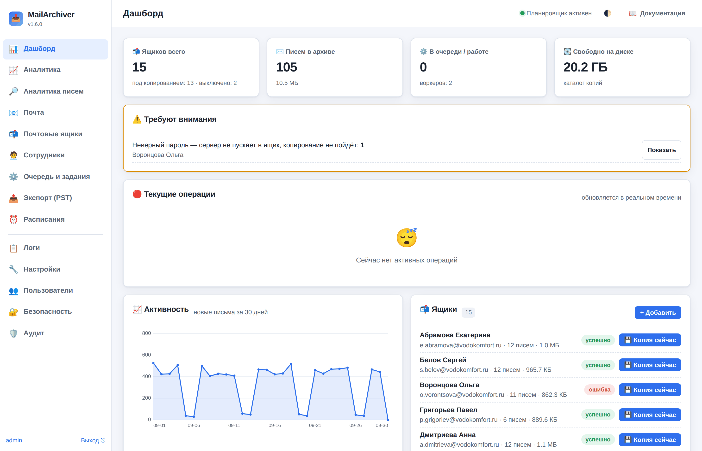

# MailArchiver

**Сервис резервного копирования почтовых ящиков по IMAP с веб-интерфейсом, очередью заданий,
планировщиком, подробной статистикой и экспортом в `.pst` для Microsoft Outlook.**

MailArchiver по расписанию делает локальные копии почтовых ящиков (по IMAP), позволяет выгрузить
эти копии в формат `.pst` (для всех версий Outlook), а также восстановить письма обратно на
IMAP-сервер. Всё управляется через удобный веб-интерфейс с подсказкой к каждому параметру.

---

## Возможности

- 📥 **Инкрементальный бэкап по IMAP** — докачиваются только новые письма (по UID/UIDVALIDITY), с сохранением структуры папок и флагов (прочитано/важное и т.п.). Переезд почты на другой сервер не удваивает архив: уже скачанные письма узнаются по Message-ID, размеру и дате. Письма старше срока хранения ящика не скачиваются.
- 💾 **Надёжное локальное хранилище** в формате Maildir (по файлу `.eml` на письмо) с проверкой целостности (SHA-256) и опциональным сжатием.
- 📤 **Экспорт в `.pst`** для Outlook, а также в **EML** и **MBOX**.
  - Встроенный **native**-движок — собственный генератор `.pst` без внешних программ и лицензий: формат Unicode (Outlook 2003+), папки, письма с получателями, текстом и HTML и **всеми вложениями**; большой ящик делится на файлы до 1,9 ГБ. Проверяется независимыми читателями `.pst` (libpff, `readpst`).
  - Движок **Aspose** — `.pst` через Aspose.Email (нужна лицензия), в том числе старый ANSI для Outlook 97–2002.
- ♻️ **Восстановление** писем из копии обратно на любой IMAP-сервер (с флагами и датами, защитой от дублей, пробным прогоном) — целым ящиком или **только выбранные письма**: флажками в «Почте» и в результатах поиска, в тот же ящик или (администратором) в ящик коллеги, например чтобы передать переписку уволенного.
- 📥 **Импорт из `.pst` и `.ost`** без внешних программ — письма из файла Outlook на почтовый сервер или сразу в локальную копию ящика. Собственный читатель формата: файлы Unicode (Outlook 2003+), ANSI (Outlook 97–2002) и `.ost` Outlook 2013+ (большие страницы, сжатые блоки), в том числе с шифрованием; папки, вложения, вложенные письма, тело из HTML и RTF, флаги и даты получения. Файл загружается через интерфейс (до 2 ГБ) или берётся из каталога импорта на сервере — без предела размера. Повторный импорт не создаёт дублей.
- ⏰ **Планировщик** (cron/интервалы) — автоматический бэкап по расписанию, в том числе **копирование всех ящиков по очереди**: одно задание в заданное время копирует ящики строго по одному (давно не копировавшиеся — первыми), с паузой между ящиками и остановкой к началу рабочего дня; переживает перезапуск службы.
- 🧰 **Групповые действия** над сотнями ящиков: копирование (параллельно или по очереди), копия «с нуля» с карантином прежних копий, включение/выключение, срок хранения, удержание, расписания с разносом по времени, смена сервера и способа входа, папки и их проверка на сервере, выгрузка, восстановление, переиндексация поиска, удаление — с проверкой по каждому ящику до запуска, подтверждением опасных действий и историей операций. Добавление ящиков списком и список ящиков в Excel.
- 🧺 **Прежние копии после «с нуля»**: автоматическое сравнение с новой копией, список писем, которых в новой нет, возврат их в архив и удаление карантина только без потери писем.
- ⚙️ **Очередь заданий** с приоритетами, лимитом нагрузки на ящик, отменой и повторными попытками; по желанию — в отдельном процессе службы (`server.worker_process`), чтобы копирование не замедляло интерфейс.
- 📊 **Живая статистика** и мониторинг текущих операций (WebSocket), графики, логи, история, аудит.
- 👷 **Роль «Оператор»**: следит за копированием и запускает его (копии, проверки, отмена и повтор заданий, журнал), но не читает письма, не меняет настроек и ничего не удаляет — права проверяются на сервере по белому списку.
- 📈 **Аналитика системы** (для администратора и оператора) — хранилище, задания по статусам и типам, длительность заданий, активность по дням, экспорты, расписания.
- 🔎 **Аналитика писем** (для администратора) — отправители и домены, распределение по годам/дням недели/часам, тепловая карта «день недели × час», размеры, вложения, облака частых слов. Плюс **глубокий анализ содержимого** фоновым заданием: типы вложений, домены получателей, текст/HTML, язык. Графики рисуются локально, без внешних библиотек.
- ✉️ **Почтовый клиент** в разделе «Почта» — написать, ответить, переслать (SMTP: пароль, OAuth2, отдельный вход или ретранслятор), прочитано и помечено, перенести и удалить, папки, переписка цепочкой, подсказка адресов, подпись, черновики с вложениями, горячие клавиши; правила сортировки и автоответ (работают и без открытого клиента), метки, шаблоны, адресная книга с группами, псевдонимы, отправить позже и отменить отправку, «напомнить позже», «Отменить» после переноса, приглашения на встречи, уведомления о прочтении, архивы .zip. Действия идут на почтовый сервер и сразу отражаются в архиве; письма, удалённые с сервера, в архиве остаются. Сотрудник — в своих ящиках, администратор — в любом (по настройке, с аудитом).
- ↩️ **Ответы на письма** (администратору; сотруднику — по своим ящикам) — какие письма остались без ответа, время ответа (медиана, 90 %, в рабочих часах), соблюдение срока ответа, динамика и сравнение с прошлым периодом, тепловые карты, сравнение ящиков и отделов, отправители и домены, кто не отвечает нам, цепочки переписки; списки писем с выгрузкой в CSV. Связи «письмо — ответ» — по заголовкам `In-Reply-To` и `References`, ответ новым письмом — по теме и собеседнику.
- 📬 **Контроль ящиков**: проверка паролей всех ящиков одной кнопкой, даты первой и последней копии в таблице, отборы «с неправильным паролем», «без резервных копий», «копия устарела», история копирования ящика.
- 🧑‍💼 **Сотрудники**: справочник из кадровой выгрузки (CSV/XLSX/XML-таблица, файл или ссылка) с автоматическим заведением ящиков по шаблону и массовой загрузкой паролей. У сотрудника может быть **несколько ящиков** (прежний адрес, филиал, второй домен) — войдя паролем любого из них, он видит архив всех.
- 🔒 **Безопасность**: вход по паролю (PBKDF2), **двухфакторный вход** (TOTP: Яндекс Ключ, Google Authenticator и др.) с резервными кодами, защита от подбора, вход сотрудников в архив своих ящиков по паролю ящика, шифрование паролей ящиков (Fernet/AES) и **шифрование самих писем на диске** (AES-256-GCM, по желанию), поддержка OAuth2 (Gmail, Microsoft 365), **журнал безопасности** с действующими блокировками и их снятием.
- 🛰️ **Копия архива вне сервера** — ежедневно в сетевую папку, на другой сервер по SSH (rsync) или в S3 (Yandex Object Storage, VK Cloud, MinIO…), со снимками базы, защитой от массового удаления и восстановлением одной командой (`replica-pull`, `restore-snapshot`).
- 📡 **Мониторинг**: метрики `/metrics` для Prometheus и Zabbix, еженедельная сводка на почту — в том числе о прежних копиях после «с нуля» и письмах, которых нет в архиве.
- 🔍 **Поиск по письмам** во всех ящиках (SQLite FTS5): тема, адреса, имена вложений, текст; каждый поиск — в аудите.
- 🗝️ **Вход в ящики через администратора почты** (Dovecot master users, SASL PLAIN с authzid) — без сбора паролей сотрудников.
- 📮 **Сервер Axigen** (CLI и FTP Backup & Restore, только по шифрованному соединению, если серверы на разных машинах): сверка учётных записей сервера с архивом, копирование и восстановление ящиков без паролей сотрудников, изменения на сервере только по кнопке с проверкой (закрыть и открыть вход, сменить пароль, удалить с сервера письма, которые уже в архиве, создать и удалить учётную запись), очередь, лицензия, квоты с оповещениями и метриками, консоль только для чтения, диагностика и журнал всех команд.
- 🖥️ **Ящики на сервере**: групповые действия с учётными записями почтового сервера (закрыть и открыть вход, пароли, автоответ и пересылка, удаление писем, которые уже в архиве, создание и удаление учётных записей) с проверкой по каждой записи, отчётами и повтором неудавшегося.
- 🔌 **Почтовые серверы**: подключение к API Microsoft 365, Google Workspace, Яндекс 360, VK WorkSpace, Zimbra и Carbonio, CommuniGate Pro, Kerio Connect, MDaemon, mailcow и Postfix + Dovecot — сверка учётных записей с архивом по расписанию, копирование ящиков без паролей сотрудников, журнал обращений к API.
- 🧳 **Уволенные сотрудники**: последняя копия всех ящиков сотрудника, выключение копирования и удержание архива на N лет независимо от срока хранения.
- 🧬 **Отчёт «Одинаковые вложения»** — сколько места освободит хранение одной копии рассылок и логотипов (формат хранения не меняется).
- 🌐 **Веб-интерфейс** на русском с тёмной/светлой темой и **подробной подсказкой к каждому параметру** (описание, рекомендация, пример).

## Скриншот



---

## Быстрый старт

### Вариант 1. Docker Compose (проще всего)

```bash
cd docker
docker compose up -d
```
Откройте `http://127.0.0.1:8493` на этой же машине (порт намеренно опубликован только локально;
снаружи — через reverse proxy с HTTPS или SSH-туннель, см. `docs/ru/03-installation.md`).
Администратора создайте при первом входе (мастер первичной настройки).

### Вариант 2. Установка на Linux (служба systemd)

```bash
cd mail_backup
sudo bash scripts/install.sh
```
Скрипт автоматически определит дистрибутив (apt/dnf/yum/zypper/pacman), установит зависимости,
создаст пользователя и службу, настроит автозапуск и предложит создать администратора.
Веб-интерфейс: `http://127.0.0.1:8493`.

**Обновление:**
```bash
cd mail_backup   # новая версия исходников
sudo bash scripts/update.sh --check   # по желанию: только проверить, ничего не меняя
sudo bash scripts/update.sh
```
Обновление начинается с проверки — до остановки службы: доступ службы к файлам, каталог данных,
место на диске, версия Python, конфигурация, пакеты. Перед запуском новой версии снимается копия
базы; если служба не поднялась — скрипт печатает причину из её журнала и возвращает прежнюю версию
вместе с базой. Параметры и переменные: `bash scripts/update.sh --help`.

**Сервер без интернета:** на машине с интернетом соберите автономный архив
(`bash scripts/make_offline_bundle.sh`) и ставьте из него теми же командами — см.
`docs/ru/03-installation.md`, раздел «Установка и обновление без интернета».

**Удаление:**
```bash
sudo bash scripts/uninstall.sh          # данные сохраняются
sudo bash scripts/uninstall.sh --purge  # удалить всё, включая данные
```

---

## Документация

- 📖 **Полная документация со скриншотами и схемами** — прямо в веб-интерфейсе: раздел «📖 Документация»
  в меню (оглавление, поиск по тексту, тёмная тема); кнопка «📖 Справка» вверху справа открывает главу о
  текущем разделе. Отдельной страницей — `/static/docs/index.html`.
- 📋 [Справочник всех параметров](docs/ru/05-parameters-reference.md)
- 🚀 [Установка, обновление, удаление](docs/ru/03-installation.md) · [Настройка](docs/ru/04-configuration.md) · [Устранение неполадок](docs/ru/11-troubleshooting.md) · [Частые вопросы](docs/ru/12-faq.md)
- 🔐 [Безопасность и двухфакторный вход](docs/ru/08-security.md) · [Шифрование копии писем](docs/ru/09-encryption.md) · [Почтовые ящики: пароли и даты копий](docs/ru/10-mailboxes.md) · [Сотрудники](docs/ru/07-employees.md)
- 🛰️ [Копия вне сервера и восстановление](docs/ru/13-replica.md) · [Мониторинг](docs/ru/14-monitoring.md) · [Поиск по письмам](docs/ru/15-search.md) · [Вход через администратора почты](docs/ru/16-mailadmin.md) · [Сервер Axigen](docs/ru/19-axigen.md)
- 🧰 [Групповые действия с ящиками](docs/ru/17-bulk.md) · [Расписания и копирование всех ящиков по очереди](docs/ru/18-schedules.md) · [Ящики на сервере](docs/ru/20-server-bulk.md) · [Почтовые серверы](docs/ru/21-mailservers.md)
- 📘 Руководство Word: [`docs/MailArchiver_Руководство.docx`](docs/MailArchiver_Руководство.docx) — собирается из `docs/ru` командой `bash scripts/manual/build.sh`.
- 📝 [История изменений](CHANGELOG.md)
- Исходные материалы документации — в каталоге [`docs/ru/`](docs/ru/).

## Требования

- Linux, Python **3.10–3.14** (для нативной установки; в Docker уже включён). Где системный `python3` старше
  (RHEL 8/9, Debian 11, Ubuntu 20.04), `install.sh` берёт стоящий рядом `python3.12`/`python3.11` (на RHEL-подобных
  ставит его сам); свой интерпретатор — `sudo MA_PYTHON=/usr/bin/python3.12 bash scripts/install.sh`.
- Доступ в интернет на время установки и обновления — либо автономный архив с пакетами (`scripts/make_offline_bundle.sh`).
- Для импорта `.pst` внешние программы не нужны. `readpst` (пакет `pst-utils` / `libpst`) ставится автоматически как запасной способ разбора файла.
- Для копии архива на другой сервер по SSH: `rsync` и `openssh-client` — ставятся автоматически.
- Для надёжного экспорта `.pst`: `pip install Aspose.Email-for-Python-via-NET` + лицензия Aspose (опционально).

## Структура проекта

```
mail_backup/
├── mailarchiver/          # исходный код сервиса
│   ├── imap/              # подключение, бэкап, восстановление
│   ├── storage/           # локальное хранилище Maildir
│   ├── export/            # движки экспорта (eml, mbox, pst-aspose, pst-native)
│   ├── pstimport/         # импорт .pst и .ost: чтение формата, сборка писем, заливка, каталог импорта
│   ├── queue/             # очередь заданий и воркеры
│   ├── worker.py          # очередь и расписания в отдельном процессе (server.worker_process)
│   ├── replies.py         # индекс ответов на письма и раздел «Ответы на письма»
│   ├── webmail.py         # почтовый клиент: действия на сервере, проверка почты, отправка, черновики
│   ├── webmail_tools.py   # клиент: правила, автоответ, метки, шаблоны, адресная книга, отложенные письма
│   ├── scheduler/         # планировщик
│   ├── replica/           # копия вне сервера (папка, rsync, S3) и снимки базы
│   ├── axigen/            # сервер Axigen: CLI, FTP Backup, сверка, действия, состояние
│   ├── mailservers/       # почтовые серверы по API: подключения, драйверы, сверка, слежение
│   ├── serverops/         # «Ящики на сервере»: групповые действия с учётными записями сервера
│   ├── web/               # веб-интерфейс (FastAPI) + статика/шаблоны
│   ├── search.py          # поиск по письмам (FTS5)
│   ├── monitoring.py      # метрики Prometheus и еженедельная сводка
│   ├── dedup.py           # отчёт «Одинаковые вложения»
│   ├── bulk.py            # групповые действия с ящиками
│   ├── employees.py       # справочник сотрудников, синхронизация с кадровой выгрузкой, увольнение
│   ├── cronutil.py        # cron-выражения (дни недели как в crontab)
│   ├── config.py, database.py, security.py, service.py, ...
├── config/config.example.yaml
├── scripts/               # install.sh, update.sh, uninstall.sh и их общие функции common.sh;
│                          # make_release.py — архив выпуска, make_offline_bundle.sh — архив для
│                          # установки без интернета; gen_docs.py — встроенная справка;
│                          # manual/ — сборка руководства Word из docs/ru
├── systemd/               # unit-файл systemd
├── docker/                # Dockerfile, docker-compose.yml, entrypoint.sh
├── docs/ru/               # документация (Markdown); docs/*.docx — руководство Word
├── tests/                 # автотесты (pytest)
├── .github/workflows/     # проверки и выпуск в GitHub Actions (tests.yml, release.yml)
└── requirements.txt, pyproject.toml
```

## Разработка и тесты

```bash
python3 -m venv venv && ./venv/bin/pip install -r requirements.txt && ./venv/bin/pip install --no-deps -e .
./venv/bin/pip install -e ".[test]" ruff               # pytest, httpx и httpx2 (клиент тестов Starlette)
./venv/bin/pytest -q                                   # тесты установки от root: sudo … MA_REQUIRE_SCRIPT_TESTS=1
./venv/bin/ruff check --select F,E9 mailarchiver tests scripts
python scripts/gen_docs.py --check                     # встроенная справка и справочник параметров не устарели
```

## Лицензия

MIT (см. [LICENSE](LICENSE)). Библиотека Aspose.Email — отдельная коммерческая лицензия
(нужна только при использовании движка экспорта Aspose).
