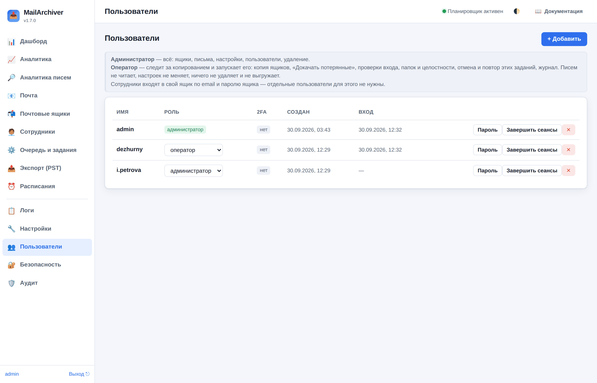
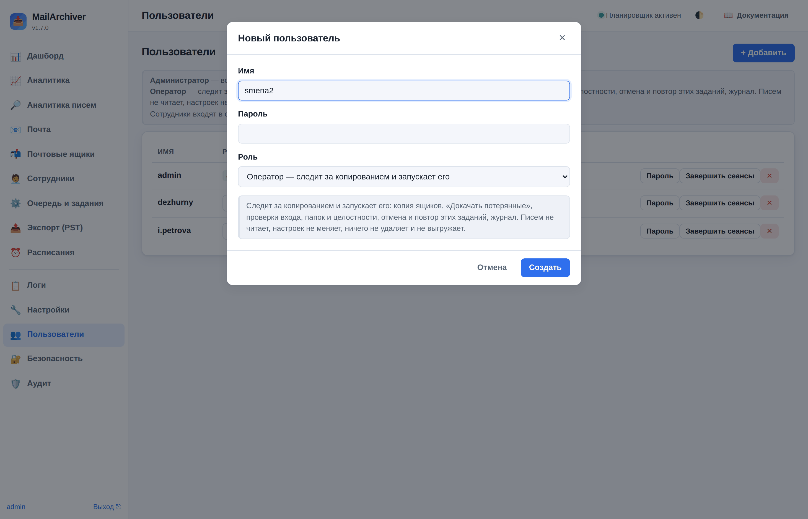
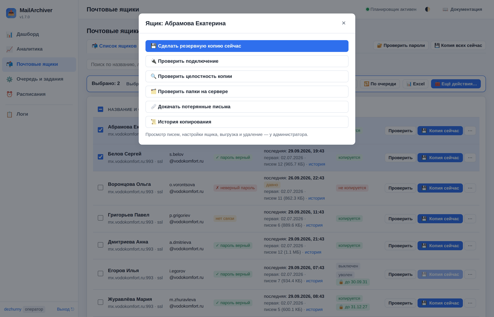
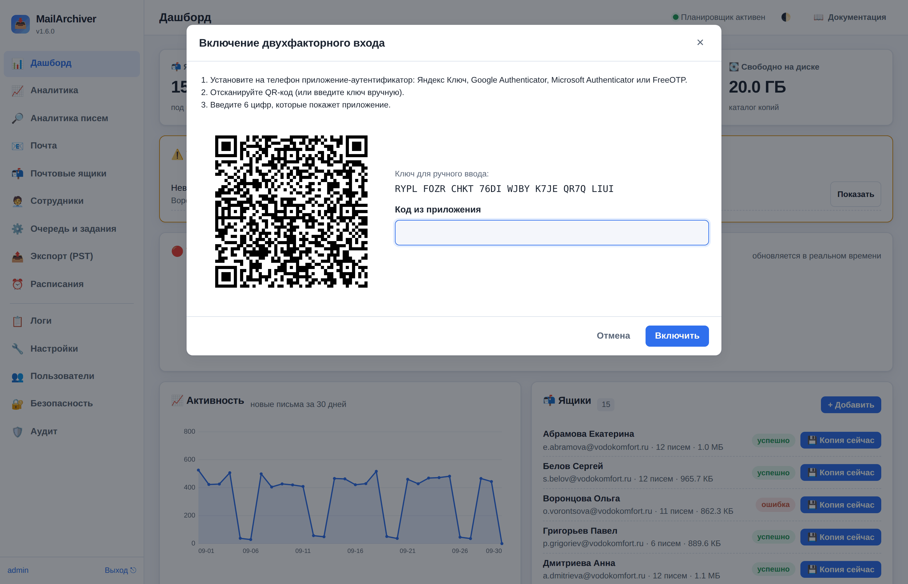
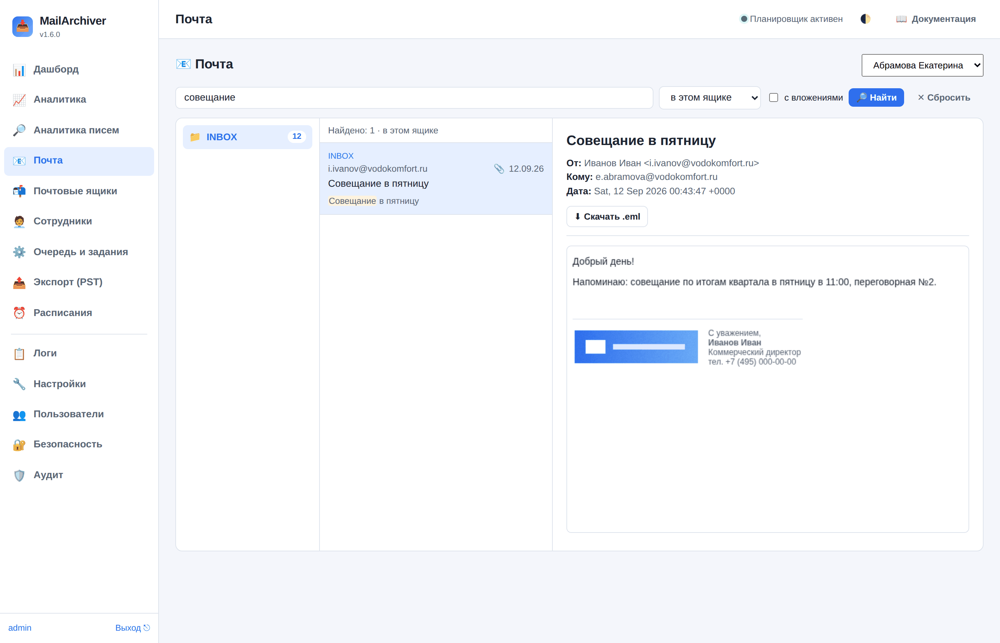
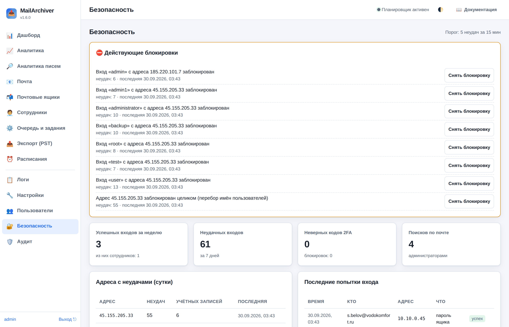
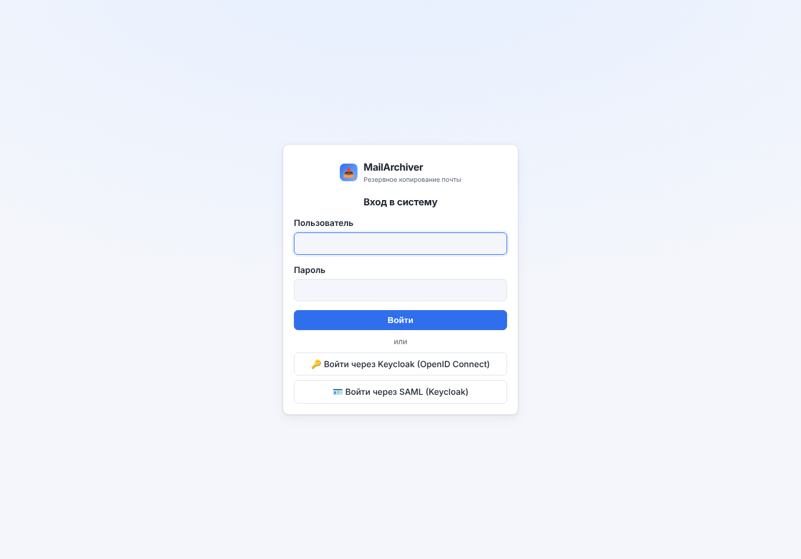

# Безопасность: вход, двухфакторная аутентификация, доступ сотрудников

В MailArchiver хранится почта всей организации, поэтому вход в интерфейс защищён
в несколько слоёв. Здесь описано, как они работают и что настроить.

## 1. Вход администратора

- Пароли пользователей хранятся только в виде хеша (PBKDF2), восстановить пароль
  из базы нельзя. Забытый пароль сбрасывается командой на сервере:
  `sudo mailarchiver reset-password -u admin`.
- **Сеанс** живёт `security.session_ttl_hours` часов (по умолчанию 12) и
  завершается раньше, если пользователь ничего не делал `security.session_idle_minutes`
  минут (по умолчанию 60). Открытая, но забытая вкладка сеанс **не продлевает**:
  живое обновление дашборда и опрос хода заданий идут «в фоне» и не считаются
  действиями пользователя. Когда сеанс закончился, интерфейс сам показывает форму
  входа и после входа возвращает в тот же раздел.
- Смена пароля (своего или чужого) завершает все открытые сеансы этого
  пользователя; «Пользователи» → «Завершить сеансы» делает то же без смены пароля.

### Роли: администратор и оператор

Пользователей интерфейса заводит администратор в разделе **«👥 Пользователи»** и выбирает роль.
Роль можно сменить там же: открытые сеансы пользователя при этом завершаются. Свою роль поменять
нельзя, а последнего включённого администратора нельзя понизить, отключить или удалить — в системе
всегда остаётся хотя бы один администратор. Права проверяются при каждом
запросе к серверу, а не только скрытием кнопок в интерфейсе.



| Что | Администратор | Оператор |
|-----|---------------|----------|
| Дашборд, очередь заданий, аналитика системы | да | да |
| Журнал службы («Логи») | да | да, кроме записей заданий, подробности которых оператору закрыты (выгрузки, восстановление, анализ писем…) |
| Расписания | да | только просмотр |
| Копия ящика сейчас, копия всех ящиков (параллельно или по очереди), «Докачать потерянные письма» | да | да |
| Проверить подключение, пароли (вход), папки на сервере, целостность копии | да | да |
| Отменить и повторить задания копирования и проверок | да | да, кроме копии «с нуля» и последней копии перед выключением ящика |
| Групповые действия | все | копирование и проверки, отмена заданий; список ящиков в Excel |
| Письма, поиск, аналитика писем, выгрузка и восстановление | да | нет |
| Добавление, настройка, выключение и удаление ящиков; копия «с нуля»; прежние копии; сроки хранения и удержание | да | нет |
| Настройки, пользователи, сотрудники, журнал безопасности, аудит | да | нет |

Оператор видит все задания в очереди, но подробности тех, в итогах которых бывают темы и
отправители писем (выгрузки, восстановление, анализ писем, сравнение прежних копий), — только
итоговой строкой, без текста ошибки и хода выполнения. Заметок администратора к ящикам оператор не
видит (и в списке ящиков в Excel их нет). Выключенный ящик оператор скопировать не может, а
задание, которое уже стоит в очереди, второй раз не поставит. Обязательный двухфакторный вход
(ниже) распространяется и на операторов; включают его они сами — своё имя внизу меню.

Новый пользователь по умолчанию создаётся оператором; роль «администратор» выбирается явно.





## 2. Защита от подбора пароля

Счёт неудачных попыток ведётся так, чтобы злоумышленник не мог «выключить» вход
настоящему владельцу учётной записи:

| Что считается | Предел (при `max_login_attempts = 5`) | Что происходит |
|---|---|---|
| Учётная запись + один адрес | 5 за `lockout_minutes` | этот адрес блокируется для этой учётной записи |
| Один адрес по всем учётным записям | 50 | адрес блокируется целиком (перебор имён) |
| Учётная запись со всех адресов | 100 | вход не блокируется, но ответ на неудачу замедляется (до 2 с) |
| Неверные коды 2FA учётной записи | 10 за `lockout_minutes`, 50 за сутки | ввод кодов из приложения блокируется, резервные коды работают |
| Проверки пароля одного почтового ящика | 10 | пароль этого ящика на почтовом сервере не проверяется до конца окна |
| Проверки паролей всех ящиков вместе | 60 | вход по паролю ящика временно приостановлен |

Все пределы считаются от одного параметра `security.max_login_attempts`, окно —
`security.lockout_minutes`.

Неверный пароль к несуществующему логину проверяется так же долго, как к существующему: по времени
ответа нельзя узнать, есть ли такой пользователь.

## 3. Двухфакторный вход (2FA)

После пароля запрашивается шестизначный код из приложения-аутентификатора на
телефоне: Яндекс Ключ, Google Authenticator, Microsoft Authenticator, FreeOTP,
KeePassXC. Даже если пароль утёк, без телефона войти нельзя.

### Как включить



1. Нажмите своё имя внизу меню слева → «Включить двухфакторный вход».
2. Отсканируйте QR-код приложением (или введите ключ вручную).
3. Введите шесть цифр, которые показывает приложение.
4. **Сохраните резервные коды** (10 штук, вида `abcde-fghjk`) — скопируйте в
   менеджер паролей или распечатайте и уберите в сейф. Каждый код подходит для
   входа один раз, если телефона нет под рукой. Больше они показаны не будут;
   новые можно выпустить в том же окне («Новые резервные коды», нужен код из
   приложения).

Чтобы 2FA была **обязательной** для всех администраторов и операторов, включите
«Настройки → Безопасность → Обязательный двухфакторный вход» (`security.require_2fa`).
Администратор без 2FA после входа увидит только окно её настройки.

### Как это защищено

- Код из приложения действует 30 секунд (принимается соседний шаг — если часы
  телефона немного расходятся с сервером). Один и тот же код дважды не принимается.
- После верного пароля выдаётся одноразовый «билет» на 5 минут: на него даётся
  **3 попытки** ввода кода, затем нужно снова ввести пароль. Билет привязан к
  адресу и к паролю — после смены пароля выданные билеты перестают действовать.
- Неверные коды учитываются по учётной записи **со всех адресов**: после 10
  неудач за 15 минут (или 50 за сутки) ввод кодов из приложения блокируется, а
  администраторам уходит письмо-уведомление (если уведомления настроены). Это
  значит, что пароль учётной записи, по всей видимости, известен постороннему —
  **смените его**. Резервные коды при этом продолжают работать: подобрать их
  невозможно (около 50 бит на код), и владелец войдёт даже во время атаки.
- Резервные коды хранятся как хеши и не зависят от файла `secret.key`. Если этот
  файл потерян или заменён (коды из приложения тогда проверить нельзя), войдите
  резервным кодом.

### Потерян телефон

- Войдите резервным кодом, затем отключите 2FA и включите заново с новым телефоном.
- Нет ни телефона, ни кодов — другой администратор: «Пользователи» → «Сбросить 2FA».
- Единственный администратор — на сервере: `sudo mailarchiver reset-2fa -u admin`.

## 4. Вход сотрудников по паролю своего ящика

Сотрудник может войти в интерфейс своим email и паролем почтового ящика и
работать **только со своим архивом**: читать письма, скачивать их и вложения,
выгружать и восстанавливать свой ящик (раздел «Почта» → «Выгрузить» /
«Восстановить в ящик»), возвращать в ящик отдельные письма («♻️ Восстановить письмо»,
«Восстановить выбранные» — только в тот же ящик), следить за своими заданиями. С 1.17.0
«Почта» — почтовый клиент: в своих ящиках сотрудник пишет и отправляет письма, переносит и
удаляет их, работает с папками на сервере (глава «Почтовый клиент»). Администратор делает то же
в любом ящике, если это разрешено настройкой «Администратор может писать и менять ящики»; каждое
такое действие — в аудите.

**Несколько ящиков.** Если в разделе «Сотрудники» за сотрудником числится несколько ящиков, то,
войдя паролем **любого** из них, он видит архив всех: в «Почте» появляется переключатель ящиков, а
поиск — «во всех моих ящиках». Так работает, пока сотрудник числится работающим: уволенный видит
только ящик, паролем которого вошёл. Список пересчитывается на каждом запросе — отвязанный в карточке
ящик закрывается сразу. Привязывая к сотруднику чужой или общий ящик, помните: этим вы открываете ему
архив этого ящика — а всякому, кто знает пароль привязанного ящика, архив всех ящиков сотрудника.
При переносе ящика к другому сотруднику открытые его паролем сеансы завершаются. Выключенный
администратором ящик сотрудник только читает: проверить, скопировать или восстановить его нельзя.
Задания, которыми администратор вернул письма из ящика сотрудника в чужой ящик, сотруднику не видны.

Чего сотрудник **не может**: менять срок хранения и расписания (то есть
уменьшить или отключить архив), отменять копирование по расписанию, загружать
.pst, видеть чужие ящики, общий журнал, логины администраторов и заметки к ящику.
Ограничения от перегрузки: одно такое же задание по ящику за раз (и при залпе одновременных
запросов), не больше 20 заданий в час, не больше 3 хранящихся выгрузок, а «Проверить» и проверка папок
на сервере — по одной за раз и не больше 6 за 10 минут на ящик.

Задания по своему ящику, которые запустил администратор или расписание, сотрудник видит в очереди, но
из их журнала — только предупреждения и ошибки (почему копия не прошла), без хода работы.

Пароль сотрудника проверяется входом на почтовый сервер. Чтобы страницу входа
нельзя было использовать для подбора паролей почты (и чтобы защита почтового
сервера, например fail2ban, не заблокировала адрес MailArchiver — тогда
остановилось бы копирование всех ящиков), число таких проверок ограничено
(см. таблицу выше). Если сотрудникам этот вход не нужен, выключите его:
«Настройки → Безопасность → Вход сотрудников по паролю ящика» (`security.mailbox_login`).

Сеансы сотрудника завершаются, когда администратор задаёт ящику новый пароль,
выключает ящик или нажимает в меню ящика «Завершить сеансы сотрудника».

## 5. Защита веб-интерфейса

- Запросы, меняющие данные, принимаются только со «своей» страницы (проверка
  `Origin`/`Referer` или служебного заголовка) — чужой сайт не может отправить
  их от имени вошедшего администратора. Интерфейс нельзя встроить в чужую страницу.
- **Первичная настройка** (создание первого администратора) и работа в режиме
  без входа (`security.auth_enabled: false`) доступны только по IP-адресу,
  `localhost`, короткому имени без точки или имени из `server.public_url` — это
  защита от атаки DNS rebinding. Если за обратным прокси интерфейс открывается по
  доменному имени, укажите его в `server.public_url`.
- HTML писем показывается в изолированной «песочнице» без скриптов, с
  собственной политикой безопасности: внешние картинки, стили и шрифты
  (трекинг-пиксели) не загружаются, пока вы не нажмёте «Показать картинки».
  Картинки, вложенные в само письмо (логотип в подписи, скриншот в тексте —
  ссылки `cid:`), показываются сразу: они берутся из архива, а не из интернета.
  Встраиваются только растровые картинки (PNG, JPEG, GIF, WebP, BMP) до 5 МБ
  каждая и до 15 МБ на письмо; SVG не встраивается (в нём может быть скрипт).
  Ссылки открываются в новой вкладке.
- **Страница интерфейса — со строгой политикой безопасности (CSP).** Браузер выполняет только скрипты
  самого MailArchiver из его файлов: встроенные в страницу скрипты, обработчики в разметке и `eval`
  запрещены, объекты (`<object>`, `<embed>`) не встраиваются, формы не отправляются на чужой адрес.
  Если бы в интерфейсе нашлась ошибка экранирования, внедрённый через неё скрипт не выполнился бы.
- **Размер запроса ограничен до проверки входа.** Без действующего входа сервер принимает не больше
  256 КБ, после входа — 32 МБ (загрузка файла PST — до 2 ГБ). Запрос больше предела получает отказ
  413 и не читается: занять диск или память сервера «загрузкой файла» без входа нельзя.
- Номер версии анонимным посетителям не показывается (ни на странице входа, ни в
  `/health`, ни в документации).



## 6. Раздел «Безопасность»: блокировки и события

Раздел **«🔐 Безопасность»** (только администратору) собирает в одном месте всё, что относится к
входу в интерфейс:



- **Действующие блокировки** — по тем же правилам, что в таблице раздела 2: «вход такого-то
  пользователя с такого-то адреса», «адрес заблокирован целиком (перебор имён)», «ввод кодов 2FA
  заблокирован», «проверка пароля ящика на почтовом сервере приостановлена». У каждой — число
  неудач, время последней и кнопка **«Снять блокировку»**: например, когда сотрудник сам перепутал
  пароль, а ждать 15 минут некогда. Снятие записывается в аудит (`security_unblock`).
- **Адреса с неудачами за сутки** — откуда подбирают пароли и по скольким учётным записям.
- **Последние попытки входа** — кто, откуда, каким способом (пароль, код 2FA, пароль ящика),
  успех или неудача. Журнал попыток хранится около суток.
- **События безопасности** за последнее время: входы и выходы, включение и сброс 2FA, смена
  паролей, завершение сеансов, создание и удаление пользователей, **поиск по почте** (кто что
  искал — см. [поиск](15-search.md)).

Письмо о подборе кода 2FA («пароль этой учётной записи, по-видимому, известен постороннему»)
уходит администраторам не чаще раза за окно блокировки — и после перезапуска службы не
повторяется.

## 7. Метрики мониторинга

Адрес `/metrics` (для Prometheus и Zabbix) по умолчанию **выключен**. Включённый, он отдаётся
только с адресов из списка (по умолчанию — с самого сервера) или по токену в заголовке
`Authorization: Bearer …`: в метриках есть названия ящиков и адреса почты. Подробно —
[мониторинг](14-monitoring.md).

## 8. Секреты на сервере

| Файл | Что защищает | Что будет без него |
|---|---|---|
| `<каталог данных>/secret.key` | пароли ящиков, SMTP и источника сотрудников в базе, подпись cookie, секреты 2FA | пароли ящиков придётся ввести заново, 2FA — сбросить; письма не пострадают |
| ключ шифрования копии (`storage.encryption_key_file`) | содержимое писем на диске и снимков базы (если включено шифрование) | **зашифрованные письма и снимки не прочитать** — см. [шифрование копии](09-encryption.md) |
| `<каталог данных>/replica_ssh_key` | вход на сервер копии по SSH (если копия по rsync) | создайте новый ключ и добавьте его на сервер копии |

Пароль администратора почты (вход в ящики без паролей сотрудников), секретный ключ S3 и токен
метрик тоже хранятся в базе зашифрованными ключом `secret.key` и в интерфейс не отдаются.
**Ни один ключ не попадает в копию вне сервера** — храните `secret.key` и ключ шифрования
отдельно (см. [копия вне сервера](13-replica.md)).

Права на `secret.key` служба проверяет при запуске и исправляет на `0600`.

## 9. Вход через LDAP / Active Directory

С 1.20.0 администраторы и операторы могут входить **доменным логином и паролем**: «Настройки →
🏢 Вход через LDAP / Active Directory».

- **Сервер** — `ldaps://dc01.company.local` (порт 636) или `ldap://…` (389) со StartTLS. Без
  шифрования пароль по сети не отправляется (кроме сервера на той же машине).
- **Служебная учётная запись** (только чтение) ищет пользователя по **фильтру** — для Active
  Directory `(&(objectClass=user)(sAMAccountName={login}))`, для FreeIPA и OpenLDAP — `(uid={login})`;
  `{login}` — введённый логин (часть до `\` отбрасывается, спецсимволы экранируются).
- **Роль** — по группе: член «Группы администраторов» входит администратором, «Группы операторов» —
  оператором; вложенные группы Active Directory учитываются. Не состоит ни в одной — вход запрещён.
- Учётная запись архива заводится **сама** при первом входе (в «Пользователях» — с пометкой «🏢 из
  каталога»); роль сверяется при каждом входе. Двухфакторный вход для таких учётных записей работает
  как обычно.
- **Сверка с каталогом** (1.21.0, «Сверять пользователей с каталогом», включено): раз в час служебная
  учётная запись проверяет пользователей из каталога. Удалённый из каталога, **отключённый в AD**
  (`userAccountControl`) или исключённый из групп архива отключается **сразу** — сеансы закрываются,
  API-токены перестают действовать, не дожидаясь его следующего входа; смена группы меняет роль.
  Каталог недоступен — никто не отключается. В «Пользователях» такой пользователь — «выключен
  каталогом»: включится сам, если права в каталоге вернут.
- Если пользователя из каталога **отключил администратор** («выключен»), вход через каталог его
  обратно не включает — только администратор.
- Локальные пользователи архива входят как раньше; доменный пользователь с тем же логином, что у
  локального, через каталог не входит.
- **«Сотрудники входят доменным паролем»** — сотрудник, не входящий в группы архива, входит
  доменным паролем в архив своих ящиков: ящик находится по адресу `mail` из каталога (логин ящика
  или адрес сотрудника в справочнике).

Каталог может быть и **источником справочника сотрудников** (гл. 7.4): ФИО, почта и дополнительные
адреса (`proxyAddresses`), должность, отдел, телефоны; отключённые в AD — «не работает».

Кнопка **«Проверить»** в карточке настроек: без логина — подключение служебной учётной записью; с
логином — найденная запись, её группы и роль в архиве; с паролем — и сам вход. Неудачные входы
считаются защитой от подбора так же, как обычные.

## 10. Единый вход (OpenID Connect)

С 1.22.0 вход в архив возможен через **корпоративный единый вход** — Keycloak, Microsoft Entra ID
(Azure AD), ADFS, Authentik, Okta, Google и любой другой поставщик OpenID Connect: «Настройки →
🔑 Единый вход (OpenID Connect)». На странице входа появляется кнопка «Войти через единый вход».

1. У поставщика заведите **клиента** (приложение) с типом «веб-приложение» и обратным адресом
   `https://<адрес архива>/api/auth/oidc/callback` (адрес архива — «Адрес интерфейса» в разделе
   «Сервер и сеть»; можно задать и вручную — «Обратный адрес»).
2. В архиве укажите **издателя** (`https://sso.company.ru/realms/company`,
   `https://login.microsoftonline.com/<tenant>/v2.0`), идентификатор и секрет клиента (секрет
   хранится в базе зашифрованным; без секрета — публичный клиент, вход защищён PKCE).
3. **Роль** — по утверждению с группами или ролями (`groups`; для ролей Keycloak —
   `realm_access.roles`): значение из «Группы администраторов» — администратор, из «Группы
   операторов» — оператор. Ни то ни другое — вход запрещён, а при включённом «Сотрудники входят через
   единый вход» человек входит **сотрудником** в архив своих ящиков (ящик находится по `email`).
4. Кнопка **«Проверить»** читает описание поставщика и ключи подписи и показывает, что найдено.



Как это защищено: вход — по коду авторизации с **PKCE** (S256); `state` и `nonce` хранятся в
подписанной cookie на 10 минут и сверяются при возврате; подпись `id_token` проверяется ключами
поставщика (RS256/384/512, PS256, ES256/384, EdDSA; `none` и HS256 не принимаются), как и издатель,
получатель (`aud`, `azp`), срок и время выдачи (допуск — 2 минуты). Описание поставщика берётся
только по https (кроме этой машины), перенаправления не выполняются. Неудачи записываются в аудит
(`login_oidc_error`), успешный вход — как обычный (`login`, способ — единый вход).

Учётная запись архива заводится **сама** при первом входе (в «Пользователях» — «🔑 единый вход»);
роль сверяется при каждом входе: убрали из группы — вход запрещён, а учётная запись отключается
(«выключен единым входом»; включится сама, если права вернут). Локальный пользователь с тем же логином
через единый вход не входит; отключённый администратором — тоже. «Обязательный двухфакторный вход»
архива к таким пользователям не применяется: второй фактор проверяет поставщик — включите его там.
SAML 2.0 архив не поддерживает — ADFS и Entra ID умеют и OpenID Connect.

## 11. API-токены

Для скриптов, мониторинга и интеграций администратор выпускает **API-токен** в разделе
«👥 Пользователи → 🔑 API-токены»: имя («Zabbix», «ночная выгрузка»), владелец, роль — оператор
(смотреть состояние и запускать копирование) или администратор (не выше роли владельца) — и срок
(30 дней, 90 дней, год или бессрочно).

```bash
curl -H "Authorization: Bearer ma_…" https://mail-archive.company.ru/api/state
curl -X POST -H "Authorization: Bearer ma_…" https://mail-archive.company.ru/api/accounts/12/backup
```

- Токен показывается **один раз**; в базе хранится только его SHA-256 и первые знаки для
  узнавания.
- Запрос выполняется от имени владельца с ролью токена; в аудите действие подписано
  «владелец [токен «имя»]»; в списке токенов — время и адрес последнего использования.
- С токеном **недоступны** свой пароль и двухфакторный вход, пользователи и сами токены.
- Отключение или понижение владельца, истечение срока и **«Отозвать»** действуют сразу.
- Запросы с токеном не требуют cookie и заголовка `X-Requested-With`: браузер сам не подставит
  заголовок `Authorization` в чужой запрос, поэтому подделка запроса со страницы другого сайта
  невозможна.

