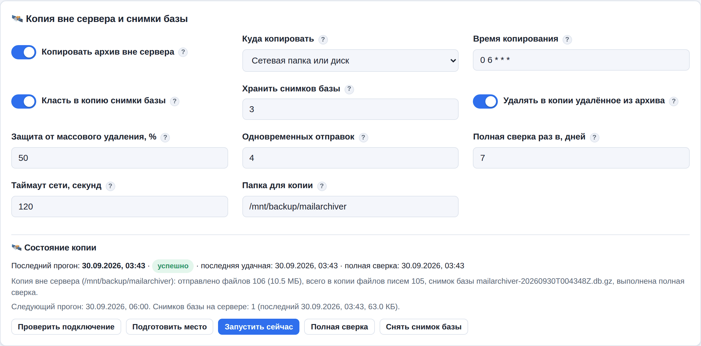

# 13. Копия архива вне сервера и снимки базы

Архив почты лежит на одном сервере. Если этот сервер пропадёт целиком — сгорит диск, данные
зашифрует вирус-вымогатель, по ошибке удалят виртуальную машину, — пропадёт и архив. Правило
надёжного резервного копирования «3-2-1» требует, чтобы хотя бы одна копия лежала **в другом
месте**. MailArchiver делает такую копию сам, каждый день.

Настройка — «Настройки → 🛰️ Копия вне сервера и снимки базы».



## Куда можно копировать

| Вариант | Что это | Когда выбрать |
|---------|---------|---------------|
| **Сетевая папка или диск** | Любой каталог, подключённый к серверу: общая папка Windows (SMB/CIFS), NFS, USB-диск | Есть файловый сервер или NAS в другой комнате / здании |
| **Сервер по SSH (rsync)** | Другой Linux-сервер; копирование программой rsync поверх SSH | Есть второй Linux-сервер, лучше — на другой площадке |
| **S3-хранилище** | Облачное хранилище: Yandex Object Storage, VK Cloud, Selectel, свой MinIO | Нужна копия за пределами офиса без своего оборудования |

## Что попадает в копию

- **Файлы писем** всех ящиков — ровно как они лежат в архиве. Если включено шифрование копии
  писем, в копию уходят уже зашифрованные файлы: хранилище или администратор NAS прочитать их не
  смогут.
- **Снимки базы данных** (каталог `db/` в копии) — индекс писем, ящики, расписания, настройки.
  Без базы копия писем — просто груда файлов: нет ни поиска, ни просмотра, ни выгрузки по ящикам.
  Снимок делается «на ходу» (служба не останавливается) в начале каждого прогона копии — если
  свежего, не старше 10 минут, ещё нет, — проверяется на целостность, сжимается и — если включено
  шифрование писем — шифруется тем же ключом. Пароли ящиков в снимке и так зашифрованы ключом
  `secret.key`.
- **Ежедневные копии настроек** (папка `settings/` в копии, с 1.27.0) — если задан пароль копий настроек
  («Настройки → 🗄 Копия настроек», параметр «Пароль копий настроек»): параметры, подключения к почтовым
  серверам, сотрудники, ящики, пользователи, личные настройки «Почты» и config.yaml, зашифрованные этим
  паролем. Их можно восстановить и без `secret.key` — подробнее в «Ежедневная копия настроек» ниже.
- Файл **README-MailArchiver.txt** — памятка, как восстановить архив из этой копии.

В копию **не попадают ключи** — и это сделано намеренно:

- `secret.key` из каталога данных (им зашифрованы пароли ящиков и секреты настроек);
- ключ шифрования писем (`storage.encryption_key_file`), если шифрование включено.

Храните их **отдельно** от копии (сейф, менеджер паролей, флешка у руководителя). Копия вместе с
ключами — это не защищённая копия. Если `secret.key` всё же потерян вместе с сервером, снимок базы его не
заменит (пароли ящиков в нём зашифрованы этим ключом), а ежедневная копия настроек с паролем — заменит:
см. «Восстановление после аварии».

## Снимки базы на самом сервере

Снимки делаются каждый день в «Время копирования», **даже если копия вне сервера выключена**, и
хранятся в каталоге `snapshots/` внутри каталога данных (по умолчанию — 3 последних). Это
защита от порчи базы на самом сервере: например, после сбоя диска или неудачного обновления.
Снимок можно сделать и вручную — кнопкой «Снять снимок базы» в карточке настроек.

С 1.26.0 рядом с каждым снимком лежит **подпись** — файл с тем же именем и окончанием `.sig`: сумма SHA-256
снимка и HMAC от неё ключом, производным от `secret.key`. Подписи удаляются вместе со снимками и уходят в
копию вне сервера вместе с ними; в карточке «Состояние копии» видно, подписан ли последний снимок.

## Настройка: сетевая папка

1. Подключите папку к серверу. Пример для общей папки Windows:

   ```bash
   sudo apt install cifs-utils
   sudo mkdir -p /mnt/backup
   # /etc/fstab — одной строкой; учётные данные в отдельном файле с правами 600:
   //nas.company.ru/mail  /mnt/backup  cifs  credentials=/etc/cifs-mail,uid=mailarchiver,gid=mailarchiver,file_mode=0600,dir_mode=0700,_netdev,nofail  0  0
   sudo mount /mnt/backup
   ```

   Важно: `uid=mailarchiver,gid=mailarchiver` — служба работает от имени пользователя
   `mailarchiver` и должна иметь право писать в папку.

2. В настройках выберите «Куда копировать: Сетевая папка или диск», укажите папку, например
   `/mnt/backup/mailarchiver`, сохраните.
3. Нажмите **«Проверить подключение»**, затем **«Подготовить место»**. В папке появится метка
   `.mailarchiver-replica`.
4. Включите «Копировать архив вне сервера» и нажмите «Запустить сейчас» — первая копия
   отправит весь архив (это долго), дальше каждый день уходят только новые письма.

> **Зачем метка.** Если сетевой диск отвалится, точка монтирования `/mnt/backup` останется
> пустой папкой на системном диске сервера. Без метки служба начала бы писать копию туда и
> забила бы системный диск. С меткой она видит, что метка пропала там, где копия уже была, и
> останавливается с ошибкой «Метка копии … пропала» (а в карточке настроек и в сводке видно,
> что копия не обновляется). Если место действительно новое или очищено намеренно, нажмите
> «Подготовить место». По той же причине служба не пишет копию в непустую папку без метки.

Папка не может быть в `/home` или `/root`: служба запущена с защитой systemd `ProtectHome` и
домашних каталогов не видит. Используйте `/mnt`, `/media` или `/srv`.

В именах файлов писем есть двоеточие (`…:2,S`), которое запрещено в Windows. В сетевой папке оно
записывается как `%3A`; команда `replica-pull` при восстановлении возвращает исходные имена.

## Настройка: сервер по SSH (rsync)

1. На сервере-получателе заведите пользователя и папку, установите rsync:
   `sudo apt install rsync`.
2. В настройках MailArchiver выберите «Сервер по SSH», укажите «Сервер и папку» в виде
   `backup@backup.company.ru:/srv/mailarchiver`, при необходимости порт.
3. Сохраните настройки и нажмите **«SSH-ключ службы»** — служба создаст ключ и покажет его
   открытую часть. Добавьте её одной строкой в файл `~/.ssh/authorized_keys` пользователя
   `backup` на сервере-получателе. (Ключ можно получить и командой
   `sudo mailarchiver replica-ssh-key`.)
4. «Проверить подключение» → «Подготовить место» → включить → «Запустить сейчас».

Ключ сервера-получателя запоминается при первом подключении (файл `replica_known_hosts` в
каталоге данных). Если потом ключ сервера изменится — например, кто-то подменил сервер, — копия
остановится с ошибкой «ключ сервера изменился». Если сервер действительно переустановили, удалите
его строку из `replica_known_hosts`.

Скорость можно ограничить параметром «Ограничение скорости (SSH)», чтобы копия не забирала
канал целиком в рабочее время.

## Настройка: S3-хранилище

1. В консоли хранилища создайте **бакет** и **сервисный аккаунт** с правом записи в этот бакет,
   выпустите для него **статический ключ доступа** (идентификатор и секрет).
2. В настройках выберите «S3», укажите адрес, регион, бакет, папку в бакете и ключи:

   | Хранилище | Адрес | Регион |
   |-----------|-------|--------|
   | Yandex Object Storage | `https://storage.yandexcloud.net` | `ru-central1` |
   | VK Cloud | `https://hb.ru-msk.vkcloud-storage.ru` | `ru-msk` |
   | Selectel | `https://s3.ru-1.storage.selcloud.ru` | `ru-1` |
   | Свой MinIO | `https://minio.company.ru:9000` | `us-east-1` (как настроено в MinIO) |

3. «Проверить подключение» → «Подготовить место» → включить → «Запустить сейчас».

Если хранилище требует адресовать бакет в имени сервера (`https://бакет.сервер/…`), выключите
параметр «Бакет в пути адреса».

Для копии, которую читают только при аварии, подходит «холодный» класс хранения (параметр
«Класс хранилища S3», например `COLD` в Yandex Object Storage или `STANDARD_IA`) — он дешевле
хранить, но дороже читать.

> **Совет.** Включите в бакете блокировку версий или «защиту от удаления» (Object Lock), если
> хранилище это умеет: тогда даже злоумышленник с ключом службы не сможет стереть копию.

## Как работает ежедневный прогон

- Отправляются только **новые** файлы — служба помнит, что уже отправлено. Первый прогон
  отправляет весь архив; его можно прервать — следующий продолжит с места остановки.
- Письма, удалённые из архива по сроку хранения, удаляются и в копии (параметр «Удалять в копии
  удалённое из архива»; выключите, если копия должна хранить всё, что когда-либо было в архиве).
- **«Скопировать с нуля» и копия.** Прежние файлы ящика при этом уходят в карантин, а карантин в
  копию не отправляется. Пока карантин ящика не удалён (раздел «Карантин»), файлы этого ящика в
  копии не удаляются — иначе письма, которых уже нет на почтовом сервере, остались бы только на
  диске архива. В журнале прогона об этом одна строка; после удаления карантина лишнее уйдёт из
  копии обычным прогоном.
- **Защита от массового удаления.** Если прогон собирается удалить в копии больше 50 % файлов
  (параметр «Защита от массового удаления»), он ничего не удаляет: так выглядит отключившийся
  диск с архивом, а не обычная очистка. В карточке настроек появится предупреждение и кнопка
  «Разрешить удаление и запустить» — разрешение действует на один прогон.
- Раз в неделю (параметр «Полная сверка раз в, дней») список файлов в самой копии сверяется с
  архивом целиком — так находятся файлы, пропавшие на стороне копии, и отправляются заново.
  Внеочередную сверку запускает кнопка «Полная сверка».
- Если копия не обновлялась больше двух суток, на дашборде появляется красная плашка, а в
  еженедельной сводке и в метриках мониторинга — соответствующая отметка.

## Восстановление после аварии

Пример: сервер MailArchiver потерян, копия лежит в S3 или сетевой папке, ключи сохранены
отдельно.

1. Установите MailArchiver на новый сервер (`sudo bash scripts/install.sh`) и остановите службу:

   ```bash
   sudo systemctl stop mailarchiver
   ```

2. Скачайте копию в каталог данных:

   ```bash
   # из сетевой папки
   sudo mailarchiver replica-pull --dir /mnt/backup/mailarchiver
   # из S3 (секретный ключ — в файле, чтобы он не остался в истории команд)
   sudo mailarchiver replica-pull --s3-endpoint https://storage.yandexcloud.net \
        --s3-bucket company-mail --s3-prefix mailarchiver/ --s3-region ru-central1 \
        --s3-access-key AKIA... --s3-secret-key-file /root/s3.secret
   ```

   Команда скачивает письма и снимки базы, возвращает исходные имена файлов и пропускает то, что
   уже скачано (её можно запускать повторно). Ключ `--only-db` — только снимки базы. Копию,
   сделанную по SSH, верните обычным rsync-ом в `/var/lib/mailarchiver/mailboxes/` и
   `/var/lib/mailarchiver/snapshots/`.

3. Положите на место ключи: `secret.key` — в каталог данных (`/var/lib/mailarchiver/secret.key`,
   владелец `mailarchiver`, права 600), ключ шифрования писем — по пути из настроек.

4. Восстановите базу из самого свежего снимка:

   ```bash
   sudo mailarchiver restore-snapshot mailarchiver-20260924T060000Z.db.gz.enc
   ```

   Если база уже есть, команда откажется её заменять без `--force` (прежняя база при этом
   сохраняется рядом как `…before-restore-<время>`). Для зашифрованного снимка ключ берётся из
   настроек или указывается явно: `--key /etc/mailarchiver/storage.key`.

5. Проверьте ключ шифрования (`sudo mailarchiver storage-key`) и запустите службу:
   `sudo systemctl start mailarchiver`.

С 1.27.0 `replica-pull` скачивает и ежедневные копии настроек — в `settings-backups/` каталога данных (с
`--only-db` тоже); копию по SSH верните rsync-ом и в `/var/lib/mailarchiver/settings-backups/`. **Если
`secret.key` утрачен**, снимок базы развернуть можно (с `--allow-unsigned`), но пароли ящиков и секреты настроек
в нём не расшифруются. Тогда после разворачивания верните их из ежедневной копии настроек паролем копий
настроек — новым `secret.key` они зашифруются заново:

```bash
sudo mailarchiver settings-restore /var/lib/mailarchiver/settings-backups/daily-<время>.json \
     --password-file pw.txt --update
```

## Восстановление снимка: что проверяется

Прежняя база (для PostgreSQL — схема `<схема>_before_<время>`) с 1.25.0 откладывается в сторону **только
после** того, как снимок развёрнут и проверен: битый или оборванный снимок, неверный ключ, ошибка `psql`
оставляют её на месте под своим именем (для PostgreSQL переименование и разворачивание — одна
транзакция), и сообщение «База не изменена» — правда.

Снимок PostgreSQL перед `psql` проверяется: `psql` выполняет не только SQL, но и свои команды (в том
числе команды оболочки), а незашифрованный снимок может подменить тот, кто может писать в копию вне
сервера. Пропускается только то, что пишет `pg_dump` для схемы службы; команды `psql`, `DO`,
`COPY … PROGRAM`, функции не на sql/plpgsql и т. п. — отказ «Снимок отклонён…», база не меняется.
Шифрование снимков (оно включается вместе с шифрованием копии) защищает их от подмены совсем: без ключа
зашифрованный снимок не подделать.

С 1.26.0 до разворачивания проверяется **подпись снимка** (`….sig`, см. «Снимки базы на самом сервере») —
для SQLite и PostgreSQL, зашифрованного и нет. Ключ подписи берётся из `secret.key` в каталоге данных,
поэтому при восстановлении после аварии сначала верните `secret.key`, потом запускайте `restore-snapshot`
(или укажите ключ: `--secret-key /путь/secret.key`). Что отвечает команда:

| Подпись | Что происходит |
|---------|----------------|
| Верна | «Подпись снимка верна» — снимок разворачивается. |
| Не совпадает | Отказ «Подпись не совпадает: снимок изменён или повреждён после снятия». Возьмите другой снимок. |
| Другим ключом | Отказ: снимок снят на другом сервере или до смены `secret.key` — укажите его ключ `--secret-key`. |
| Нет файла `.sig` | Снимок до 1.26.0 или подпись не скопирована. Зашифрованный снимок разворачивается (подмену выдаст расшифровка), незашифрованный — только с `--allow-unsigned`. |
| Нет `secret.key` | Отказ: верните ключ или укажите `--secret-key`; без проверки — `--allow-unsigned`. |

`--allow-unsigned` разворачивает снимок без проверки подписи — только для своих файлов, в которых вы
уверены (например, снимков, снятых до 1.26.0 и лежавших на самом сервере).

## Проверка, что копия жива

- Карточка настроек показывает итог последнего прогона (что отправлено и удалено), дату
  последнего удачного прогона и полной сверки, время следующего прогона и снимки базы.
- Метрики мониторинга: `mailarchiver_replica_last_success_timestamp_seconds` и
  `mailarchiver_db_snapshot_timestamp_seconds` (см. [14-monitoring.md](14-monitoring.md)).
- Раз в квартал делайте **пробное восстановление** на тестовую машину по шагам выше — копия, из
  которой ни разу не восстанавливались, может оказаться бесполезной в самый нужный момент.

Часть этой работы с 1.26.0 делает ежемесячная **проверка восстановления** («Настройки → 🧪 Проверка
восстановления», параметр «Разворачивать снимок базы на пробу»): самый свежий снимок проверяется так, как
его восстанавливали бы. Проверяется подпись, снимок расшифровывается и распаковывается; снимок SQLite
разворачивается во временный файл (каталог временных файлов службы), проверяется `PRAGMA quick_check`,
считаются ящики и письма, файл сразу удаляется. Выгрузка PostgreSQL проверяется той же проверкой, что перед
`psql`, и с 1.27.0 разворачивается по-настоящему — `psql`, как `restore-snapshot`, — во временную базу
`mailarchiver_drill_<…>` на том же сервере PostgreSQL; там считаются ящики и письма, затем база удаляется.
Для этого пользователю базы нужно право `CREATEDB` (`ALTER ROLE mailarchiver CREATEDB;`); без него выгрузка
только проверяется, а в итоге — пометка «у пользователя базы нет права создавать базы». Число ящиков и писем
в развёрнутой базе меньше, чем в снимке, — проблема. Итог — в событиях задания и
аудите (`restore_drill`): «Снимок базы: снимок … развёрнут на пробу: ящиков N, писем M»; неверная подпись,
нечитаемый снимок, нет ключа шифрования — проблема и уведомление. Если во временном каталоге меньше места,
чем размер базы, снимок не разворачивается — только замечание. Заодно проверка напоминает, если ежедневной
копии настроек больше двух суток. Пробное восстановление на тестовую машину (с письмами, ключами и входом в
интерфейс) это не заменяет.

## Резервная копия настроек

Снимок базы хранит всё сразу — и индекс писем, и настройки — и разворачивается целиком, вместо нынешней
базы. Иногда нужно другое: сохранить **только настройки** перед большими изменениями и вернуть их, перенести
настройки на новый сервер (например, с SQLite на PostgreSQL или на тестовую машину), восстановить
настройки, не трогая архив писем. Для этого с 1.26.0 есть копия настроек: «Настройки → 🗄 Копия настроек»
или команды `mailarchiver settings-backup` и `mailarchiver settings-restore`.

### Что в копии

| Раздел | Что входит |
|--------|-----------|
| Параметры | Действующие значения всех параметров раздела «Настройки» (заданные в интерфейсе и в config.yaml); параметры «только в config.yaml» — нет |
| Подключения к почтовым серверам | Подключения (Microsoft 365, Google, Zimbra…) с их настройками |
| Сотрудники | Справочник сотрудников |
| Ящики | Ящики (сервер, логин, папки, сроки хранения, удержание, связь с сотрудником и подключением), их расписания, доступ к чужим ящикам |
| Пользователи | Учётные записи интерфейса (хеши паролей, двухфакторный вход, роли) и API-токены — **только в копии с паролем** |
| Почтовый клиент | Отправитель, подпись и SMTP ящика, правила, автоответ, метки, шаблоны, адресная книга, сохранённые поиски, сертификаты S/MIME |
| config.yaml | Текст файла конфигурации — **только в копии с паролем**; при восстановлении не применяется |

В копии **нет** писем, индекса, истории заданий, аудита, дел, черновиков, подписок на уведомления — для
них снимки базы и копия вне сервера. Расписания действий на почтовом сервере (удаление старых писем и т. п.)
не переносятся: их создают заново, с подтверждением.

**Без пароля** в файл не попадают секреты — пароли ящиков, подключений, почты для уведомлений, LDAP, S3 и
других параметров, токены OAuth, закрытые ключи S/MIME, — а также пользователи и config.yaml. Такой файл —
обычный JSON, его можно прочитать и сравнить; после восстановления пароли придётся ввести заново.

**С паролем** (не короче 10 символов) файл целиком зашифрован (scrypt и AES-256-GCM) и содержит всё,
включая секреты. Секреты внутри не зависят от `secret.key`, поэтому такая копия переносится на другой сервер
со своим ключом: при восстановлении они шифруются ключом нового сервера. Пароль копии нигде не хранится —
запишите его отдельно от файла; без него копию не прочитать.

### Скачать копию

В интерфейсе: «Настройки → 🗄 Копия настроек → ⬇ Скачать копию» (по умолчанию — с паролем; разделы можно
выбрать). В командной строке:

```bash
# с паролем из файла (первая строка файла)
sudo mailarchiver settings-backup -o settings.json --password-file pw.txt
# без пароля — без секретов, пользователей и config.yaml
sudo mailarchiver settings-backup -o settings-plain.json --no-password
```

Без `-o` файл `mailarchiver-settings-<дата>.json` записывается в текущий каталог. Без `--password-file` и
`--no-password` команда спрашивает пароль с клавиатуры. Регулярную копию
настроек можно делать той же командой из cron; каждая копия записывается в аудит (`settings_backup`).

### Восстановить

Восстановление **ничего не удаляет**. Что делать с тем, что уже есть, выбирается:

- **«Только добавить недостающее»** (по умолчанию) — добавляются ящики, сотрудники, подключения,
  пользователи, правила, шаблоны… которых здесь нет; существующее не трогается; параметры берутся из копии
  только те, что здесь не меняли (остались по умолчанию). Расписание ящика из копии добавляется, только если
  у ящика нет своего расписания того же вида.
- **«Добавить и обновить существующее»** — ещё и переписывает существующее значениями из копии: параметры,
  поля ящиков, сотрудников, пользователей; единственное расписание ящика с другим временем заменяется
  расписанием из копии.

Ящики сопоставляются по серверу и логину, сотрудники — по табельному номеру, иначе по адресу, иначе по ФИО,
подключения — по виду и названию, пользователи — по имени. Связи (ящик — сотрудник, доступ к чужим ящикам,
шаблоны сотрудника) восстанавливаются по этим признакам, а не по номерам, поэтому копия годится и для
другого сервера.

Сначала всегда показывается, **что изменится** — по разделам: добавить, изменить, без изменений, оставить
как есть, пропустить (с причинами: «Нет ящика…», «неизвестный параметр…»). Проверка выполняет то же самое,
что восстановление, и откатывает его — показанное и будет сделано. Затем «Восстановить»: всё одной
транзакцией; не получилось — не меняется ничего.

Перед восстановлением служба **сама сохраняет нынешние настройки** — копию со всем, зашифрованную ключом
`secret.key` (каталог `settings-backups/` в каталоге данных, последние 10). Вернуть их — внизу того же окна,
«Настройки перед прошлыми восстановлениями → Проверить возврат», или командой `mailarchiver settings-restore
/var/lib/mailarchiver/settings-backups/before-restore-<время>.json --update`. Вернуть можно значения;
то, что восстановление добавило, остаётся (удаляется вручную).

В командной строке:

```bash
# проверка: что изменится
sudo mailarchiver settings-restore settings.json --password-file pw.txt --dry-run
# добавить недостающее
sudo mailarchiver settings-restore settings.json --password-file pw.txt
# добавить и обновить существующее
sudo mailarchiver settings-restore settings.json --password-file pw.txt --update
# только параметры и ящики
sudo mailarchiver settings-restore settings.json --password-file pw.txt --update \
     --sections settings,accounts
# только извлечь config.yaml из копии
sudo mailarchiver settings-restore settings.json --password-file pw.txt \
     --extract-config old.yaml
```

Разделы: `settings`, `mail_servers`, `employees`, `accounts`, `users`, `webmail`. После восстановления из
командной строки перезапустите службу — так применятся расписания и параметры хранилища (в интерфейсе они
применяются сразу). config.yaml из копии не применяется никогда: `--extract-config` записывает его в
отдельный файл — сравните его с действующим и перенесите нужное вручную.

### Ежедневная копия настроек

С 1.27.0 служба сама делает копию всех настроек раз в сутки — вместе со снимком базы или прогоном копии вне
сервера («Настройки → 🗄 Копия настроек», параметры «Ежедневная копия настроек», «Хранить ежедневных копий
настроек», «Пароль копий настроек»; по умолчанию включено, хранятся 14 последних). Копии лежат в
`settings-backups/` каталога данных рядом с копиями «перед восстановлением»:

| Файл | Чем зашифрована | Куда уходит |
|------|-----------------|-------------|
| `daily-<время>.json` | паролем копий настроек — полная копия, как «Скачать копию» с паролем | в копию вне сервера (папка `settings/`) |
| `daily-local-<время>.json` | ключом `secret.key` — пароль копий настроек не задан | остаётся на сервере |
| `before-restore-<время>.json` | ключом `secret.key` — перед каждым восстановлением | остаётся на сервере |

Копия с паролем — то, что спасает настройки, если сервер утрачен вместе с `secret.key`: ей нужен только
пароль. Поэтому задайте **пароль копий настроек** (не короче 10 символов) и запишите его отдельно от сервера,
как ключи. Пароль хранится в базе зашифрованным; сменить его можно в любой момент — прежние копии остаются
под прежним паролем.

Вернуть ежедневную копию — в том же окне, «↩ Автоматические копии настроек»: видно, какие копии есть и чем
зашифрованы; «Проверить возврат» показывает, что изменится, пароль копий настроек подставляется сам. В
командной строке — `mailarchiver settings-restore` с файлом из `settings-backups/` (для `daily-…` —
`--password-file`).

### Что восстановление делает осторожно

- **Свою учётную запись** восстановление не меняет — тот, кто восстанавливает, не может лишиться входа или
  прав из-за старой копии. Если после восстановления не осталось ни одного включённого администратора —
  отказ, ничего не меняется.
- У пользователей, чей пароль, роль или двухфакторный вход изменились, закрываются сеансы; у ящиков, чей
  пароль или владелец изменились, — сеансы сотрудника (и уведомления на устройствах при смене владельца).
- **Копию вне сервера** восстановление не включает: служба писала бы в место копии другого сервера и
  удаляла бы там то, чего нет у неё. Включите её вручную, проверив место копии.
- Адрес сервера, на который уходит сохранённый пароль (LDAP, OpenID Connect, администратор почты, Axigen,
  Telegram, webhook), меняется, а пароля в копии нет (копия без пароля), — сохранённый здесь пароль
  сбрасывается, введите его заново (так же, как при изменении адреса в «Настройках»).
- Параметры и расписания проверяются так же, как при сохранении в интерфейсе: неизвестный этой версии
  параметр, неверное расписание — пропускаются с пояснением.
- Сотрудник, которого копия отмечает уволенным (а здесь он работал), сразу теряет доступ: закрываются его
  сеансы, доступ к ящикам и уведомления на устройствах — так же, как при увольнении по выгрузке кадров.
- Копию настроек нельзя сделать и восстановить с API-токеном — только войдя в интерфейс (в ней хеши паролей
  и токенов). Восстановление записывается в аудит (`settings_restore`) с итогами.
