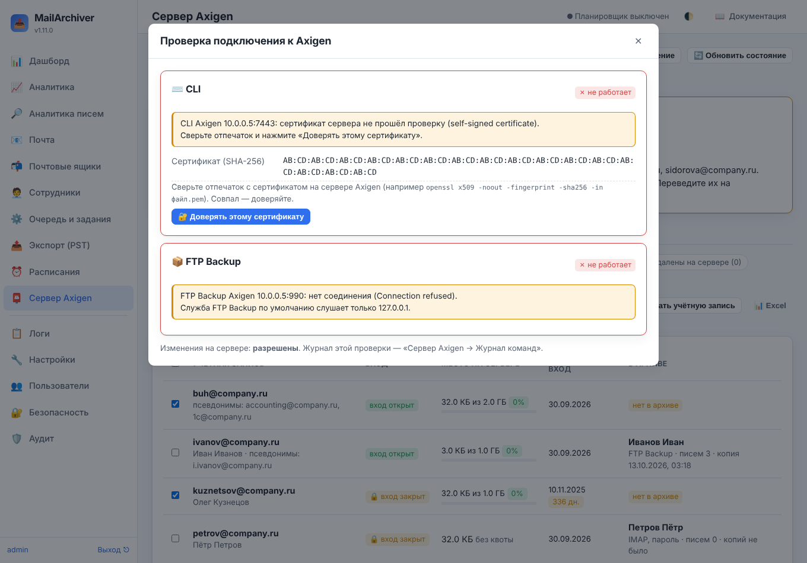
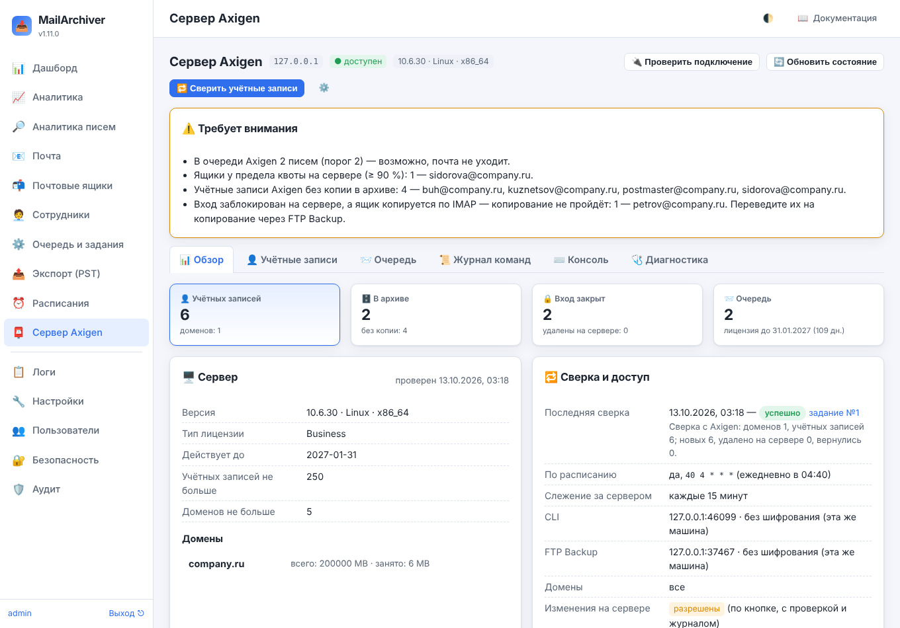
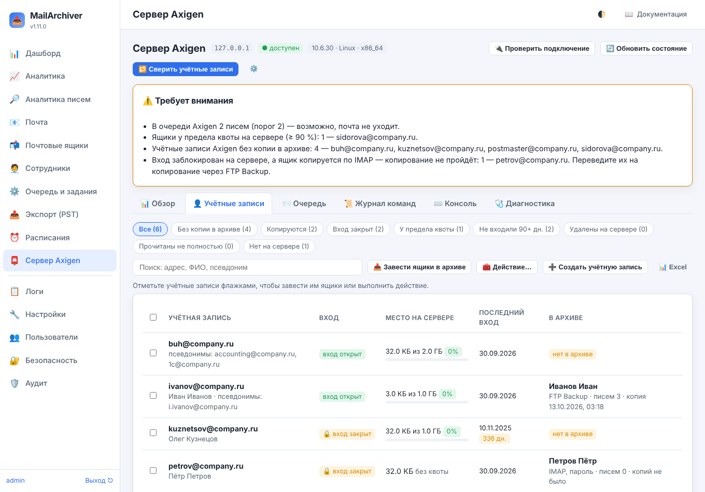
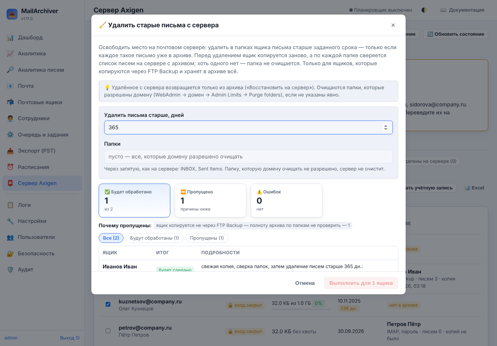
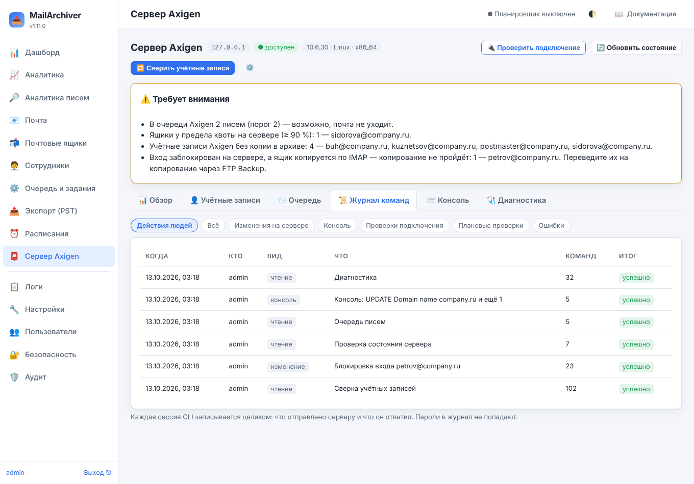

# 19. Сервер Axigen

Если почта организации — на сервере **Axigen**, MailArchiver работает с ним не только как с
IMAP-сервером. Раздел **«Сервер Axigen»** (появляется в меню, когда включён в настройках):

- **сверяет учётные записи сервера с архивом**: кто есть на сервере, но не копируется; чьи учётные
  записи удалены на сервере, а архив остался; у кого закрыт вход; кто у предела квоты и кто давно не
  входил;
- **копирует ящики без паролей сотрудников** — через службу Axigen **FTP Backup & Restore**, входом
  администратора Axigen. Пароли собирать и обновлять не нужно, смена пароля сотрудником копирование не
  ломает;
- **меняет сервер по кнопке** (если это разрешено): закрыть и открыть вход, сменить пароль, удалить с
  сервера старые письма, которые уже лежат в архиве, удалить и создать учётную запись — каждое действие
  сначала показывает проверку и ничего не меняет, пока вы не подтвердите;
- **восстанавливает письма в ящик без пароля** — тоже через FTP Backup;
- **следит за сервером**: доступен ли, сколько писем в очереди, когда кончается лицензия, у кого
  заполнен ящик, — с письмом администраторам, плашкой на дашборде и метриками для Prometheus и Zabbix;
- даёт **консоль CLI только для чтения**, **диагностику** и **журнал всех команд**, отправленных
  серверу.

Всё это доступно только администратору MailArchiver.

## 19.1. Как MailArchiver разговаривает с Axigen

| Канал | Что через него делается | По умолчанию у Axigen |
|---|---|---|
| **CLI** — текстовый интерфейс администрирования | учётные записи, псевдонимы, ФИО, квоты, службы (вход), очередь, лицензия, изменения на сервере | слушает `127.0.0.1:7000` |
| **FTP Backup & Restore** | письма ящиков (копирование и восстановление) | слушает `127.0.0.1:21` |
| IMAP | как раньше — для ящиков, которые копируются по паролю | — |

Оба канала требуют логина и пароля **администратора Axigen**. Войти администратором в чужой ящик по
IMAP Axigen не даёт (как это умеют Dovecot или Cyrus, см. [16-mailadmin.md](16-mailadmin.md)) — поэтому
письма без паролей берутся через FTP Backup: эта служба Axigen предназначена для резервного копирования
и показывает ящики как каталоги, папки — как вложенные каталоги, письма — как файлы.

## 19.2. Подготовка сервера Axigen

1. **Администратор.** Подойдёт `admin`, но лучше завести отдельного администратора только для архива
   (WebAdmin → Administrative Accounts): его действия легко найти в журналах Axigen. Ему нужны права на
   домены, которые копируются, и на резервное копирование.
2. **Слушатели.** CLI и FTP Backup по умолчанию слушают только `127.0.0.1` — с другой машины к ним не
   подключиться. Если MailArchiver стоит не на сервере Axigen:
   - в WebAdmin → Services → **CLI** → Listeners добавьте слушатель на сетевом адресе сервера, лучше
     **с SSL**, и в его правилах доступа разрешите только адрес сервера архива;
   - то же для **FTP Backup & Restore** → Listeners (SSL-слушатель — «TLS сразу», implicit FTPS);
   - откройте эти порты в межсетевом экране — только для сервера архива.

   **Без шифрования пароль администратора по сети не отправляется**: к другой машине MailArchiver
   подключается только по TLS. Без шифрования — только к этой же машине, указанной как `127.0.0.1`,
   `::1` или `localhost` (имя сервера, даже если оно ведёт на эту машину, не подходит: ответ DNS мог бы
   смениться между проверкой и подключением). Исключение — явно включённое «Разрешить без шифрования»
   (тогда пароль и письма видны в сети между серверами).
3. **Упаковка писем.** В настройках службы FTP Backup оставьте **выключенным** «Use the TAR format to pack
   messages»: тогда каждое письмо — отдельный файл и следующее копирование берёт только новые. С
   упаковкой (`messages.tar` на папку) MailArchiver тоже работает, но папку, в которой изменилось хоть
   одно письмо, скачивает целиком (записывает только новые).
4. **Кодировка имён папок** («Folder name encoding», UTF-7 или UTF-8) — любая: MailArchiver понимает обе.

## 19.3. Настройка в MailArchiver

«Настройки → 📮 Сервер Axigen»:

| Параметр | Что задать |
|---|---|
| Работать с сервером Axigen | включить |
| Адрес сервера Axigen | имя или IP сервера, например `10.0.0.5` |
| Администратор Axigen, пароль | учётная запись из п. 19.2 (пароль хранится в базе зашифрованным) |
| Порт CLI, CLI через SSL | порт слушателя CLI; «SSL», если Axigen на другой машине |
| Порт FTP Backup, Шифрование FTP Backup | порт службы; «TLS сразу» для SSL-слушателя или «AUTH TLS» для обычного порта с явным шифрованием |
| Адрес IMAP этого сервера | ровно как поле «Сервер» у ящиков, например `mx.company.ru` — по нему сверка понимает, какие ящики архива с этого сервера |
| Домены | пусто — все домены сервера, или список через запятую |
| Разрешить изменения на сервере | включите, если архивом управляют те же люди, что и почтой; без этого MailArchiver только читает сервер |

Остальные параметры — в справке у каждого поля (значок «?») и в
[05-parameters-reference.md](05-parameters-reference.md).

Сохраните настройки и нажмите **«Проверить подключение»**. Проверка входит в CLI и FTP Backup и
показывает версию Axigen, срок лицензии, домены, очередь и корень FTP Backup.

**Самоподписанный сертификат.** У Axigen во внутренней сети сертификат SSL-слушателя обычно
самоподписанный — проверка по цепочке доверия его не примет. Тогда проверка подключения покажет
**отпечаток SHA-256** сертификата и кнопку **«Доверять этому сертификату»**. Перед нажатием сверьте
отпечаток с сервером — на самом сервере Axigen:

```bash
openssl s_client -connect 127.0.0.1:7443 </dev/null 2>/dev/null | openssl x509 -noout -fingerprint -sha256
```

(порт — вашего SSL-слушателя). Совпал — нажмите «Доверять» и **введите пароль заново** (администратора
Axigen или, если у FTP Backup свой, — его): он сохранится вместе с отпечатком. Дальше MailArchiver примет
только этот сертификат — и на канале управления, и на канале данных FTP, — а соединение с другим
(подменённым) отвергнет. Сертификат на сервере сменили — проверка покажет новый отпечаток, подтвердите
его так же.



## 19.4. Раздел «Сервер Axigen»

Вверху — адрес, состояние («доступен» / «недоступен»), версия и кнопки **«Проверить подключение»**,
**«Обновить состояние»** (прочитать лицензию, домены и очередь сейчас) и **«Сверить учётные записи»**.
Под ними — что требует внимания. Вкладки:

- **Обзор** — учётные записи, сколько из них копируются, у скольких закрыт вход, очередь, лицензия,
  домены, итог последней сверки, как защищено подключение;
- **Учётные записи** — таблица учётных записей сервера вместе с ящиками архива (п. 19.5);
- **Очередь** — очередь писем сервера (только просмотр);
- **Журнал команд** — каждая сессия CLI целиком: что отправлено серверу и что он ответил (п. 19.10);
- **Консоль** — команды CLI только для чтения (п. 19.10);
- **Диагностика** — сырые ответы сервера на команды, которыми пользуется MailArchiver (п. 19.10).



## 19.5. Сверка учётных записей

Сверка (кнопка или расписание «Сверять учётные записи по расписанию») **только читает** сервер: по
каждому домену — список учётных записей, по каждой — псевдонимы, ФИО, квоту и занятое место (по списку
папок), службы (по ним видно, открыт ли вход) и регистрационные сведения (последний вход, если сервер
его отдаёт). Каждое поле читается отдельной командой: если сервер не отдал одно из них, теряется только
оно — у учётной записи будет пометка «не всё прочитано».



Учётная запись сопоставляется с ящиком архива **по логину ящика**, а если не нашлась — **по
псевдонимам**. На вкладке «Учётные записи» — отборы:

| Отбор | Что попадает |
|---|---|
| Без копии в архиве | учётные записи, у которых нет ящика в архиве — их письма не копируются |
| Копируются | есть ящик в архиве |
| Вход закрыт | у учётной записи нет ни одной службы входа (POP3, IMAP, WebMail, ActiveSync…) |
| У предела квоты | заполнено 90 % квоты и больше |
| Не входили 90+ дн. | последний вход больше 90 дней назад (если сервер отдаёт дату входа) |
| Удалены на сервере | учётной записи нет на сервере, а в архиве она была — архив сохранён |
| Нет на сервере | ящики архива с адресом этого сервера, которых нет среди учётных записей (логин записан иначе, удалены до первой сверки, домен не входит в «Домены») |

Учётная запись, которой не оказалось в очередной сверке, **не удаляется** из списка, а помечается
удалённой — так видно, что ящик удалили на сервере, а архив остался. Домен, список которого не
прочитался, ничьих учётных записей «удалёнными» не делает.

**Завести ящики в архиве.** Отметьте учётные записи без ящика и нажмите «Завести ящики в архиве»: ящики
появятся в MailArchiver (на сервере ничего не меняется) — с копированием через FTP Backup или по паролю.
Включите «Заводить ящики для новых учётных записей», чтобы это делала сама сверка для каждой новой
учётной записи. Новым ящикам сотрудников из раздела «Сотрудники» способ копирования задаёт параметр
«Копировать новые ящики через FTP Backup Axigen» ([07-employees.md](07-employees.md)).

**Выгрузка в Excel** — кнопка «Excel»: учётные записи с квотами, последним входом, состоянием входа и
ящиками архива (на втором листе — ящики, которых нет на сервере).

Щелчок по строке открывает **карточку учётной записи**: всё, что прочитала сверка, ящик в архиве и
действия с ним. «Перечитать с сервера» обновляет одну учётную запись, не дожидаясь общей сверки.

## 19.6. Копирование через FTP Backup

Как перевести ящики:

- один ящик — в его карточке «Способ входа → Через FTP Backup Axigen (без пароля ящика)»; логин —
  полный адрес;
- много сразу — «Почтовые ящики → Групповые действия → Сервер Axigen → Копировать через FTP Backup
  Axigen» (или «Действие…» на вкладке «Учётные записи»);
- новые — «Завести ящики в архиве» (п. 19.5) и шаблон ящиков сотрудников.

Сохранённые пароли ящиков при переводе **не удаляются**: они нужны для восстановления по IMAP и для
входа сотрудника в архив своим паролем. Вернуть копирование по паролю можно тем же действием.

Как идёт копирование:

1. MailArchiver входит в FTP Backup и находит каталог ящика: каталог домена в корне или в `domains`, в
   нём — каталог учётной записи (или в каталоге `accounts`/`users`). Найденный путь запоминается. Если
   у вас другая раскладка — задайте «Путь к ящику на FTP», например `domains/{domain}/{local}`.
2. Обходит папки ящика. Пропускаются папки «Не копировать папки (FTP)» (календарь, контакты, задачи —
   это не почта) и, как при копировании по IMAP, исключения ящика и общих настроек.
3. Скачивает **только новые файлы**: которых не было или которые изменили размер. Файлы, которых на
   сервере больше нет, забываются — **письма в архиве остаются**: архив не удаляет то, что удалили на
   сервере.
4. Файл, не похожий на письмо (служебный файл сервера), запоминается и в архив не попадает.
5. Письмо, которое уже есть в этой папке архива (то же содержимое — например, скопированное раньше по
   IMAP), второй раз не записывается: **переход ящика с IMAP на FTP Backup не удваивает архив**.

Отличия от копирования по IMAP:

- отметок «прочитано» и «важное» FTP Backup не отдаёт — у писем, взятых этим способом, их нет;
- дата письма — время доставки на сервер (верхний заголовок `Received`), без него — заголовок `Date`,
  без него — время файла;
- лимит размера письма, срок хранения ящика, «Докачать потерянные» и «Скопировать с нуля» работают так
  же.

«Проверить подключение» у такого ящика проверяет FTP Backup: показывает найденный каталог и папки с
числом файлов.

## 19.7. Изменения на сервере

Кнопки, которые меняют сервер, работают, только если в настройках включено **«Разрешить изменения на
сервере»**. Каждое действие:

- запускается из карточки учётной записи, кнопкой «Действие…» на вкладке «Учётные записи» или в
  «Почтовые ящики → Групповые действия → Сервер Axigen» — и сначала показывает **проверку**: что будет
  сделано с каждым ящиком и что пропустится, — ничего не меняя;
- выполняется одним заданием «Действия на сервере Axigen», ящик за ящиком: перед изменением состояние
  учётной записи читается с сервера заново; команда, которая меняет сервер, считается выполненной, только
  если сервер ответил «+OK» (ответ без итога — ошибка «Axigen не подтвердил команду»), а службы, создание
  и удаление учётной записи после изменения ещё и перечитываются;
- записывается в **журнал команд** (с ответами сервера) и в **аудит**. Пароли в журнал не попадают;
- **не продолжается само после перезапуска службы** и не запускается кнопкой «Повторить»: за время простоя
  учётную запись могли поменять вручную, повторять вслепую нельзя. Что успело выполниться — в событиях
  задания; для остальных ящиков запустите действие заново — с проверкой.

| Действие | Что делает | Условия |
|---|---|---|
| 🔒 **Заблокировать вход** | убирает у учётной записи службы входа и отправки (POP3, IMAP, WebMail, ActiveSync, `remoteDelivery`…); прежний список служб запоминается | сначала — последняя копия ящика; не удалась — вход **не** закрывается. «Продолжать принимать письма» оставляет приём писем (`localDelivery`), если он был. «Сменить пароль на случайный» — чтобы никто не вошёл, даже если вход откроют. Если по списку служб не понять, открыт ли вход (незнакомые названия, пустой список — службы могут наследоваться от домена), блокировка не выполняется |
| 🔓 **Разблокировать вход** | возвращает службы, которые были до блокировки | только для учётных записей, заблокированных из MailArchiver (иначе прежний список неизвестен) |
| 🔑 **Сменить пароль на случайный** | задаёт новый случайный пароль | никому не показывается; если ящик копируется по IMAP — сохраняется в его карточке, и копирование продолжается |
| 🧹 **Удалить старые письма с сервера** | удаляет в папках ящика письма старше заданного срока (не меньше 30 дней); в итоге — сколько писем было в папке и сколько стало | только для ящиков, которые копируются через FTP Backup и хранят в архиве всё: срок хранения «хранить всё» или **бессрочное** удержание (временное не подходит — когда оно кончится, очистка по сроку удалила бы из архива то, чего на сервере уже нет). Перед удалением — свежая копия, затем по каждой папке **каждый** файл на сервере сверяется с архивом: хоть одного письма нет — папка не очищается (если в папке появились письма после копии, ящик докопируется один раз и папка сверяется снова). Очищаются папки, которые разрешено очищать домену (WebAdmin → домен → Admin Limits → Purge folders), или указанные явно из их числа; если этот список прочитать не удалось — ничего |
| 🗑️ **Удалить учётную запись** | удаляет учётную запись на сервере; копирование ящика выключается | только если вход уже заблокирован. На время удаления приём писем останавливается (иначе письмо, пришедшее между сверкой и удалением, пропало бы — отправителю придёт отказ, как и после удаления). Архив ставится на бессрочное удержание (иначе со сроком хранения последняя копия не скачала бы старые письма), ящик копируется ещё раз, и **все папки** на сервере (кроме календаря, контактов и других «Не копировать папки (FTP)») сверяются с архивом; письма, пришедшие во время копии, докопируются один раз. Хоть одного письма нет в архиве — папка исключена из копирования, письмо больше лимита размера, папка не читается — учётная запись не удаляется; удалить всё же можно с отметкой «Удалить, даже если часть писем не в архиве». Отказ или сбой на любом шаге до удаления возвращает приём писем и удержание как было. Ящик, который копируется по IMAP, так не проверить — его сначала переведите на FTP Backup; с отметкой он удаляется, только если его удачная копия сделана не раньше чем за сутки до блокировки |

Те же действия — и многие другие (пароли файлом для раздачи, службы по отдельности, квоты, псевдонимы по
шаблону, контактные данные из «Сотрудников», создание учётных записей списком, папки и письма по IMAP) — для
многих учётных записей сразу есть в разделе **«🖥️ Ящики на сервере»** ([20-server-bulk.md](20-server-bulk.md)); там
же они доступны и учётным записям без ящика в архиве (кроме удаления и очистки).

На вкладке «Учётные записи» есть ещё **«Создать учётную запись»** (адрес, имя, фамилия, свой или
случайный пароль — случайный показывается один раз, — и сразу ящик в архиве), а в карточке учётной
записи — **«Задать пароль…»** (свой или случайный).

**Уволенный сотрудник** — типичный порядок: «Заблокировать вход» (последняя копия делается сама,
письма на его адрес продолжают приходить и копироваться) → через нужный срок «Удалить учётную запись»
(удержание архива, последняя копия, сверка всех папок с архивом, удаление). Автоматически, без команды администратора,
MailArchiver сервер не меняет.



## 19.8. Восстановление через FTP Backup

У ящика, который копируется через FTP Backup, «♻️ Восстановить на сервер» предлагает выбрать, как
заливать: **через FTP Backup** (без пароля ящика) или по IMAP (если пароль задан). Режимы те же, что
обычно: в папки с префиксом (по умолчанию), в исходные папки или в одну папку; пробный прогон;
пропуск дублей.

- Письмо заливается файлом в каталог папки; недостающая папка создаётся с именем в той же кодировке,
  что у соседних.
- Дубли проверяются по Message-ID: у писем папки, которые архив уже брал, он известен из индекса;
  незнакомые файлы папки читаются с сервера (до 2000 на папку, больше — без проверки дублей, об этом
  сказано в журнале задания).
- Отметки «прочитано» и «важное» и дату получения FTP не передаёт.
- В конце папки перечитываются: письмо считается восстановленным, только если сервер его показывает.
- Нужно «Разрешить изменения на сервере» (письма заливает администратор Axigen); запустить может только
  администратор MailArchiver — кнопкой в меню ящика или групповым действием. **По расписанию**
  восстановление через FTP Backup не выполняется: оно меняет почтовый сервер.
- Папку с именем «.», «..» или с управляющими знаками служба FTP Backup не получит — такие письма
  восстановите в другую папку.

## 19.9. Состояние сервера и оповещения

Если включено «Следить за состоянием сервера», MailArchiver каждые 15 минут читает версию, лицензию,
домены и очередь и вместе с последней сверкой решает, что требует внимания:

| Проблема | Когда |
|---|---|
| Сервер недоступен | две проверки подряд не удались |
| Очередь | писем в очереди не меньше порога «Предупреждать об очереди от» |
| Лицензия | до окончания осталось не больше «Предупреждать о лицензии за» дней (неделя и меньше — ошибка) |
| Квота | ящики заполнены на «Предупреждать о квоте от» % и больше |
| Без копии в архиве | учётные записи, у которых нет ящика в архиве |
| Удалены на сервере | учётные записи удалены, а копирование их ящиков включено |
| Вход закрыт, а ящик копируется по IMAP | такое копирование не пройдёт — переведите ящик на FTP Backup |
| Сертификат не проверяется | шифрование включено, но «Проверять сертификат сервера» выключено и отпечаток не сохранён: подмену сервера никто не заметит |
| Уволены, а вход открыт | сотрудник уволен в «Сотрудниках», а вход в его учётную запись открыт — закрыть: «Ящики на сервере» → отбор «Уволены, вход открыт» → «Заблокировать вход» ([20-server-bulk.md](20-server-bulk.md)) |
| Скоро упрутся в квоту | при нынешнем росте (по замерам при сверках) ящик заполнит квоту за 30 дней |

Проблемы видны в разделе «Сервер Axigen» и на **дашборде**; о новой проблеме администраторы получают
**письмо** (если включены уведомления) — не чаще раза в сутки на каждую. В **еженедельной сводке** —
строка о сервере и его проблемах. Для **Prometheus и Zabbix** ([14-monitoring.md](14-monitoring.md)):

| Метрика | Что показывает |
|---|---|
| `mailarchiver_axigen_up` | последняя проверка сервера удалась (1/0) |
| `mailarchiver_axigen_queue_messages` | писем в очереди |
| `mailarchiver_axigen_license_days_left` | дней до окончания лицензии |
| `mailarchiver_axigen_accounts{state="total\|blocked\|deleted"}` | учётные записи по последней сверке |
| `mailarchiver_axigen_problems{problem="…"}` | 1 — проблема есть (`unreachable`, `queue`, `license`, `quota`, `unarchived`, `gone`, `blocked_imap`, `tls_unverified`, `dismissed_open`, `quota_soon`) |

## 19.10. Журнал команд, консоль, диагностика

**Журнал команд** — каждая сессия CLI целиком: кто, когда, что отправлено серверу, что он ответил.
Пароли (администратора и задаваемые учётным записям) заменены на `••••`. Хранятся последние 5000
сессий с изменениями на сервере, 1000 сессий консоли, 500 прочих и 200 плановых проверок — плановые
проверки не вытесняют из журнала действия людей. Отбор «Действия людей» скрывает плановые проверки
состояния и удачные проверки подключения.



**Консоль** выполняет команды CLI одной сессией, но **только для чтения**: `LIST`, `SHOW`, `GET`,
`SEARCH`, `LOOKUP`, `HELP`, переход в контекст (`UPDATE Domain`/`Account`/`Group`/`List`/`FolderRcpt`/
`AccountClass`, `CONFIG`, `ENTER QUEUE`) и `BACK`. Команды, которые меняют сервер (`SET`, `COMMIT`,
`ADD`, `REMOVE`, `PURGE`, `SAVE`…), не выполняются: изменения — кнопками MailArchiver (с проверкой и
журналом) или в WebAdmin. `QUERY` и `JSONQUERY` консоль тоже не выполняет: по документации Axigen не
понять, что их запросы только читают. Пример:

```
UPDATE Domain name company.ru
LIST Accounts
```

**Диагностика** собирает сырые ответы сервера на команды, которыми пользуется MailArchiver: версия,
лицензия, домены, учётная запись (папки, псевдонимы, квота, службы), ограничения домена, очередь. Если
сверка читает что-то не так (не та квота, нет последнего входа) — скачайте отчёт и пришлите
разработчикам: паролей в нём нет.

## 19.11. Безопасность

- Пароль администратора Axigen хранится в базе зашифрованным, в интерфейс не отдаётся и отправляется
  **только** на «Адрес сервера Axigen». Сменили адрес, порт, выключили шифрование или проверку
  сертификата, разрешили «без шифрования», сменили отпечаток сертификата — пароль нужно ввести заново в
  том же сохранении; то же при «Доверять этому сертификату» (иначе администратор архива, не знающий
  пароля, мог бы перенаправить его на свой сервер или сервер-посредник). Включить шифрование или
  проверку можно без пароля.
- К другой машине — только по TLS; сертификат проверяется по цепочке доверия или по сохранённому
  отпечатку. «Проверять сертификат сервера» выключать не нужно: без проверки соединение шифруется, но
  подмену сервера никто не заметит.
- Значения, которые подставляются в команды CLI (адреса, имена папок, пароли), проверяются: кавычки,
  `\`, перевод строки и управляющие знаки не допускаются — одно поле не может дописать к команде
  вторую.
- Раздел и все его действия — только администратору MailArchiver, как и «Проверить подключение» у
  ящика, который копируется через FTP Backup (она входит администратором Axigen); изменения на сервере —
  только при «Разрешить изменения на сервере»; каждое изменение — в журнале команд и в аудите.
- Каталог ящика на FTP Backup ищется только для адресов доменов из «Домены» и только по имени учётной
  записи без «/» и «..»; запомненный путь берётся, только если он ведёт в каталог именно этого логина.
- Файл больше 512 МБ в память не читается: такое письмо пропускается с предупреждением (и считается
  отсутствующим в архиве — удаление и очистка его учтут).

## 19.12. Ограничения

- **Настоящего Axigen в среде разработки не было.** Команды CLI взяты из справочника Axigen 10.6, а вид
  ответов (таблицы, «имя = значение») описан в документации не полностью — разбор нарочно терпим к
  вариантам и проверен на учебном сервере в нескольких видах ответов. Если что-то читается не так —
  вкладка «Диагностика».
- **Раскладка каталогов FTP Backup** в документации описана в общих словах; MailArchiver ищет каталог
  ящика по нескольким известным вариантам, а если не нашёл — пишет, что лежит в каталоге домена, и
  можно задать свой шаблон пути.
- **Восстановление через FTP Backup**: как Axigen принимает залитые файлы, в документации не описано.
  MailArchiver проверяет после заливки, что сервер показывает письма, и иначе сообщает об ошибке —
  проверьте его сначала на тестовом ящике.
- **Удаление старых писем** использует команду `PURGE account folders <папка> BEFORE <N>d` (по базе
  знаний Axigen); очищать можно только папки, разрешённые домену. Между сверкой папки с архивом и
  командой очистки проходят секунды; письмо, которое в эти секунды переложат в папку и которое старше
  срока, сверку не пройдёт и может быть удалено. Очищайте папки, куда письма не перекладывают вручную
  (корзина, спам), или в нерабочее время.
- После «Разблокировать вход» службы учётной записи заданы явным списком — даже если до блокировки они
  наследовались от настроек домена.
- Последний вход сервер отдаёт не всегда (зависит от версии и служб) — тогда отбор «Не входили» пуст.
