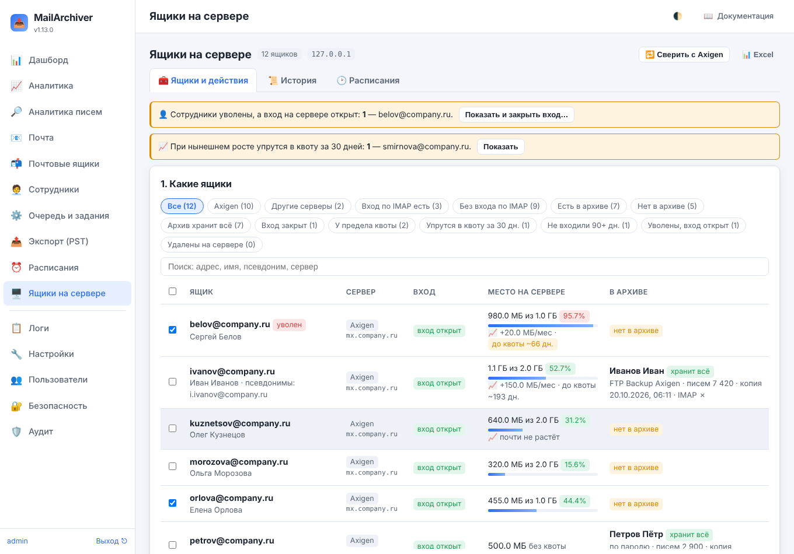
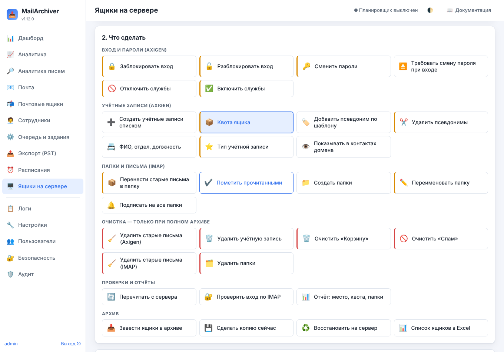
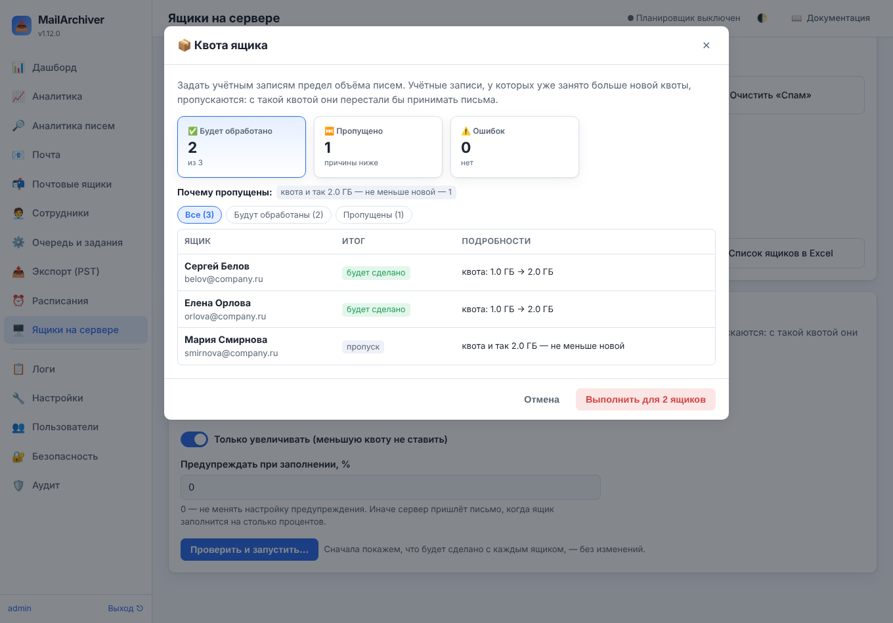
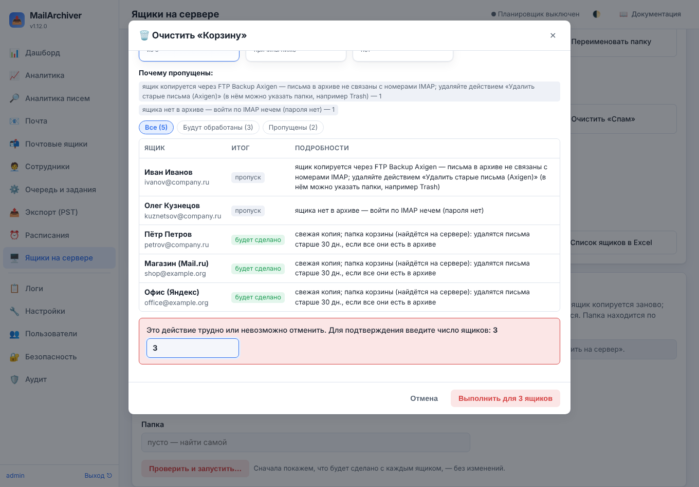
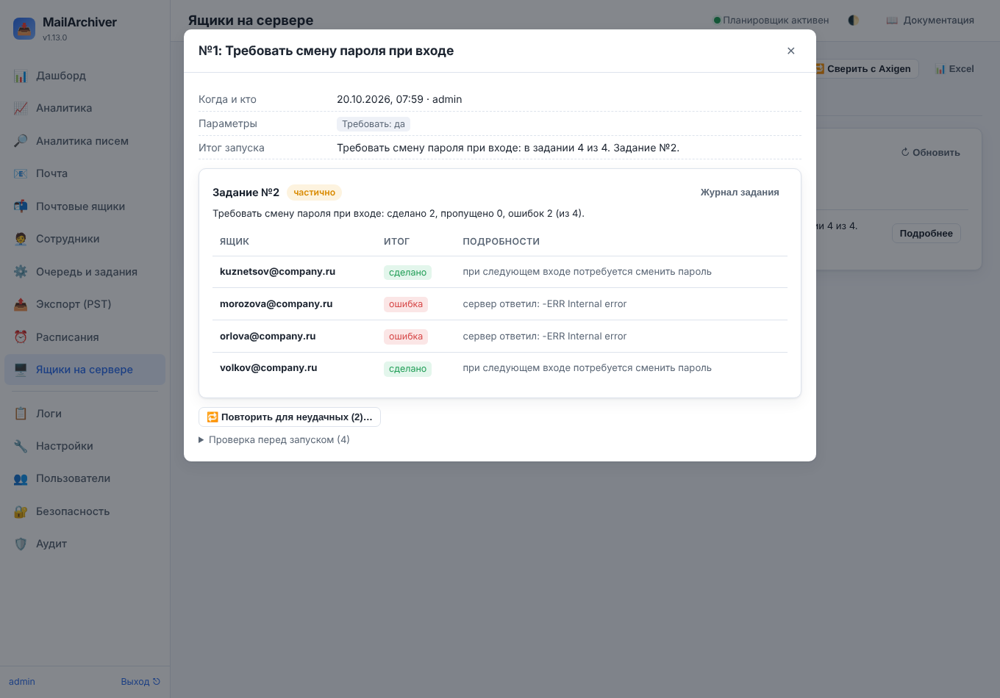
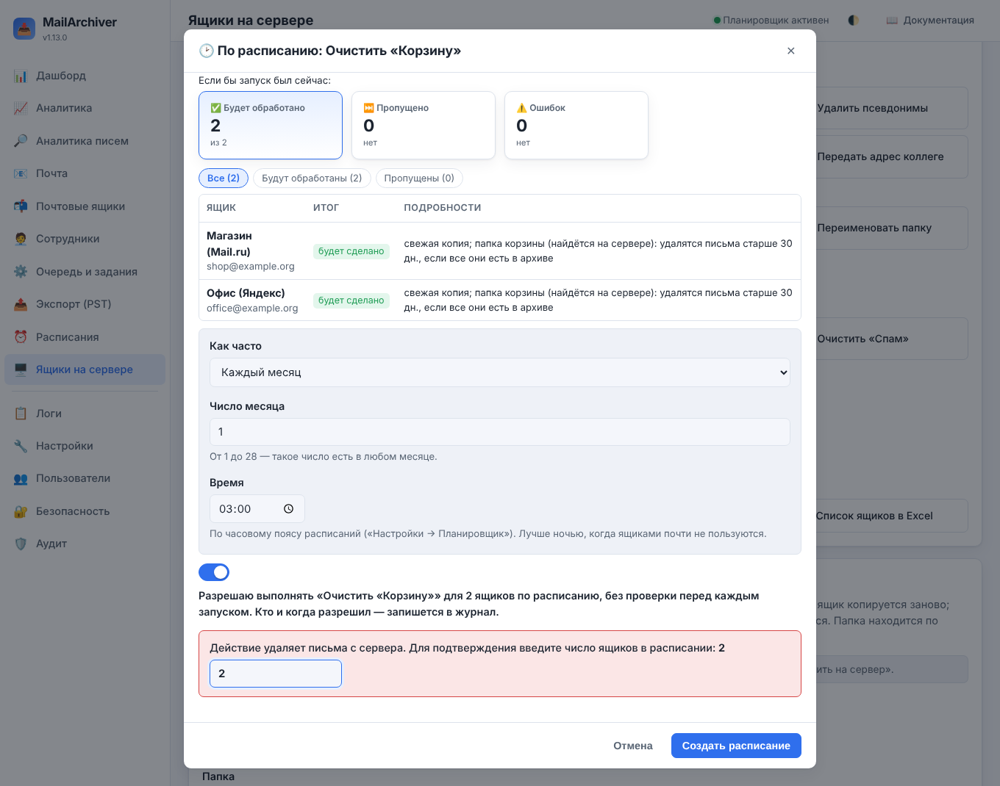

# 20. Ящики на сервере: групповые действия

Раздел **«🖥️ Ящики на сервере»** (виден только администратору) работает не с архивом, а с самим почтовым
сервером: учётными записями, паролями, службами, квотами, псевдонимами, папками и письмами — сразу у многих
ящиков. Групповые действия с **архивом** (копирование, срок хранения, расписания, выгрузки) остаются в
«Почтовые ящики → Групповые действия» ([17-bulk.md](17-bulk.md)).

Раздел умеет три вида ящиков:

| Ящик | Как с ним работает MailArchiver | Что доступно |
|---|---|---|
| **Учётная запись Axigen** | через CLI администратора Axigen ([19-axigen.md](19-axigen.md)) — пароли сотрудников не нужны | вход и пароли, службы, квоты, псевдонимы, контактные данные, тип учётной записи, создание и удаление, очистка папок через Axigen, отчёт |
| **Учётная запись подключённого сервера** (Microsoft 365, Google Workspace, Яндекс 360, Zimbra, Kerio, mailcow…) | через API сервера — подключение в разделе «Почтовые серверы» ([21-mailservers.md](21-mailservers.md)) | то, что позволяет API сервера: вход и пароли, квоты, псевдонимы, ФИО и отдел, **автоответ и пересылка**, создание и удаление, отчёт — у каждого сервера своё ([21.9](21-mailservers.md#219-что-умеет-каждый-сервер)) |
| **Ящик архива на любом сервере** (Яндекс, Mail.ru, Exchange, Dovecot, тот же Axigen…) | по IMAP — так же, как копирование: паролем ящика, [входом администратора почты](16-mailadmin.md) или OAuth2 | папки и письма: перенос, отметки, создание, переименование и удаление папок, очистка корзины и спама, проверка входа, отчёт |

Учётная запись Axigen или подключённого сервера, у которой есть ящик в архиве, доступна и для действий по IMAP — если в ящик можно войти
(есть пароль или вход администратора почты).

Главные правила раздела те же, что у групповых действий архива:

- **сначала проверка, потом действие** — окно проверки показывает, что будет сделано с каждым ящиком и что
  пропустится (и почему), и ничего не меняет;
- **удалять письма, папки и учётные записи можно только при полном архиве** — всё, что удаляется с сервера,
  должно уже лежать в архиве (подробно — [20.6](#206-очистка--только-при-полном-архиве)).

## 20.1. Какие ящики видны

В таблице:

- **учётные записи Axigen** из последней сверки с сервером (кнопка «🔁 Сверить с Axigen» вверху или
  сверка по расписанию). Учётная запись связывается с ящиком архива по логину, затем по псевдонимам;
- **учётные записи подключённых серверов** — из последней сверки каждого подключения («Почтовые серверы» →
  «🔁 Сверить» или по расписанию);
- **ящики архива, которых нет среди учётных записей Axigen и подключённых серверов** — на других серверах.

| Колонка | Что показывает |
|---|---|
| Ящик | адрес, имя, псевдонимы; «не всё прочитано» — сверка прочитала учётную запись не полностью (подробности во всплывающей подсказке); **«уволен»** — сотрудник с этим адресом уволен в «Сотрудниках» (красная — а вход на сервере открыт) |
| Сервер | Axigen, вид и название подключения (с пометкой «только чтение», если изменения не разрешены) или IMAP и адрес сервера |
| Вход | у Axigen и подключённых серверов — открыт ли вход на сервере (у подключений ниже — последний вход, если сервер сообщает), у остальных — итог последней проверки входа |
| Место на сервере | у Axigen и подключённых серверов — занято и квота с полосой заполнения (если сервер сообщает); у остальных ящиков — по последнему «Отчёту». Ниже — **📈 рост в месяц и сколько дней до квоты** при таком росте ([20.10](#2010-место-на-сервере-во-времени)) |
| В архиве | ящик архива: способ копирования, писем, последняя копия, **«хранит всё»** (срок хранения «хранить всё» или бессрочное удержание — условие удаления с сервера), **IMAP ✓ / ✗** — можно ли войти в ящик по IMAP (почему нет — в подсказке) |

Под адресом учётной записи подключения — **🏖️ автоответ** и **↪️ пересылка**, если они включены, и вид
учётной записи, если это не обычный ящик (общий ящик, ресурс, без лицензии…).

**Отборы:** с учётной записью на сервере, без учётной записи (IMAP), вход по IMAP есть / нет, есть / нет в архиве, архив хранит всё, вход
закрыт, у предела квоты (90 % и больше), **упрутся в квоту за 30 дней**, не входили 90+ дней, **уволены, вход
открыт**, удалены на сервере. Поиск — по адресу, имени, псевдониму, серверу, отделу. Список **«Все серверы»**
рядом с поиском оставляет в таблице учётные записи одного сервера: Axigen, одного из подключений или ящики
архива без учётной записи («🖥️ Учётные записи» в карточке подключения открывает раздел сразу с таким отбором).

Над таблицей — **плашки о том, что требует внимания**: сотрудники уволены, а вход на сервере открыт (кнопка
«Показать и закрыть вход…» выбирает их и действие «Заблокировать вход»), и ящики, которые при нынешнем росте
упрутся в квоту за 30 дней («Показать»).

**Какие ящики обработать** — три способа:

- **отмеченные в таблице** (флажок в заголовке отмечает все показанные);
- **все, что видны** под отбором и поиском;
- **по списку адресов** — вставьте столбец из Excel или список из письма: адрес, псевдоним или название ящика
  в строке (можно через запятую, подойдёт и «Имя <адрес>»). Сразу видно, сколько найдено и какие адреса
  не найдены.

«📊 Excel» вверху выгружает всю таблицу; плитка «Список ящиков в Excel» — только выбранные ящики.

## 20.2. Как выполняется действие

1. Выберите ящики, затем плитку действия. Цвет полоски слева: без полоски — безопасные действия,
   **оранжевая** — меняет важное (вход, пароли, службы, квоты, псевдонимы, папки), **красная** — удаляет
   данные с сервера.
2. Заполните параметры и нажмите **«Проверить и запустить…»**. В окне проверки — сколько ящиков будет
   обработано, сколько пропущено и почему, и что именно произойдёт с каждым.
3. «Выполнить для N ящиков». Красные действия требуют ввести **число ящиков** — так случайный щелчок ничего не
   удалит.

Изменения выполняет **одно задание «Действия с ящиками на сервере»**, ящик за ящиком:

- перед каждым ящиком условия проверяются **заново** — по свежим данным (за время между проверкой и заданием
  что-то могло поменяться); у Axigen и подключённых серверов значение после изменения перечитывается с
  сервера: сервер показывает другое — это ошибка, а не «сделано»; не показывает вовсе — так и сказано в итоге;
- такие задания идут **по одному**: новое встаёт в очередь за текущим (в разделе это видно плашкой «Идёт
  действие…»);
- задание можно **отменить** («История» → «Подробнее» → «Отменить задание»): сделанное остаётся, итог по уже
  обработанным ящикам сохраняется, остальные ящики не обрабатываются;
- после перезапуска службы задание **не продолжается само** — за время простоя ящики могли поменять вручную;
  что успело выполниться, видно в журнале задания; для остальных — «🔁 Повторить для неудачных» в «История» →
  «Подробнее» ([20.8](#208-история-пароли-отчёт)): тот же запуск с проверкой, только для необработанных ящиков.
  Кнопки «Повторить» в очереди заданий у такого задания нет: повтор вслепую изменил бы ещё раз и уже изменённые
  ящики (например, выдал бы новые пароли тем, кому их уже раздали);
- каждое изменение записывается в **аудит** (удаление писем и папок — сразу по каждой папке), команды Axigen —
  в **журнал команд**, обращения к API подключённых серверов — в **журнал подключения** (пароли и токены в
  журналы не попадают).

**Права.** Раздел — только администратору MailArchiver. Действия, которые меняют учётные записи Axigen, —
только если в «Настройки → Сервер Axigen» включено **«Разрешить изменения на сервере»** (без него их плитки
недоступны, а «Перечитать с сервера» и «Отчёт» работают). У подключённых серверов то же разрешение — в каждом
подключении («Почтовые серверы» → «Изменить»): без него учётные записи этого сервера пропускаются с причиной.
Если подключён хоть один сервер, плитки доступны, а учётные записи сервера, где изменения не разрешены (или
который этого не умеет), пропускаются в проверке. Действия по IMAP этого разрешения не требуют: они работают с
ящиками архива тем же входом, что и копирование.

У подключённых серверов набор действий зависит от сервера ([21.9](21-mailservers.md#219-что-умеет-каждый-сервер));
действия, которые есть только у Axigen (службы, тип учётной записи, показ в контактах домена, очистка через
Axigen), для них пропускаются, а **🏖️ Автоответ** и **↪️ Пересылка писем** есть только у подключённых серверов
([21.5](21-mailservers.md#215-действия-в-ящиках-на-сервере)).

## 20.3. Вход и пароли

Ниже — как действия работают с Axigen; у подключённых серверов — то же по смыслу, через API сервера
([21.5](21-mailservers.md#215-действия-в-ящиках-на-сервере)).

| Действие | Что делает | Важно |
|---|---|---|
| 🔒 **Заблокировать вход** | убирает службы входа и отправки (POP3, IMAP, WebMail, телефоны, SMTP); прежний список служб запоминается | если у учётной записи есть ящик в архиве — сначала его последняя копия; не удалась — вход не закрывается. «Продолжать принимать письма» оставляет приём писем. «Сменить пароль на случайный» — чтобы никто не вошёл, даже если вход откроют. Ящик, который копируется по IMAP с паролем, после блокировки копироваться не сможет — переведите его на FTP Backup |
| 🔓 **Разблокировать вход** | возвращает службы, которые были до блокировки | только для учётных записей, заблокированных из MailArchiver (иначе прежний список неизвестен) |
| 🔑 **Сменить пароли** | новые пароли: **случайные — файлом для раздачи**, случайные — никому не показывая, или **один общий временный** | можно сразу «Потребовать сменить пароль при следующем входе». Файл с паролями скачивается в «Истории» **один раз** и не позже чем через сутки ([20.8](#208-история-пароли-отчёт)). У ящиков, которые копируются по IMAP с паролем, новый пароль сохраняется в карточке ящика — копирование продолжится |
| ⏏️ **Требовать смену пароля при входе** | включает или снимает требование сменить пароль при следующем входе | — |
| 🚫 **Отключить службы** | убирает выбранные службы: POP3, IMAP, WebMail, телефоны и Outlook (ActiveSync, MAPI), SMTP, календари и контакты (CalDAV, CardDAV, WebDAV) | остальные службы не меняются. Не осталось ни одной службы входа — это блокировка: прежний список запоминается, «Разблокировать вход» вернёт его |
| ✅ **Включить службы** | добавляет выбранные службы | названия берутся из списка служб, разрешённых домену (WebAdmin → домен → Admin Limits); домен службу не разрешает — так и сказано |

Если служб учётной записи не видно (они наследуются от домена), действия со службами её пропускают — задайте
службы в WebAdmin.

## 20.4. Учётные записи

| Действие | Что делает | Важно |
|---|---|---|
| ➕ **Создать учётные записи списком** | заводит на сервере (Axigen или подключённом — поле «Где создать») много учётных записей: из списка («адрес; имя; фамилия» или «Фамилия Имя <адрес>») или **из раздела «Сотрудники»** — тех, у кого есть адрес, а учётной записи нет | пароли — случайные (файлом для раздачи) или один общий временный; «Потребовать сменить пароль при первом входе»; квота; «Сразу завести ящики в архиве» (копирование через FTP Backup). Проверка покажет, что будет с каждой строкой: адрес занят учётной записью или псевдонимом, домена нет на сервере или в «Доменах» настроек, строка повторяется — пропуск. После создания учётная запись открывается для проверки |
| 📦 **Квота ящика** | задаёт предел объёма писем (МБ) | «Только увеличивать» не уменьшит большую квоту. Учётная запись, у которой занято больше новой квоты, пропускается (с такой квотой она перестала бы принимать письма); занятое место читается с сервера прямо перед изменением. «Предупреждать при заполнении, %» — письмо от сервера при заполнении |
| 🏷️ **Добавить псевдоним по шаблону** | второй адрес из имени: `{first}.{last}` → `ivan.ivanov`, `{f}.{last}` → `i.ivanov`, `{login}`, `{middle}` | имя и фамилия — из учётной записи, а если их нет — из «Сотрудников»; кириллица пишется латиницей. Адрес, уже занятый учётной записью или псевдонимом, — пропуск; одинаковый псевдоним у двух выбранных учётных записей получит только первая |
| ✂️ **Удалить псевдонимы** | удаляет перечисленные псевдонимы (можно без домена) или все | письма на удалённый псевдоним перестанут доходить |
| 📇 **ФИО, отдел, должность** | заполняет контактные данные (их видно в адресной книге): из «Сотрудников» — ФИО, отдел, должность, телефон; или одинаковые всем — организация, отдел, офис | по умолчанию заполняются только пустые поля; «Заменять уже заполненные поля» — перезаписать |
| ⭐ **Тип учётной записи** | basic или premium | не хватит лицензий premium — сервер откажет, это видно по каждой учётной записи |
| 👁️ **Показывать в контактах домена** | показывать или скрыть учётные записи в общей адресной книге домена | — |
| 📨 **Передать адрес коллеге** | для учётных записей, **уже удалённых** на сервере: их адрес (и, по выбору, псевдонимы) становится псевдонимом учётной записи коллеги — письма на адрес уволенного приходят коллеге | только в том же домене; адрес, занятый другой учётной записью или её псевдонимом, — пропуск. Пока учётная запись есть на сервере, адрес занят ею самой — для удаления с передачей есть поле в «Удалить учётную запись» ([20.11](#2011-уволенные-сотрудники)) |

## 20.5. Папки и письма (IMAP)

Работают с любым IMAP-сервером. В ящик входят так же, как копирование; ящик без пароля (и без входа
администратора почты), ящик FTP Backup без пароля, ящик, которого нет в архиве, — пропускаются с причиной.

| Действие | Что делает | Важно |
|---|---|---|
| 📦 **Перенести старые письма в папку** | перекладывает письма старше срока из указанных папок (по умолчанию «Входящие») в другую папку: «Архив» или **«Архив/{year}»** — по году письма | письма остаются на сервере; папка создаётся и подписывается. Без команды MOVE письма копируются и стираются из исходной папки — только эти письма. Архив увидит перенесённые письма в новой папке как новые и скопирует их ещё раз (архив вырастет на их объём) |
| ✔️ **Пометить прочитанными** | снимает отметку «не прочитано» — во всех папках или в указанных, все или старше срока | — |
| 📁 **Создать папки** | создаёт одинаковые папки (например, «Проекты/2026»), если их нет, и подписывает на них | уровни — через «/», заменяется разделителем сервера |
| ✏️ **Переименовать папку** | переименовывает папку во всех ящиках, где она есть | «Входящие» и особые папки (Отправленные, Черновики, Корзина, Спам — по отметке сервера или, если сервер их не отмечает, по имени) не переименовываются; папка с новым именем уже есть — пропуск. Архив скопирует письма папки ещё раз под новым именем |
| 🔔 **Подписать на все папки** | подписывает ящик на все его папки | помогает, когда почтовая программа «потеряла» папки, хотя на сервере они есть |

## 20.6. Очистка — только при полном архиве

Удаляющие действия красные и подтверждаются числом ящиков. Общие правила:

- **сначала свежая копия.** Ящик копируется заново; на время копии и удаления он занят заданием, и другое
  копирование его не трогает. Копия не удалась — с сервера ничего не удаляется;
- **каждое удаляемое письмо должно быть в архиве** — в той же папке, с тем же UIDVALIDITY и UID, а файл письма
  должен лежать на диске. Хоть одного нет (пришло после копии, больше лимита размера, папка исключена из
  копирования) — папка **не трогается**. Сервер не сообщает UIDVALIDITY — письма по номерам не опознать, и
  папка тоже не трогается;
- **стираются только эти письма.** Если сервер умеет UIDPLUS — командой `UID EXPUNGE`; если нет — обычным
  `EXPUNGE` и только когда других писем с отметкой «удалено» в папке нет — ни до, ни сразу после отметки
  (иначе стёрлись бы и они);
- **архив должен хранить всё** — срок хранения «хранить всё» или **бессрочное** удержание — для удаления
  старых писем и папок с письмами: иначе со временем письма пропали бы и из архива. Временное удержание не
  подходит.

| Действие | Что делает | Условия |
|---|---|---|
| 🗑️ **Очистить «Корзину»** | удаляет письма корзины — все или старше срока | папка находится по отметке сервера `\Trash` или по имени в корне ящика (Trash, Deleted Items, Корзина, Удалённые). Указанная явно папка тоже должна быть корзиной: «Входящие» или «Проекты/Trash» так не очистить (для них — «Удалить старые письма»). Удалённые письма остаются в архиве на срок хранения ящика |
| 🚫 **Очистить «Спам»** | то же для папки спама (`\Junk`, Junk, Spam, Спам, Нежелательная почта) | если «Спам» не копируется в архив, очистка его пропустит — это и есть защита |
| 🧹 **Удалить старые письма (IMAP)** | освобождает место: удаляет письма старше срока (от 30 дней) во всех копируемых папках или в указанных | только у ящиков, архив которых хранит всё |
| 🗂️ **Удалить папки** | удаляет перечисленные папки: пустые — сразу; с письмами — только с отметкой «Удалять и папки с письмами» и если все письма папки в архиве (после свежей копии) | сначала стираются ровно проверенные письма, и папка удаляется, только если после этого пуста: пришло новое письмо — папка остаётся. «Входящие», особые папки и папки с вложенными папками не удаляются. Для папок с письмами архив должен хранить всё |
| 🧹 **Удалить старые письма (Axigen)** | очистка через Axigen (`PURGE`) — для ящиков, которые копируются через **FTP Backup** | то же, что в [19-axigen.md, раздел 19.7](19-axigen.md): свежая копия, сверка каждого файла папки с архивом, только папки, которые разрешено очищать домену; архив хранит всё |
| 🗑️ **Удалить учётную запись** | удаляет учётную запись Axigen, письма остаются в архиве; копирование ящика выключается. **«Передать адрес коллеге»** — сразу после удаления адрес (и псевдонимы) становится псевдонимом коллеги: письма не уходят в отказ | только заблокированную и копируемую через FTP Backup: приём писем на время удаления останавливается, архив ставится на бессрочное удержание, ящик копируется ещё раз, все папки сверяются с архивом — хоть одного письма нет, учётная запись не удаляется ([19.7](19-axigen.md)). Адрес передать нельзя (коллега в другом домене, адрес занят, коллеги уже нет на сервере — это проверяется и прямо перед удалением) — учётная запись не удаляется вовсе |

Ящики, которые копируются **через FTP Backup Axigen**, по IMAP так не проверить (их письма в архиве не связаны
с номерами IMAP): для них очистка по IMAP пропускается с подсказкой — пользуйтесь «Удалить старые письма
(Axigen)», в нём можно указать папки, например `Trash`.

## 20.7. Проверки, отчёты, архив

| Действие | Что делает |
|---|---|
| 🔄 **Перечитать с сервера** | читает выбранные учётные записи Axigen заново (ФИО, квота, занятое место, службы, псевдонимы, последний вход), не дожидаясь общей сверки. Учётная запись исчезла с сервера — помечается удалённой, архив сохраняется |
| 🔐 **Проверить вход по IMAP** | входит в каждый ящик и сразу выходит: подходит ли пароль, отвечает ли сервер и что он умеет (UIDPLUS, MOVE, QUOTA, SPECIAL-USE). Итог — в задании и в проверке пароля ящика («Почтовые ящики»); у ящиков не на Axigen — и в колонке «Вход» |
| 📊 **Отчёт: место, квота, папки** | сколько у ящика писем и места, квота и её заполнение, непрочитанные (по IMAP), самые большие папки. Учётные записи Axigen читаются через CLI, остальные ящики — по IMAP (квота — если сервер поддерживает QUOTA). Итог — таблица в задании и файл Excel в «Истории». Занятое место запоминается — по нему считается рост ([20.10](#2010-место-на-сервере-во-времени)) |
| 📥 **Завести ящики в архиве** | заводит ящики архива для учётных записей Axigen, у которых их нет: через FTP Backup (без паролей) или по IMAP с паролем; сразу, без задания. На сервере ничего не меняется |
| 💾 **Сделать копию сейчас**, ♻️ **Восстановить на сервер** | открывают обычные групповые действия архива для ящиков выбранных строк ([17-bulk.md](17-bulk.md)) |

## 20.8. История, пароли, отчёт

Вкладка **«📜 История»** — действия раздела: когда, кто, что, со сколькими ящиками и итог (групповые действия
архива — в своей истории). «Подробнее» показывает параметры, проверку перед запуском и ход задания по каждому
ящику, кнопку «Журнал задания» и, пока задание идёт, «Отменить задание».

**Пароли для раздачи** («Сменить пароли» и «Создать учётные записи» со случайными паролями «файлом»):

- до выдачи пароли хранятся в базе **зашифрованными** (тем же ключом, что пароли ящиков); пароль записывается
  до изменения на сервере, и если сервер изменение не подтвердил, он всё равно будет в файле — с пометкой
  «проверьте вход»;
- «🔑 Скачать пароли» в «Подробнее» выдаёт файл Excel (адрес, имя, пароль) **один раз** — после скачивания
  пароли стираются; не скачали за сутки — тоже стираются (тогда смените пароли ещё раз);
- общий временный пароль в задание передаётся зашифрованным, а в истории и аудите не сохраняется вовсе.

**Отчёт в Excel** — после действия «Отчёт: место, квота, папки» в «Подробнее» есть кнопка «📊 Отчёт в Excel».

**🔁 Повторить для неудачных.** Задание закончилось, а не все ящики сделаны (ошибка у части ящиков, задание
отменено или прервано перезапуском службы) — в «Подробнее» есть кнопка «Повторить для неудачных (N)…». Она
**ничего не запускает сама**: на вкладке «Ящики и действия» отмечаются ящики с ошибкой и не обработанные,
выбирается то же действие с теми же параметрами — дальше, как обычно, «Проверить и запустить…» (условия
проверяются заново, удаляющие действия подтверждаются числом ящиков). Какие ящики сделаны, задание отмечает
по ходу работы, поэтому уже сделанные не предлагаются и после сбоя службы; ящик, на котором задание
прервалось посреди работы, предлагается с предупреждением — часть изменений на нём могла выполниться. Для
операций 1.12, у которых итог задания не сохранился, повтор отказывается: что сделано, неизвестно. Общий
пароль не хранится — его вводят заново. Для «Создать учётные записи списком» открывается окно создания со
строками, которые не получились; для удалённых учётных записей, чей адрес коллеге не передан, — «Передать
адрес коллеге».

## 20.9. По расписанию — только с вашего согласия

Сам MailArchiver почтовый сервер не меняет. Исключение — расписание, которое администратор включает сам: для
**конкретного действия** и **конкретных ящиков**.

**По расписанию можно:** очистить «Корзину» и «Спам», удалить старые письма (IMAP и Axigen), перенести старые
письма в папку, отчёт о месте. Пароли, вход, службы, удаление учётных записей по расписанию не выполняются.

1. На вкладке «Ящики и действия» выберите ящики и действие, заполните параметры.
2. **«🕑 По расписанию…»**: окно покажет, что было бы, если запустить сейчас (что пропустится и почему), и
   спросит, **как часто** (каждый день, неделю — день недели, месяц — число от 1 до 28) и **во сколько** (по
   часовому поясу расписаний, «Настройки → Планировщик»).
3. Отметьте **согласие** выполнять действие без проверки перед каждым запуском; удаляющие действия
   подтверждаются ещё и числом ящиков. Кто и когда согласился — в расписании и в аудите.

Каждый запуск — обычное задание раздела: условия («только при полном архиве», свежая копия, сверка каждого
письма) **проверяются заново по каждому ящику**, итог — в «Истории» (кто — «расписание №…»). Запуск не
начнётся, пока идёт предыдущий запуск того же расписания. В расписании — ящики, выбранные при создании:
новые ящики сами в него не попадут.

Вкладка **«🕑 Расписания»** раздела: что, когда, какие ящики, кто согласился, последний и следующий запуск;
«⏸ Выключить» / «▶ Включить», «Удалить», «Ящики» — отметить ящики расписания для ручного запуска. Такие
расписания не показываются в общем разделе «Расписания» и меняются только здесь. Планировщик выключен — они
не запускаются (об этом предупреждает плашка).

## 20.10. Место на сервере во времени

Занятое место ящика запоминается **раз в день**: при сверке с Axigen (все учётные записи), «Перечитать с
сервера» и «Отчёте» (учётные записи Axigen и ящики других серверов, если сервер сообщает квоту). По этим
замерам за последние 90 дней (нужно не меньше двух замеров с разницей от недели) раздел считает:

- **рост в месяц** — «📈 +120 МБ/мес» (или «почти не растёт») под колонкой «Место на сервере»; во всплывающей
  подсказке — с какого дня замеры;
- **сколько дней до квоты** при таком росте — оранжевым до 90 дней, красным до 30.

Ящики, которые упрутся в квоту за 30 дней, — в отборе «Упрутся в квоту за 30 дн.» и в плашке над таблицей;
учётные записи Axigen — ещё и в проблемах мониторинга Axigen ([19-axigen.md](19-axigen.md)). Рост и «До квоты, дней» есть и в выгрузке «📊 Excel». Замеры
старше 400 дней удаляет служебное обслуживание.

## 20.11. Уволенные сотрудники

**Вход открыт.** Сотрудник уволен в «Сотрудниках», а его учётная запись на сервере открыта — это видно сразу:
тег «уволен» в строке, отбор «Уволены, вход открыт», плашка над таблицей и проблема мониторинга Axigen
(«Сотрудники уволены, а вход на сервере открыт»). «Показать и закрыть вход…» выбирает их и действие
«Заблокировать вход» — дальше, как обычно, проверка и запуск.

**Письма на адрес уволенного.** Пока учётная запись заблокирована с «Продолжать принимать письма», письма
приходят в неё и копируются в архив. После удаления их принимает коллега: «Удалить учётную запись» с полем
**«Передать адрес коллеге»** (или «Передать адрес коллеге» позже, для уже удалённой) — адрес становится
псевдонимом учётной записи коллеги в том же домене. Если сервер не принял псевдоним уже после удаления, это
ошибка в итоге (удаление записано в аудит), а «Повторить для неудачных» предложит «Передать адрес коллеге».
Переданный адрес коллегу уволенным не делает.

**Автоответ («сотрудник больше не работает…»)** у подключённых серверов, которые это умеют, ставит действие
**🏖️ Автоответ** ([21.5](21-mailservers.md#215-действия-в-ящиках-на-сервере)). **У Axigen MailArchiver его не
ставит:** в Axigen это фильтр Sieve, а как его загружать через CLI, документация не описывает — ставить фильтры
на почту вслепую нельзя (ошибка в фильтре теряет письма). Автоответ ставится в WebMail Axigen самого ящика
(«Settings → Out of office autoresponder»), пока учётная запись есть; или передайте адрес коллеге.

## 20.12. Готовые сценарии

**Новые сотрудники.** Внесите их в «Сотрудники» (или подготовьте список) → «Создать учётные записи списком»
→ источник «Сотрудники…», пароли «файлом», «Потребовать сменить пароль», «Сразу завести ящики в архиве» →
«Проверить» → «Создать» → «История» → «Скачать пароли» и раздайте. Затем «Добавить псевдоним по шаблону»
`{f}.{last}` и «ФИО, отдел, должность» из «Сотрудников».

**Сотрудник уволился.** Отметьте увольнение в «Сотрудниках» → плашка «Уволены, а вход открыт» → «Показать и
закрыть вход…» → «Заблокировать вход» (последняя копия, письма продолжают приходить и копироваться) → через
нужный срок «Удалить учётную запись» с «Передать адрес коллеге» (только при полном архиве) — письма на адрес
уволенного приходят коллеге.

**Пароли утекли.** Выберите затронутые ящики → «Сменить пароли» — случайные файлом и «Потребовать сменить
пароль» → раздайте файл. Ящики, которые копируются по IMAP, получат новый пароль в карточке сами.

**На сервере кончается место.** Отбор «У предела квоты» или «Упрутся в квоту за 30 дн.» → «Отчёт» (где больше
всего) → «Квота ящика» («только увеличивать») или очистка: «Очистить «Корзину»», «Очистить «Спам»», «Удалить
старые письма» — только у ящиков, архив которых хранит всё (отбор «Архив хранит всё»). Чтобы корзина не копилась
снова — «🕑 По расписанию…», например раз в месяц ([20.9](#209-по-расписанию--только-с-вашего-согласия)).

**Задание прошло не для всех.** «История» → «Подробнее» → «🔁 Повторить для неудачных…» → «Проверить и
запустить…».

**Порядок в папках.** «Создать папки» одинаковые для отдела, «Перенести старые письма» из «Входящих» в
«Архив/{year}», «Подписать на все папки» — если сотрудники не видят папок в Outlook или на телефоне.

## 20.13. Ограничения

- Настоящего Axigen в среде разработки не было: команды CLI для паролей, служб, квот, псевдонимов, контактных
  данных и признаков учётной записи взяты из справочника Axigen 10.6 и проверены на учебном сервере; после
  каждого изменения значение перечитывается: другое значение — ошибка, не показанное — пометка «проверьте в
  WebAdmin». Сначала попробуйте действие на одной-двух учётных записях.
- Сервер без UIDPLUS: если в папке уже есть письма с отметкой «удалено», выборочное удаление невозможно — папка
  пропускается (это сказано в итоге).
- Перенос и переименование папок архив видит как новые папки и копирует их письма ещё раз; старые копии не
  удаляются.
- Рост места — прямая по замерам: скачки (большое вложение, очистка) сдвигают прогноз; у ящиков других
  серверов замеры — только из «Отчёта». Автоответ уволенным у Axigen не ставится ([20.11](#2011-уволенные-сотрудники)).
- Учётные записи подключённых серверов: что умеет каждый сервер и чего не позволяет его API —
  [21.9](21-mailservers.md#219-что-умеет-каждый-сервер).
