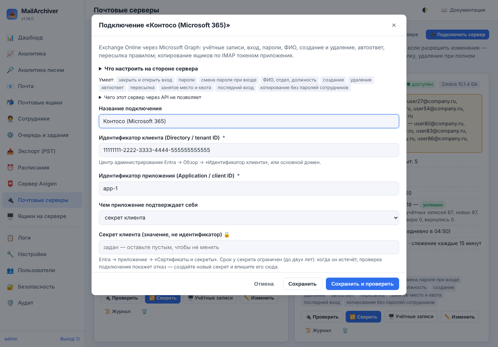
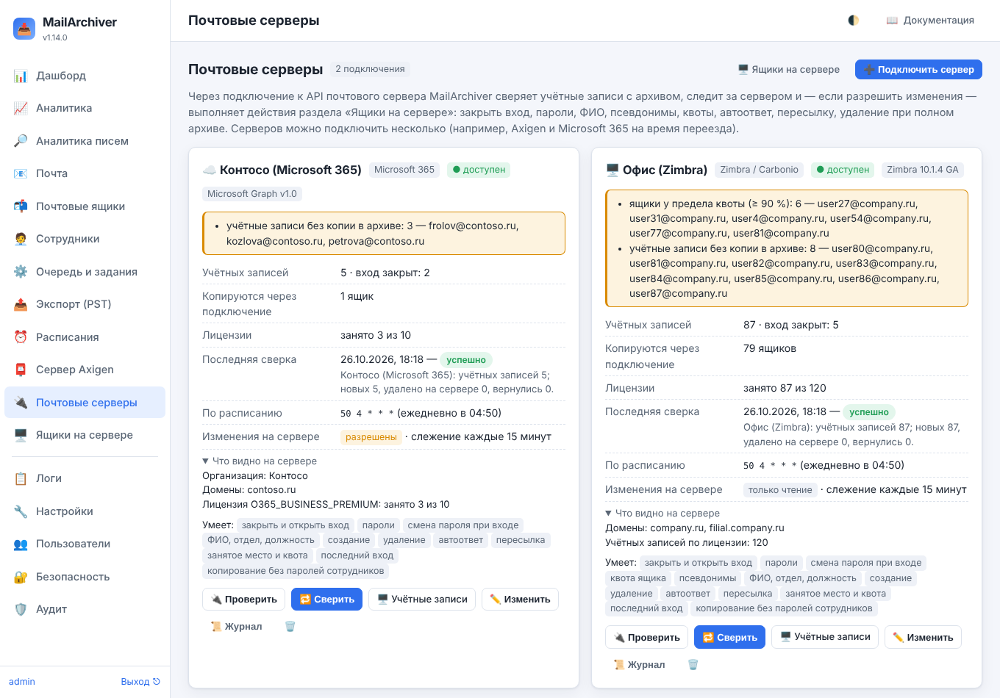

# 21. Почтовые серверы: Microsoft 365, Google Workspace, Яндекс 360 и другие

Раздел **«🔌 Почтовые серверы»** (виден только администратору) подключает MailArchiver к API почтового
сервера — так же, как раздел «Сервер Axigen» ([19-axigen.md](19-axigen.md)) подключает Axigen, но для других
серверов:

| Облачные | Свои серверы |
|---|---|
| Microsoft 365 (Exchange Online), Google Workspace, Яндекс 360 для бизнеса, VK WorkSpace | Zimbra и Carbonio, CommuniGate Pro, Kerio Connect, MDaemon, mailcow, Postfix + Dovecot |

Через подключение MailArchiver:

- **сверяет учётные записи** сервера с архивом: кто есть на сервере, у кого нет копии в архиве, кто удалён,
  у кого закрыт вход, сколько занято и какая квота, когда был последний вход;
- **копирует ящики без паролей сотрудников** — токеном приложения (Microsoft 365, Google, Яндекс 360) или
  входом администратора почты (Zimbra, mailcow, Dovecot…), если сервер это позволяет;
- **следит за сервером** каждые 15 минут: доступен ли, хватает ли лицензий, что сервер сам считает
  проблемой — и пишет администраторам о новых проблемах;
- если **разрешить изменения** — выполняет действия раздела «Ящики на сервере» ([20-server-bulk.md](20-server-bulk.md))
  с учётными записями этого сервера: закрыть и открыть вход, сменить пароли, потребовать смену пароля, квота,
  псевдонимы, ФИО и отдел, **автоответ** и **пересылка**, создание учётных записей списком, удаление при
  полном архиве и передача адреса уволенного коллеге.

Серверов можно подключить **несколько сразу** — например, Axigen и Microsoft 365 на время переезда: у каждого
своё подключение, а учётные записи всех серверов видны в одной таблице «Ящиков на сервере».

Каждый сервер умеет своё: что не позволяет его API, MailArchiver не делает и говорит об этом прямо — в форме
подключения («Чего этот сервер через API не позволяет»), в карточке подключения («Умеет: …») и в проверке
перед каждым действием (учётная запись пропускается с причиной). Что умеет каждый сервер — [21.9](#219-что-умеет-каждый-сервер).

## 21.1. Подключить сервер

1. **«🔌 Почтовые серверы» → «➕ Подключить сервер»** и выберите вид сервера.
2. Раскройте **«Что настроить на стороне сервера»** — там шаги для этого вида: какое приложение
   зарегистрировать или какого администратора завести и какие права ему дать ([21.10](#2110-настройка-на-стороне-сервера)).
3. Заполните поля: адрес сервера (для своих серверов), идентификаторы и секреты приложения или логин и
   пароль администратора. Секреты (🔒) хранятся зашифрованными и в интерфейсе не показываются — только
   «задан»; чтобы не менять, оставьте поле пустым. В «Дополнительно» — IMAP-сервер для копирования ящиков,
   проверка сертификата и прочее.
4. Отметьте, что нужно:
   - **Разрешить изменения на сервере** — без этого подключение только читает (сверка, отчёты, слежение);
   - **Сверять учётные записи по расписанию** (по умолчанию каждый день в 04:50);
   - **Новые учётные записи — сразу заводить ящики в архиве** (если сервер пускает в ящики без паролей);
   - **Следить за сервером** (каждые 15 минут).
5. **«Сохранить и проверить»**. Проверка показывает версию, организацию и домены, лицензии и то, чего не
   хватает (например, права на отчёты или на вход в ящики по IMAP).
6. На карточке подключения — **«🔁 Сверить»**: учётные записи появятся в «Ящиках на сервере».

**Самоподписанный сертификат** своего сервера: проверка покажет его отпечаток SHA-256 и кнопку
**«Доверять этому сертификату»** — сверьте отпечаток с сервером (`openssl x509 -noout -fingerprint -sha256 -in
cert.pem`) и нажмите, только если он совпал. После этого соединение принимается, только пока сертификат
тот же; выключать проверку сертификата не нужно.

**Без шифрования (http)** подключение работает только к этой же машине (127.0.0.1) или если в «Дополнительно»
явно отмечено «Разрешить без шифрования» — иначе пароль администратора или ключ API ушли бы по сети открытым
текстом.

Если поменять адрес сервера, идентификатор клиента, домен или организацию, IMAP-сервер, его порт или
шифрование, сохранённые секреты нужно ввести заново: MailArchiver не отправит их на новый адрес без
подтверждения.

## 21.2. Карточка подключения

| Что | Что показывает |
|---|---|
| Состояние | ● доступен / недоступен (по последней проверке), версия |
| Требует внимания | проблемы подключения ([21.7](#217-слежение-и-журнал)) |
| Учётных записей | по последней сверке; сколько с закрытым входом и сколько удалено на сервере |
| Копируются через подключение | сколько ящиков архива входят через это подключение |
| Лицензии | занято и всего (если сервер сообщает) |
| Последняя сверка | когда, итог и сводка: новые, удалённые на сервере, вернувшиеся |
| Умеет | что из действий «Ящиков на сервере» доступно для этого сервера |

Кнопки: **🔌 Проверить**, **🔁 Сверить**, **🖥️ Учётные записи** (открывает «Ящики на сервере» с отбором по этому
подключению), **✏️ Изменить**, **📜 Журнал** ([21.7](#217-слежение-и-журнал)) и удаление подключения. Удаление
подключения учётные записи на сервере не меняет; подключение, через которое копируются ящики архива, не
удаляется — сначала переведите эти ящики на другой способ входа.

## 21.3. Сверка

Сверка читает все учётные записи сервера (почтовые ящики; группы и списки рассылки — нет) и запоминает
снимок: адрес, псевдонимы, имя, отдел и должность, закрыт ли вход, квота и занятое место, последний вход,
автоответ и пересылка — что из этого сообщает сервер. Учётная запись, которой больше нет на сервере,
помечается **удалённой на сервере**, а её архив остаётся. Если сервер отдал список не полностью, пропавшие
удалёнными не считаются, а сверка отмечается «не всё прочитано». Пустой список — или вдвое короче прежнего,
если учётных записей было 10 и больше, — тоже считается неполным: скорее это сбой API, чем увольнение половины
компании. Если и следующая сверка вернёт столько же, пропавшие помечаются удалёнными.

Учётная запись связывается с ящиком архива:

1. ящик копируется **через это подключение** и его логин — адрес учётной записи;
2. иначе — логин совпадает с адресом, а сервер ящика — IMAP-сервер подключения;
3. иначе — просто логин совпадает с адресом (ящик заведён вручную).

Сначала — по основному адресу, потом — по псевдонимам. Архив уволенного остаётся за его (удалённой)
учётной записью, даже если его адрес потом передан коллеге.

Связь только по логину (3) — например, ящик со старого сервера после переезда в Microsoft 365 — годится, чтобы
видеть архив сотрудника, но не для удаления учётной записи и не для сохранения нового пароля в карточку
ящика: для них ящик должен копироваться с IMAP-сервера этого подключения.

Занятое место из сверки записывается в историю — как у Axigen, в таблице видно рост в месяц и прогноз до
квоты ([20.10](20-server-bulk.md#2010-место-на-сервере-во-времени)).

## 21.4. Копирование ящиков без паролей сотрудников

Ящик, который копируется **через подключение к почтовому серверу**, входит на сервер токеном приложения или
учётной записью администратора из подключения — пароль сотрудника не нужен и не хранится. Так можно:

- **«Завести ящики в архиве»** в «Ящиках на сервере» для учётных записей подключения (или отметка «Новые
  учётные записи — сразу заводить ящики в архиве» в подключении);
- в карточке ящика выбрать **«Способ входа → Через подключение к почтовому серверу»** и подключение — сервер,
  порт и шифрование подставятся из подключения;
- раздел «Сотрудники»: если сервер шаблона ящиков сотрудников — IMAP-сервер подключения, которое пускает в
  ящики без паролей, новые ящики сотрудников заводятся сразу с этим способом входа.

Токен или пароль администратора уходит **только на IMAP-сервер своего подключения** и **только с
шифрованием** (SSL/TLS или STARTTLS; без шифрования — лишь если в подключении отмечено «Разрешить без
шифрования» или сервер на этой же машине): у ящика с другим сервером вход через подключение не выполняется.
Сертификат IMAP-сервера проверяется по настройкам подключения, а не по общей настройке проверки сертификатов
IMAP: он должен быть доверенным — или, если IMAP-сервер тот же адрес, что и API, с тем же отпечатком SHA-256,
которому подключение доверяет.

Ящики не заводятся для служебных учётных записей (спам и карантин Zimbra), учётных записей без почтового
ящика (Google), без лицензии с почтой (Microsoft 365) и архивированных (Google).

Если подключений с IMAP-сервером шаблона ящиков сотрудников несколько (два клиента Microsoft 365), подключение
для нового ящика выбирается по адресу сотрудника — по последней сверке или по домену; не удалось — ящик
заводится со входом по паролю.

Для Microsoft 365 и Google ещё нужно разрешить приложению вход в ящики (IMAP.AccessAsApp и доступ к ящикам в
Exchange Online; делегирование на уровне домена с областью `https://mail.google.com/` в Google) — см.
[21.10](#2110-настройка-на-стороне-сервера).

## 21.5. Действия в «Ящиках на сервере»

Учётные записи подключений — в той же таблице «Ящиков на сервере», что и учётные записи Axigen; колонка
«Сервер» показывает вид и название подключения, а список **«Все серверы»** над таблицей — отбор по одному
серверу. Действия те же ([20-server-bulk.md](20-server-bulk.md)); для учётной записи подключения действие
выполняется, если:

- сервер это умеет (иначе — пропуск: «Microsoft 365: квота ящика — этот сервер так не умеет (или его API этого
  не позволяет)»);
- в подключении разрешены изменения (для чтения — сверки, «Перечитать», отчёта — не нужно).

После каждого изменения учётная запись перечитывается с сервера: если сервер показывает не то, что просили
(например, вход по-прежнему открыт), действие отмечается ошибкой.

Только у подключённых серверов есть два действия группы «Учётные записи»:

- **🏖️ Автоответ** — включить («Я больше не работаю в компании, пишите petrova@company.ru») с темой, текстом и
  необязательным периодом или выключить. Текст видят все, кто пишет на адрес, включая внешних отправителей.
- **↪️ Пересылка писем** — на один или несколько адресов, с копией в ящике или без; выключить. Без копии в
  ящике новые письма в архив не попадут. Пересылку на внешние адреса Microsoft 365 и Google могут запрещать
  политикой — тогда письма вернутся отправителю.

У Axigen эти два действия пропускаются с причиной (настраиваются в WebMail или WebAdmin), а действия только
Axigen (службы, тип учётной записи, показ в контактах домена, очистка через Axigen) — пропускаются для
подключённых серверов.

**Удаление учётной записи** — только при полном архиве, как у Axigen, но проверка — по IMAP:

1. вход на сервере уже закрыт («Заблокировать вход»), а ящик копируется **без пароля сотрудника** (через
   подключение или вход администратора почты) **с IMAP-сервера этого подключения** — иначе после закрытия
   входа сверить ящик с архивом нечем;
2. архив ставится на бессрочное удержание, ящик копируется ещё раз;
3. **каждое письмо каждой папки** на сервере сверяется с архивом (папка, UIDVALIDITY, UID, файл письма на
   диске); папка, исключённая из копирования, с письмами — тоже препятствие;
4. прямо перед удалением учётная запись перечитывается: вход должен быть всё ещё закрыт; папки проверяются
   ещё раз — почта приходит и при закрытом входе, и если с начала сверки пришли новые письма, учётная запись
   не удаляется (повторите удаление — будет снята ещё одна копия);
5. учётная запись удаляется, копирование ящика выключается, архив остаётся на удержании.

Хоть одного письма нет — учётная запись не удаляется, удержание снимается обратно. Если сервер ответил на
удаление ошибкой (например, 504 — запрос мог выполниться), учётная запись перечитывается: её нет — удаление
засчитывается; ответа нет — архив остаётся на бессрочном удержании, а действие отмечается ошибкой
«результат неизвестен». Письмо, пришедшее в последние секунды между повторной проверкой и удалением, в
архив не попадёт: если это важно, остановите доставку почты в ящик на сервере перед удалением.

**Передать адрес коллеге** можно там же или потом отдельным действием — если сервер умеет псевдонимы (у
Microsoft 365 через API — нет); отдельным действием — только когда учётной записи на сервере уже нет (это
проверяется прямо перед передачей).

Если действие сделало только часть (вход закрыт, а случайный пароль сервер не принял; удалена часть
псевдонимов), учётная запись отмечается ошибкой с перечнем сделанного, а сделанное записывается в аудит.

**Создание учётных записей списком** — «➕ Создать учётные записи списком» и **«Где создать»**: Axigen или
подключение, которое это умеет. Пароли — случайные файлом для раздачи или один общий (правила пароля —
сервера: проверка покажет, если пароль не подходит), квота и смена пароля при первом входе — если сервер их
задаёт, ящики в архиве — сразу, через подключение. Microsoft 365: новому пользователю выдаётся лицензия из
настройки подключения «Лицензия новым пользователям».

**Отчёт** для учётной записи без ящика в архиве (или без входа по IMAP) берёт занятое место и квоту из API
сервера, если сервер их сообщает.

## 21.6. Требования к паролям

У каждого сервера свои правила; MailArchiver проверяет общий пароль до запуска, а случайные создаёт так,
чтобы их принял любой сервер: 20 знаков — заглавные и строчные буквы, цифры и знак. Правило сервера видно в
подсказке поля «Пароль» при создании учётных записей и в описании вида сервера.

## 21.7. Слежение и журнал

**Требует внимания** (карточка подключения, дашборд, `/metrics`, еженедельная сводка, письмо администраторам
не чаще раза в сутки на каждую проблему):

| Проблема | Когда |
|---|---|
| сервер недоступен | две проверки подряд без ответа |
| сервер сообщает | что сервер сам считает проблемой: подписка приостановлена, лицензий не хватает, очередь… |
| сверка прочитала не всё | последняя сверка неполная (подробности — в её задании) |
| сертификат не проверяется | проверка сертификата выключена и отпечаток не сохранён |
| у предела квоты | занято 90 % и больше |
| упрутся в квоту за 30 дней | при нынешнем росте |
| без копии в архиве | учётные записи, у которых нет ящика в архиве |
| удалены на сервере, а копирование включено | выключите копирование — архив сохранится |
| вход закрыт, а ящик копируется по паролю сотрудника | копирование не пройдёт — переведите ящик на копирование через подключение |
| уволены, а вход открыт | сотрудник уволен в «Сотрудниках», а вход на сервере открыт |

Метрики: `mailarchiver_mailserver_up`, `mailarchiver_mailserver_licenses`, `mailarchiver_mailserver_accounts`,
`mailarchiver_mailserver_problems` с метками `server` и `type` ([14-monitoring.md](14-monitoring.md)).

**📜 Журнал** подключения — каждое обращение к API: кто, когда, что делал, сколько вызовов и с каким итогом;
по щелчку — запросы и ответы сервера. Пароли, секреты, ключи и токены в журнал не попадают (вместо них —
«••••»). По умолчанию показаны действия людей и сверки; проверки и слежение — отбором «Всё».

## 21.8. Безопасность

- Секреты подключений (секрет приложения, закрытый ключ, пароль администратора, ключ API) хранятся
  зашифрованными тем же ключом, что пароли ящиков (`secret.key`), и не отдаются интерфейсу.
- Изменения на сервере — только если они разрешены в подключении, только администратором и только после
  проверки; каждое изменение — в аудите и в журнале подключения.
- Удаление с сервера — только при полном архиве ([21.5](#215-действия-в-ящиках-на-сервере)).
- Запросы, которые меняют сервер (создание, удаление, изменения), при ответе 502/503/504 не повторяются
  сами: сервер мог их уже выполнить. Повторяются только чтение и ответ «слишком много запросов» (429).
- Пароль администратора и токены уходят на IMAP-сервер подключения только с шифрованием и проверкой
  сертификата по настройкам подключения ([21.4](#214-копирование-ящиков-без-паролей-сотрудников)).
- Права приложения или администратора на сервере выдавайте минимальные: только чтение — для сверки и
  слежения; изменения — только если они нужны ([21.10](#2110-настройка-на-стороне-сервера)).
- Токены доступа хранятся только в памяти службы и только до истечения.

## 21.9. Что умеет каждый сервер

| Сервер | Вход | Пароли | Квота | Псевдонимы | ФИО, отдел | Создание, удаление | Автоответ, пересылка | Место, вход | Без паролей |
|---|---|---|---|---|---|---|---|---|---|
| **Microsoft 365** | ✓ | ✓ | — | — | ✓ | ✓ | ✓ | ✓ | ✓ |
| **Google Workspace** | ✓ | ✓ | — | ✓ | ✓ | ✓ | ✓ | ✓ | ✓ |
| **Яндекс 360 для бизнеса** | ✓ | ✓ | — | ✓ | ✓ | только создание | ✓ | — | ✓ |
| **VK WorkSpace** | ✓ | только пароль | — | ✓ | ✓ | только создание | — | — | — |
| **Zimbra / Carbonio** | ✓ | ✓ | ✓ | ✓ | ✓ | ✓ | ✓ | ✓ | ✓ |
| **CommuniGate Pro** | ✓ | только пароль | ✓ | ✓ | ✓ | ✓ | ✓ | ✓ | ✓ |
| **Kerio Connect** | ✓ | только пароль | ✓ | ✓ | ✓ | ✓ | только пересылка | ✓ | ✓ |
| **MDaemon** | — | — | ✓ | — | — | только создание | ✓ | — | — |
| **mailcow** | ✓ | ✓ | ✓ | ✓ | ✓ | ✓ | ✓ | ✓ | ✓ |
| **Postfix + Dovecot** | — | — | — | — | — | — | ✓ | только место | ✓ |

✓ — умеет; «—» — API сервера этого не позволяет (или сервер этого не сообщает). Сверка учётных записей и слежение есть у всех. Чего ещё не позволяет каждый сервер — ниже, в [21.10](#2110-настройка-на-стороне-сервера).

## 21.10. Настройка на стороне сервера

### Microsoft 365

Exchange Online через Microsoft Graph: учётные записи, вход, пароли, ФИО, создание и удаление, автоответ, пересылка правилом; копирование ящиков по IMAP токеном приложения.

**Что настроить:**

1. Центр администрирования Entra → «Регистрация приложений» → «Новая регистрация» (одна организация). Запишите идентификаторы приложения и клиента.
2. «Сертификаты и секреты»: создайте секрет клиента или загрузите сертификат.
3. «Разрешения API» → Microsoft Graph → «Разрешения приложений»: User.ReadWrite.All, Organization.Read.All, LicenseAssignment.ReadWrite.All, MailboxSettings.ReadWrite, Reports.Read.All, AuditLog.Read.All (только чтение — User.Read.All вместо User.ReadWrite.All). «API, используемые организацией» → Office 365 Exchange Online → IMAP.AccessAsApp. Нажмите «Предоставить согласие администратора».
4. Для смены паролей: «Роли и администраторы» → «Администратор пользователей» → назначьте приложению.
5. Exchange Online PowerShell: New-ServicePrincipal -AppId <приложение> -ObjectId <объект корпоративного приложения>, затем Add-MailboxPermission <ящик> -User <субъект> -AccessRights FullAccess — для каждого ящика, который нужно копировать (и для новых).

**Поля подключения:** «Идентификатор клиента (Directory / tenant ID)», «Идентификатор приложения (Application / client ID)».

**Пароль:** от 8 до 256 знаков, три вида из четырёх: заглавные, строчные, цифры, знаки.

**Ограничения:**

- Псевдонимы и квоту ящика Microsoft Graph не меняет — только центр администрирования или PowerShell.
- Пересылка — правилом папки «Входящие»; на внешние адреса её может запрещать политика защиты от спама (письма вернутся с ошибкой 5.7.520).
- Занятое место — из отчёта Microsoft 365: отстаёт на 1–3 дня; если в отчётах скрыты имена пользователей, место не сопоставить.
- Удалённый пользователь 30 дней лежит в «Удалённых пользователях», затем удаляется с ящиком навсегда.

### Google Workspace

Gmail через Admin SDK и Gmail API сервисным аккаунтом с делегированием домена: учётные записи, вход, пароли, псевдонимы, ФИО, создание и удаление, автоответ, пересылка; копирование ящиков по IMAP токеном сервисного аккаунта.

**Что настроить:**

1. Google Cloud console → создайте (или выберите) проект → «API и сервисы» → «Включить API»: Admin SDK API и Gmail API.
2. IAM и администрирование → «Сервисные аккаунты» → «Создать сервисный аккаунт» (роли в проекте не нужны). В нём: «Ключи» → «Добавить ключ» → «Создать ключ» → JSON; содержимое файла вставьте в поле «Ключ сервисного аккаунта». Запишите уникальный идентификатор аккаунта (Client ID — число).
3. Консоль администратора Google (admin.google.com, суперадминистратор) → Безопасность → Доступ к данным и управление ими → Управление API → «Делегирование домена» → «Добавить» → Client ID и области через запятую: https://www.googleapis.com/auth/admin.directory.user,https://www.googleapis.com/auth/admin.directory.customer.readonly,https://www.googleapis.com/auth/admin.reports.usage.readonly,https://www.googleapis.com/auth/gmail.settings.basic,https://www.googleapis.com/auth/gmail.settings.sharing,https://mail.google.com/. Только чтение (без изменений на сервере): https://www.googleapis.com/auth/admin.directory.user.readonly,https://www.googleapis.com/auth/admin.directory.customer.readonly,https://www.googleapis.com/auth/admin.reports.usage.readonly,https://mail.google.com/. Изменения применяются до 24 часов.
4. Укажите адрес администратора, от имени которого работать: суперадминистратор или администратор с правами на управление пользователями и на отчёты.
5. Консоль администратора → Приложения → Google Workspace → Gmail → Доступ для конечных пользователей: разрешите доступ по IMAP (для копирования ящиков), а для «Пересылки писем» — автоматическую пересылку.

**Поля подключения:** «Ключ сервисного аккаунта (файл JSON целиком)», «Адрес администратора Google Workspace».

**Пароль:** от 8 до 100 знаков: латинские буквы, цифры и знаки, без пробелов (политика паролей организации может требовать больше).

**Ограничения:**

- Квоту ящика API Google не задаёт: место общее для Gmail, Диска и Google Фото, предел задаётся в консоли администратора по подразделениям. В сверке «занято» — только почта; общий объём и предел хранилища — в сведениях учётной записи.
- Занятое место — из отчётов Google (Reports API): данные отстают на 1–3 дня, иногда до 5.
- Пересылка — только на один адрес (так устроена автопересылка Gmail). Адрес вне доменов организации нужно подтвердить: Gmail пришлёт его владельцу письмо со ссылкой, и пока её не нажмут, пересылка не включится — действие завершится ошибкой с этой причиной, после подтверждения повторите его. Автопересылку может запрещать и политика Gmail в консоли администратора.
- Закрытый вход — приостановка пользователя (suspended): новые письма Google такому пользователю не доставляет. Учётная запись в архиве (лицензия Archived User) тоже показывается с закрытым входом: войти в неё нельзя, а открыть вход можно, только вернув её из архива в консоли администратора.
- Пускает ли Google по IMAP в ящик приостановленного пользователя, в документации не сказано. Если не пускает, MailArchiver не удалит учётную запись: после закрытия входа ящик не сверить с архивом. Тогда сверьте архив сами и удалите пользователя в консоли администратора.
- Удалённого пользователя 20 дней может восстановить суперадминистратор в консоли администратора, затем его почта и Диск удаляются навсегда — перенесите данные Диска коллеге заранее.
- Псевдонимы — только в доменах организации, не больше 30 у учётной записи; новый адрес начинает получать почту в течение 24 часов. Адрес удалённого пользователя Google может принять псевдонимом не сразу — тогда повторите «Передать адрес коллеге» позже.
- Имя и фамилия при создании учётной записи обязательны (так требует Google).
- Смена пароля при следующем входе не действует, если вход идёт через внешнего поставщика (SSO).
- Число лицензий (занято / всего) не показывается: API Google отдаёт только назначенные лицензии.

### Яндекс 360 для бизнеса

API 360: сотрудники, вход, пароли, ФИО, должность и подразделение, псевдонимы, создание, автоответ и пересылка; копирование ящиков по IMAP токеном сервисного приложения.

**Что настроить:**

1. Администратором организации откройте oauth.yandex.ru/client/new: платформа «Веб-сервисы», Redirect URI — «Подставить URL для отладки», права: directory:read_organization, directory:read_users, directory:write_users, directory:read_departments, directory:read_domains, ya360_admin:mail_read_user_settings, ya360_admin:mail_write_user_settings, ya360_admin:mail_read_organization_settings, ya360_security:domain_sessions_write. Только сверка — без прав write.
2. Получите токен: откройте https://oauth.yandex.ru/authorize?response_type=token&client_id=<ClientID этого приложения>, войдите администратором и скопируйте токен в «OAuth-токен администратора». Изменили права приложения — получите новый токен.
3. Для копирования ящиков без паролей (тариф «Основной», «Продвинутый» или «Корпоративный»): создайте на oauth.yandex.ru ещё одно приложение с правом mail:imap_full, запишите его ClientID и Client secret.
4. Владелец организации уведомляет сотрудников (п. 3.6 оферты), получает свой токен с правом ya360_security:service_applications_write и включает сервисные приложения: POST https://api360.yandex.net/security/v1/org/<orgId>/service_applications/activate.
5. Затем регистрирует приложение: POST https://api360.yandex.net/security/v1/org/<orgId>/service_applications с телом {"applications": [{"id": "<ClientID>", "scopes": ["mail:imap_full"]}]}. Запрос заменяет весь список — перечислите в нём и уже зарегистрированные приложения (их видно запросом GET по тому же адресу).
6. Доступ по IMAP должен быть разрешён: настройка почты организации «IMAP» (действует на новых сотрудников), а у сотрудников, которым его выключали, — в их настройках Почты («Почтовые программы»).

**Поля подключения:** «Идентификатор организации (orgId)», «OAuth-токен администратора организации».

**Пароль:** не короче 8 знаков: латинские буквы, цифры и символы (все три вида), без пробелов.

**Ограничения:**

- Квоту ящика, занятое место и последний вход API 360 не показывает и не задаёт — в сверке их нет.
- Удалить сотрудника API 360 не позволяет (метода в документации нет) — удаляйте в консоли admin.yandex.ru. Письма и Диск удалённого сотрудника восстановить нельзя: сначала убедитесь, что ящик полностью в архиве.
- Автоответ — только текст: тему и период действия API не задаёт (тема ставится первой строкой текста). Включение заменяет все правила автоответа ящика, выключение — удаляет их.
- Пересылка — только на адреса доменов организации (ограничение API 360). Включение заменяет все правила пересылки ящика, выключение — удаляет их. После закрытия входа пересылка продолжает работать.
- Учётные записи создаются только в основном домене организации, имя и фамилия обязательны. Требуется ли смена пароля при входе, API только задаёт — прочитать нельзя.
- Псевдонимы — только в домене учётной записи, у ящика их не больше 10.
- Копирование без паролей — токеном сервисного приложения: только на тарифах «Основной», «Продвинутый» и «Корпоративный»; владелец организации обязан уведомить сотрудников (п. 3.6 оферты). Пока ClientID и Client secret приложения не заданы, ящики в архив через подключение не заводятся.
- Служебные учётные записи (роботы), уволенные сотрудники и общие ящики в сверку не попадают.
- Действия выполняются только по основному адресу сотрудника: адрес, который стал псевдонимом другого сотрудника (например, передан коллеге после удаления в консоли), считается отсутствующим — изменения не уйдут коллеге, а «Перечитать» пометит учётную запись удалённой.

### VK WorkSpace

API biz.mail.ru (OAuth o2.mail.ru): учётные записи домена, вход, пароли, имя и фамилия, псевдонимы, создание; ящики копируются по IMAP с паролями приложений сотрудников.

**Что настроить:**

1. Напишите в службу поддержки VK WorkSpace: зарегистрировать клиента API biz.mail.ru для вашего домена. Получите client_id, client_secret и согласуйте адрес возврата (redirect_uri).
2. Администратор домена открывает в браузере https://o2.mail.ru/login?client_id=<client_id>&response_type=code&scope=biz.api&redirect_uri=<адрес возврата>&state=<любая строка> и разрешает доступ. Из адреса, на который его вернёт, возьмите code — он действует 5 минут.
3. Обменяйте код на токены: curl -u <client_id>:<client_secret> -d grant_type=authorization_code -d code=<code> -d redirect_uri=<адрес возврата> https://o2.mail.ru/token. В подключение вставьте client_id и refresh_token из ответа.
4. Ящики в архив заводятся вручную («Почтовые ящики»): сервер imap.mail.ru, порт 993, SSL, логин — адрес, пароль — пароль приложения сотрудника. Пароли приложений администратор раздаёт массово (панель администратора → «Пользователи» → CSV), или сотрудник создаёт сам: «Безопасность» → «Пароли для внешних приложений», полный доступ к почте.

**Поля подключения:** «Почтовый домен», «Идентификатор клиента API (client_id)», «Refresh token».

**Пароль:** от 6 до 40 знаков латиницей, хотя бы один спецсимвол, не только цифры; без имени, логина, телефона и названия домена.

**Ограничения:**

- Войти в ящик без пароля сотрудника API VK WorkSpace не позволяет («войти как пользователь» есть только в веб-панели администратора): ящики копируются по IMAP (imap.mail.ru, 993, SSL) с паролем приложения каждого сотрудника — заведите их в «Почтовых ящиках».
- Поэтому удалить учётную запись через MailArchiver нельзя: удаляет он только после сверки всего ящика с архивом по IMAP без пароля сотрудника, а такого входа нет. Удаляйте в панели администратора (30 дней учётную запись можно восстановить); после сверки она будет помечена удалённой, и её адрес можно передать коллеге («Передать адрес коллеге»).
- Квоту, занятое место, последний вход, автоответ и пересылку API не показывает и не задаёт.
- Требовать смену пароля при входе, задавать отдел, должность и отображаемое имя API не умеет; имя и фамилия меняются только вместе.
- Закрыть вход: «мягкая» блокировка — вход запрещён, письма продолжают приходить; если письма принимать не нужно — полная блокировка.
- Псевдонимов у учётной записи — не больше 5, только в её домене.
- Сервер принимает не больше 200 запросов в минуту: в больших доменах сверка с псевдонимами идёт дольше.

### Zimbra / Carbonio

SOAP API администратора Zimbra и Carbonio: учётные записи, вход, пароли, квота, псевдонимы, ФИО, создание и удаление, автоответ, пересылка; копирование ящиков по IMAP входом администратора «от имени» ящика.

**Что настроить:**

1. Заведите администратора для MailArchiver. Глобальный: zmprov ma backup-admin@example.ru zimbraIsAdminAccount TRUE. Делегированный (меньше прав): zmprov ma backup-admin@example.ru zimbraIsDelegatedAdminAccount TRUE и на каждый домен — zmprov grr domain example.ru usr backup-admin@example.ru domainAdminRights; домены перечислите в «Домены».
2. Для копирования ящиков без паролей сотрудников делегированному администратору нужно право adminLoginAs («View Mail»): zmprov grr domain example.ru usr backup-admin@example.ru adminLoginAs. У глобального администратора оно есть.
3. Откройте порт 7071 (HTTPS, SOAP администратора) только для сервера MailArchiver. В Carbonio это внутренний порт хранилища — давайте доступ через доверенную сеть или VPN.
4. IMAP: порт 993 (IMAPS) должен быть доступен, у учётных записей — включён IMAP (zimbraImapEnabled и zimbraPrefImapEnabled). Вход без шифрования (zimbraImapCleartextLoginEnabled) не включайте.
5. Самоподписанный сертификат: «Проверить подключение» покажет его отпечаток — нажмите «Доверять этому сертификату».
6. Чтобы последний вход был точнее: zmprov mcf zimbraLastLogonTimestampFrequency 1d.

**Поля подключения:** «Адрес сервера Zimbra / Carbonio», «Администратор», «Пароль администратора».

**Пароль:** от 8 до 64 знаков без пробелов; класс обслуживания (COS) может требовать заглавные буквы, цифры и знаки.

**Ограничения:**

- «Заблокировать вход» ставит статус locked: вход закрыт, письма принимаются. Статус closed (письма отклоняются, адрес исключается из всех списков рассылки) MailArchiver не ставит — если приём нужно остановить, закройте учётную запись в консоли администратора.
- Последний вход Zimbra записывает не чаще раза в 7 дней (zimbraLastLogonTimestampFrequency) — это примерная дата; при частоте 0 её нет вовсе.
- Число писем в ящике SOAP администратора не отдаёт — в сверке только занятое место и квота.
- Отдел записывается в атрибут ou (подразделение): атрибута department в схеме Zimbra нет.
- Темы у автоответа Zimbra нет — она ставится первой строкой текста; даты автоответа — по UTC. Ответ один для всех отправителей (отдельный текст для внешних выключается).
- Удаление необратимо: учётная запись удаляется вместе с ящиком (вернуть — только из резервной копии сервера).
- Перед удалением архив сверяется с ящиком по IMAP уже после закрытия входа: проверьте на своей версии, что вход администратора «от имени» в ящик со статусом locked проходит («Проверить вход» в карточке ящика). Если нет — удаление остановится, ничего не удалив.
- Лицензия читается только у Zimbra Network Edition; у Carbonio и Zimbra FOSS её нет.

### CommuniGate Pro

CLI (PWD): учётные записи, вход (службы AccessModes), пароли, квота, псевдонимы, ФИО, создание и удаление, автоответ и пересылка правилами; копирование ящиков по IMAP входом администратора «от имени» ящика (CanImpersonate).

**Что настроить:**

1. Заведите администратора для MailArchiver (или используйте postmaster): права администратора сервера или доменов (CanCreateAccounts, CanCreateAliases, управление правилами), для копирования ящиков без паролей — право CanImpersonate: SETACCOUNTRIGHTS backup-admin@example.ru (CanImpersonate, …) — сначала прочитайте прежние права GETACCOUNTRIGHTS, SET их заменяет.
2. Шифрование: в WebAdmin → Settings → Services → PWD добавьте приёмник (Listener) на отдельном порту с «Init SSL/TLS» и сертификатом домена — его порт укажите в подключении. Без TLS (порт 106) — только в доверенной сети: выберите «без шифрования» и включите «Разрешить без шифрования»; вход тогда — только по APOP (пароль администратора на сервере хранится открыто, не U-crpt).
3. Разрешите вход в CLI с адреса MailArchiver: ограничения адресов приёмника PWD и список Client IP Addresses.
4. IMAP: порт 993 (IMAPS) должен быть доступен, у учётных записей включена служба IMAP; вход без шифрования не включайте.
5. Самоподписанный сертификат: «Проверить подключение» покажет его отпечаток — нажмите «Доверять этому сертификату».

**Поля подключения:** «Адрес сервера CommuniGate Pro», «Администратор», «Пароль администратора».

**Пароль:** от 8 до 64 знаков без пробелов.

**Ограничения:**

- «Требовать смену пароля при входе» не поддерживается: ключ этой настройки в документации CLI не назван.
- Закрыть вход — выключить службы входа (AccessModes): остаётся только Mail (письма принимаются) или ничего (письма ждут в очереди, затем отклоняются). Открыть вход — вернуть службы по умолчанию для домена; если у учётной записи был свой набор служб, он показан в итоге действия при закрытии.
- Перед удалением архив сверяется с ящиком по IMAP после закрытия входа, а вход администратора «от имени» (CanImpersonate) по документации требует включённой у ящика службы IMAP. Если сервер не пустит — удаление остановится на последней копии, ничего не удалив.
- Телефоны не записываются: имена их настроек зависят от интеграции с каталогом (Directory Integration).
- Число писем в ящике CLI не отдаёт — в сверке только занятое место (StorageUsed) и квота (MaxAccountSize).
- Лицензии и очередь писем по CLI не читаются (команды для них не документированы) — в мониторинге только версия, домены и число учётных записей.
- Автоответ и пересылка — правила «#Vacation» и «#Redirect» (как в веб-интерфейсе); даты автоответа — по времени сервера. Пересылка — действие «Mirror to», без копии — ещё «Discard».
- Псевдоним — только в домене самой учётной записи.
- Без шифрования (CLI на другой машине) администратор входит только по APOP: пароль администратора должен храниться на сервере открыто (не U-crpt), а приветствие — содержать метку APOP; иначе подключайтесь по TLS. Паролем открытым текстом (USER/PASS) MailArchiver входит только по TLS или на эту же машину.
- Удаление необратимо: учётная запись удаляется вместе с ящиком.

### Kerio Connect

API администрирования Kerio Connect (JSON-RPC): учётные записи всех доменов, место и квота, последний вход, закрытие входа, пароли, квота, псевдонимы, ФИО и отдел, создание и удаление, пересылка; ящики копируются по IMAP мастер-паролем (Master Authentication) или с паролями сотрудников.

**Что настроить:**

1. Webadmin Kerio Connect (https://сервер:4040/admin) → Configuration → Administration Settings: включите «Allow administration from remote host» и ограничьте его группой IP-адресов, в которой есть адрес MailArchiver; откройте порт 4040 (HTTPS) в межсетевом экране.
2. Accounts → Users: заведите для MailArchiver отдельную учётную запись (не личную) с обычным надёжным паролем. Вкладка Rights: «Whole server read/write» — для изменений, «Whole server read only» — только для сверки; для одного домена хватит прав администратора домена.
3. Если сертификат сервера самоподписанный — «Проверить подключение» покажет его отпечаток SHA-256: сверьте его с Webadmin (Configuration → SSL Certificates) и нажмите «Доверять этому сертификату».
4. Configuration → Services: служба IMAPS (993) должна работать — по ней копируются ящики.
5. Чтобы копировать ящики без паролей сотрудников: Configuration → Advanced Options → Master Authentication — включите, задайте мастер-пароль и разрешите вход только группе IP-адресов с адресом MailArchiver; впишите мастер-пароль в подключение.
6. Если сеансы обрываются на долгой сверке — Configuration → Advanced Options → Kerio Connect Client → Session security: увеличьте «Maximum session duration» (MailArchiver входит заново сам, но не больше раза на вызов).

**Поля подключения:** «Адрес сервера Kerio Connect», «Учётная запись администратора», «Пароль администратора».

**Пароль:** от 8 до 64 знаков, без пробелов; если в домене включена политика сложности паролей — ещё и по её правилам.

**Ограничения:**

- Автоответ («нет на месте») API администрирования Kerio не задаёт: его включает сам сотрудник в Kerio Connect Client, а сразу для всех — правило фильтра сообщений в Webadmin.
- Потребовать смену пароля при следующем входе Kerio через API не умеет — такого признака у учётной записи нет.
- Ящики копируются без паролей сотрудников мастер-паролем (Master Authentication, команды IMAP X-MASTERAUTH и X-SETUSER) — только с адресов из группы IP, заданной в Kerio. Без мастер-пароля — с паролями сотрудников, и тогда удалить учётную запись из раздела «Ящики на сервере» нельзя: перед удалением ящик сверяется с архивом по IMAP, а после закрытия входа пароль сотрудника не пускает.
- Закрытый вход (выключенная учётная запись) мастер-паролем, скорее всего, тоже не открыть — проверьте на своём сервере: если последняя копия перед удалением не удаётся, учётная запись не удаляется.
- «Закрыть вход» выключает учётную запись целиком: по документации Kerio выключенная учётная запись не принимает и новые письма.
- Отдел, должность, телефоны и организация хранятся в личном контакте пользователя; офис (почтовый адрес) MailArchiver не задаёт.
- Число писем API администрирования не отдаёт: у учётной записи есть только число всех элементов (письма, контакты, события, задачи) — оно показано в карточке учётной записи, а в сверке и отчёте писем нет.
- У учётных записей из службы каталогов (Active Directory, LDAP) пароль проверяет каталог — MailArchiver его не меняет и такие учётные записи не удаляет (это делается в каталоге).
- Удаление учётной записи удаляет и её папку с письмами на сервере — восстановить её нельзя (письма остаются в архиве).
- Псевдонимы — дополнительные адреса самой учётной записи; псевдонимы домена (Aliases), ведущие на неё, MailArchiver не показывает и не меняет.

### MDaemon

XML API MDaemon: учётные записи всех доменов (квота, число писем, псевдонимы), квота, создание, автоответ и пересылка; ящики копируются по IMAP с паролями сотрудников.

**Что настроить:**

1. MDaemon Remote Administration → Setup → Web & IM Services → Remote Administration: включите веб-сервер удалённого администрирования, лучше «HTTPS only» (порт 444), — или запустите XML API на сайте Webmail в IIS (обработчик MDMgmtws.dll, путь /MdMgmtWS).
2. Setup → XML API Management → Address Restrictions: разрешите адрес MailArchiver (с версии 24.0 XML API отказывает всем адресам, которые не разрешены явно).
3. Учётная запись для MailArchiver: Account Editor → Administrative Roles → «Account is a global administrator» (или администратор домена — тогда видны только его домены); обычный надёжный пароль, не пароль приложения.
4. Если сертификат самоподписанный — «Проверить подключение» покажет его отпечаток SHA-256: сверьте его и нажмите «Доверять этому сертификату».
5. IMAP (IMAPS, порт 993) должен быть включён — по нему ящики копируются с паролями сотрудников.

**Поля подключения:** «Адрес XML API MDaemon», «Учётная запись администратора», «Пароль администратора».

**Пароль:** от 8 до 64 знаков, без пробелов; если в MDaemon включены надёжные пароли — ещё заглавные, строчные и цифры, без имени ящика.

**Ограничения:**

- Закрыть вход, сменить пароль, ФИО или псевдонимы и удалить учётную запись XML API умеет, но нужные элементы не описаны публично (только в справочнике MD-API.html из поставки сервера) — MailArchiver этого пока не делает: используйте MDaemon Remote Administration.
- Копирования без паролей сотрудников у MDaemon нет: мастер-пароля IMAP нет, а вход глобального администратора в чужие ящики не описан. Ящики копируются с паролями сотрудников.
- Последний вход и занятое место XML API не показывает (видны квота и число писем) — при смене квоты проверка «занято больше новой квоты» не выполняется.
- Лицензии и очередь писем XML API публично не описывает — в состоянии сервера только версия и домены.
- Тему автоответа XML API не задаёт — у ответа будет тема, которую ставит сервер.
- Требование сменить пароль при первом входе XML API публично не описывает — новые учётные записи создаются без него.

### mailcow

mailcow через REST API: ящики, вход (с приёмом писем и без), пароли, квота, псевдонимы, полное имя, создание и удаление, автоответ и пересылка фильтром Sieve; копирование ящиков по IMAP мастер-пользователем Dovecot.

**Что настроить:**

1. mailcow → Система → Настройки → Доступ → «Изменить данные администратора» → API: включите ключ «чтение и запись» (для одной сверки хватит «только чтение»), в «Разрешённые IP» укажите адрес MailArchiver. Скопируйте ключ в подключение.
2. Для копирования ящиков без паролей задайте постоянного мастер-пользователя Dovecot: в mailcow.conf — DOVECOT_MASTER_USER=archmaster и DOVECOT_MASTER_PASS=<пароль без спецзнаков>, затем docker compose up -d. В подключении — имя archmaster (без @mailcow.local) и этот пароль.
3. IMAP-сервер для копирования — адрес mailcow, порт 993 (SSL) или 143 (STARTTLS); если IMAP открыт на другом адресе, укажите его в «Дополнительно».

**Поля подключения:** «Адрес mailcow», «Ключ API».

**Пароль:** от 8 до 64 знаков без пробелов (и требования политики паролей mailcow).

**Ограничения:**

- Закрыть вход с приёмом писем — состояние ящика «вход запрещён, письма принимаются» (active = 2); без приёма — ящик выключается (active = 0). В выключенный ящик mailcow не пускает и мастер-пользователя: последняя копия и сверка с архивом перед удалением не пройдут, пока вход не закроют с приёмом писем.
- Пароль меняется только у ящиков, которые входят паролем mailcow (не LDAP, Keycloak или OIDC).
- ФИО в mailcow — одно поле «Полное имя»: MailArchiver пишет туда «Имя Фамилия», а при сверке делит его по первому пробелу. Отдел, должность и телефон mailcow не хранит.
- Псевдоним ящика — объект mailcow, который ведёт только в этот ящик. Псевдонимы на несколько ящиков, общие (catch-all) и адреса доменов-псевдонимов в его псевдонимах не показываются.
- Автоответ и пересылка — фильтром «MailArchiver: автоответ и пересылка» (prefilter, выполняется до личных фильтров пользователя из SOGo). Включённым mailcow держит только один prefilter на ящик: если у ящика уже включён другой, MailArchiver его не выключает и действие не выполняет.
- Удалённый ящик ещё несколько дней (MAILDIR_GC_TIME, обычно 5 суток) лежит на сервере в /var/vmail/_garbage; восстановить его через API нельзя. Псевдонимы, которые вели только в него, удаляются вместе с ним; если убрать их не удалось, удаление всё равно засчитывается, а что осталось — в итоге действия.
- Пароль мастер-пользователя Dovecot API mailcow не отдаёт: нужен постоянный мастер-пользователь из mailcow.conf (по умолчанию mailcow создаёт случайного при каждом перезапуске контейнера dovecot).
- Запросы с неверным ключом API netfilter-mailcow считает подбором и блокирует адрес MailArchiver.

### Postfix + Dovecot

Свой сервер Postfix + Dovecot (и iRedMail, PostfixAdmin) через doveadm HTTP API: список ящиков, занятое место и квота, автоответ и пересылка сценарием Sieve; копирование ящиков по IMAP мастер-пользователем Dovecot.

**Что настроить:**

1. Включите doveadm HTTP API: в настройках Dovecot (например, conf.d/10-doveadm.conf) задайте doveadm_api_key = <длинный случайный ключ> (или doveadm_password) и в service doveadm добавьте inet_listener http { port = 8080 } (ssl = yes — для https). Перезапустите Dovecot.
2. Разрешите доступ к этому порту только с адреса MailArchiver (межсетевой экран).
3. Мастер-пользователь для копирования ящиков: passdb с master = yes и result_success = continue (Dovecot 2.3: passdb { driver = passwd-file; args = /etc/dovecot/master-users; master = yes; result_success = continue }), в файле — строка «archmaster:{SHA512-CRYPT}…» (doveadm pw -s SHA512-CRYPT). Для входа «ящик*мастер» — ещё auth_master_user_separator = *.
4. Если включён модуль acl, дайте мастер-пользователю доступ ко всем папкам: plugin { acl_user = %u } (или master_user = %u).
5. iRedMail: мастер-пользователи уже включены (/etc/dovecot/dovecot-master-users); имя укажите с несуществующим доменом, например archmaster@not-exist.com.
6. Для квоты в сверке — модуль quota в mail_plugins; для автоответа и пересылки — Pigeonhole (sieve в mail_plugins для lda/lmtp) с хранилищем сценариев file (sieve = file:~/sieve;active=~/.dovecot.sieve).

**Поля подключения:** «Адрес doveadm HTTP API».

**Пароль:** от 8 до 64 знаков.

**Ограничения:**

- Учётные записи хранит не Dovecot, а его база пользователей (SQL, LDAP, файлы passwd; PostfixAdmin, iRedMail и т. п.) — doveadm её только читает. Закрыть вход, сменить пароль, создать или удалить учётную запись, задать квоту и псевдонимы через это подключение нельзя: это делается там, где ведутся пользователи.
- Команды doveadm «kick» (разорвать сеансы) и «authCacheFlush» (сбросить кэш входа) есть, но базу пользователей не меняют: пока вход не закрыт в самой базе, сотрудник войдёт снова.
- Последний вход doveadm не показывает (модуль last_login пишет его во внешний словарь), псевдонимы живут в Postfix — в сверке их нет.
- Список учётных записей — обходом всех пользователей (как doveadm -A): база пользователей должна уметь их перечислять (iterate_query в SQL, iterate_* в LDAP). Если на одном пользователе doveadm споткнётся, он не отдаёт ничего — сверка сообщит ошибку.
- Квота и занятое место — из модуля quota (doveadm quota get). Без него занятое место — сумма размеров писем во всех папках, а квота неизвестна.
- Автоответ и пересылка — сценарием Sieve «mailarchiver» через doveadm (нужен модуль doveadm в Pigeonhole). Активным бывает только один сценарий: MailArchiver делает активным свой, подключая в нём прежний (include), а при выключении возвращает прежний. Если почтовый клиент (Roundcube, SOGo) потом включит свой сценарий, автоответ и пересылка перестанут действовать — сверка это покажет.
- Очередь Postfix и версию Dovecot doveadm HTTP API не показывает.
- doveadm HTTP API — опасный интерфейс: открывайте его только для адреса MailArchiver, а в недоверенной сети — только с TLS (ssl = yes у inet_listener http).
