# 22. Почтовый клиент

С версии 1.17.0 раздел «📧 Почта» — полноценный почтовый клиент: письма можно не только читать и
искать в архиве, но и писать, отвечать и пересылать, отмечать прочитанными и помеченными,
переносить по папкам, удалять, создавать и переименовывать папки. Всё это делается **на почтовом
сервере** — так же, как в Outlook, Thunderbird или почте на телефоне, — и сразу отражается в
архиве.

В 1.18.0 добавлено всё, чего ждут от почтовой программы: **правила сортировки** и **автоответ**,
которые работают и без открытого клиента; **метки**, **шаблоны писем**, **адресная книга** с
группами, **псевдонимы** отправителя; **отменить отправку**, **отправить позже**, **напомнить
позже**; **«Отменить»** после переноса и удаления; **важность** и **уведомление о прочтении**;
**приглашения** в календарь с ответом «принять / отклонить»; просмотр картинок и PDF, архивы .zip,
**быстрый ответ**, «Отписаться» от рассылок, уведомления о новой почте.

В 1.19.0: новая почта появляется **сразу** (IMAP IDLE); письма **беседами**; **сохранённые поиски**;
**«В архив»**; **проверка подлинности отправителя** и предупреждения о фишинге; проверка подписи
**S/MIME**; правила и автоответ **на самом почтовом сервере** (Sieve); черновики — и в папке
«Черновики» сервера; **квота** ящика.

В 1.20.0: **подпись и шифрование S/MIME** своих писем и **расшифровка** входящих; **проверки перед
отправкой** (адресаты вне организации, номера карт, СНИЛС, паспорт, ИНН — в тексте и вложениях);
письма **из архива во вложения**; **календарь и контакты** почтового сервера (CalDAV, CardDAV);
установка клиента **как приложения** и открытие ссылок `mailto:` (раздел 22.11).

В 1.22.0: **общие и делегированные ящики** — чужой ящик, открытый администратором для чтения или
полностью, и **«Все входящие»** нескольких ящиков одним списком (22.13); **уведомления о новой почте
на компьютер и телефон**, даже когда «Почта» закрыта (22.14).

В 1.24.0: **английский интерфейс** — вход, «Почта» со всеми окнами и сообщения сервера в ней (22.15).

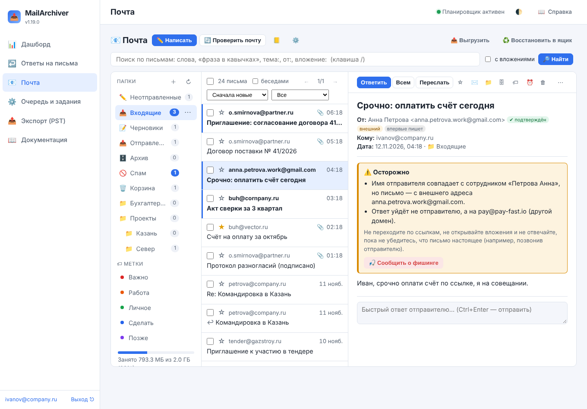

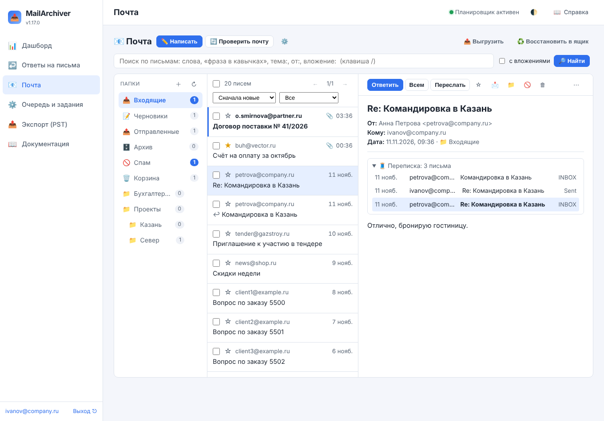

## 22.1. Как это устроено

Письма показываются **из архива**: открываются мгновенно, даже если почтовый сервер сейчас
недоступен, и ищутся поиском по всему архиву (глава «Поиск по письмам»). Действия идут на сервер
по IMAP (письма, папки, флаги) и SMTP (отправка), после чего архив приводится к новому состоянию
сервера — не дожидаясь следующего копирования:

| Действие | На сервере | В архиве |
|----------|-----------|----------|
| Прочитано, помечено (⭐) | флаги `\Seen`, `\Flagged` | те же флаги у копии |
| Перенести в папку | MOVE (или COPY и удаление) | копия появляется в новой папке, в старой — отмечена «нет на сервере» |
| Удалить | перенос в «Корзину»; из «Корзины» — удаление насовсем | копия остаётся, отмечена «нет на сервере» |
| Спам / Не спам | перенос в «Спам» / во «Входящие» | как при переносе |
| Отправить | SMTP, копия в «Отправленные», у исходного письма — «Отвечено» | отправленное письмо — сразу в «Отправленных» архива |
| Создать, переименовать, удалить папку | CREATE, RENAME, DELETE | при переименовании письма архива переходят в новую папку; письма удалённой папки остаются в архиве |

**Архив ничего не теряет.** Письмо, удалённое или перенесённое в клиенте (или в любой другой
почтовой программе), остаётся в архиве: в папке, где оно лежало, оно помечается «нет на сервере» и
в списке клиента не показывается. Увидеть такие письма — флажок «удалённые с сервера (N)» над
списком; вернуть в ящик — «♻️ Восстановить». Папки, которых на сервере больше нет, собраны внизу
списка папок под заголовком «🗄 Только в архиве».

**Новая почта.** Пока раздел открыт, служба держит с ящиком соединение в режиме **IMAP IDLE**:
почтовый сервер сам сообщает о новом письме во «Входящих», и оно появляется в списке за секунды
(«Новая почта сразу (IMAP IDLE)»). Соединение закрывается через три минуты после того, как клиент
закрыли. Кроме того, открытая папка раз в две минуты («Проверять почту, секунд»)
сверяется с сервером: новые письма скачиваются в архив и появляются в списке, удалённые исчезают,
отметки «прочитано» и «помечено», сделанные на телефоне, переносятся в архив (у 300 последних
писем папки). Кнопка **«🔄 Проверить почту»** делает то же сразу и обновляет счётчики всех папок.
За одну проверку скачивается до 200 новых писем, остальные скачает копирование; пока ящик
копируется заданием, проверка писем не скачивает, а только отмечает удалённые.

Число непрочитанных писем «Входящих» видно в **заголовке вкладки** браузера, а «Входящие»
проверяются, даже когда открыта другая папка. Включите **уведомления о новой почте** («⚙️ → 👁
Вид») — браузер покажет уведомление, когда вкладка в фоне.

Письма, которых в папке на сервере больше нет, отмечает и обычное копирование ящика — поэтому
клиент правильно показывает и то, что удалили в другой почтовой программе.

Если сервер не пустил клиент в ящик (сменился пароль), ящик отмечается «неверный пароль», как после
«Проверить» в «Почтовых ящиках», и клиент больше не входит в него сам — только по кнопке «Проверить
почту»: частые неудачные входы с адреса архива сервер может заблокировать (fail2ban), и встало бы
копирование всех ящиков.

## 22.2. Папки и список писем

Слева — папки ящика **на сервере**: «Входящие», «Черновики», «Отправленные», «Архив», «Спам»,
«Корзина» (их клиент узнаёт по отметкам сервера SPECIAL-USE или привычным именам), затем
остальные — деревом. Рядом с папкой — число непрочитанных (у «Черновиков» и «Отправленных» —
всего писем). Над папками: **＋** — новая папка, **↻** — список папок с сервера заново. Письма
можно **перетащить** мышью на папку.

У папки при наведении появляется **⋯**:

- **«Отметить все прочитанными»** — все непрочитанные письма папки (на сервере);
- **«Очистить»** — у «Корзины» и «Спама»: удалить с сервера все их письма (копии в архиве
  остаются);
- **«Создать вложенную папку»**, **«Переименовать»**, **«Переместить в другую папку»**,
  **«Удалить папку»** — «Входящие» и особые папки не переименовываются, не переносятся и не
  удаляются;
- **«Применить правила к письмам папки»** — правила сортировки (22.5) к письмам, которые уже лежат
  в папке;
- **«Скачать письма папки (.zip)»** — до 2000 последних писем файлами `.eml` в одном архиве.

Под папками — **метки** (22.7): щелчок по метке показывает письма открытой папки с этой меткой; ниже —
**сохранённые поиски** («☆ Сохранить поиск» рядом с «Найти»; щелчок повторяет поиск, × — удалить) и
**квота** ящика на сервере («Занято 1,2 ГБ из 5 ГБ»; полоса желтеет после 75 % и краснеет после 90 %;
показывается, если сервер сообщает квоту — расширение IMAP QUOTA).

Над списком писем — порядок (новые, старые, по отправителю, по теме, крупные) и отбор (все,
непрочитанные, помеченные, с вложениями, отвеченные, с меткой). Писем на странице — 25, 50, 100 или
200, список бывает обычным и **компактным** («⚙️ → 👁 Вид»). Флажок **«беседами»** показывает письма
одной переписки одной строкой (последнее письмо и число писем беседы); выбор беседы — все её письма
в папке. Беседы собираются по индексу раздела «Ответы на письма» — только что пришедшее письмо
встаёт в беседу, когда его разберёт индекс (раз в 10 минут). В «Отправленных» и «Черновиках» вместо
отправителя показан получатель. Непрочитанное письмо выделено полосой слева и жирным шрифтом,
**☆** в строке ставит и снимает пометку, ↩ и ↪ — «отвечено» и «переслано», цветные ярлыки —
метки письма.

**Несколько писем** отмечаются флажками (флажок в шапке — вся страница; пробел на строке — тоже
выбор). Когда выбрана вся страница, а писем в папке больше, появляется ссылка **«Выбрать все N
писем папки»** (до 5000 за раз). На полосе «Выбрано: N» — «Прочитано», «Не прочитано», «⭐»,
«Переместить», «🗄 В архив», «🏷 Метка», «⏰ Напомнить», «Спам», «Удалить», «↪ Переслать вложением» (выбранные
письма — файлами `.eml` в новом письме), «⬇ .zip» (скачать архивом) и «Восстановить».

**«Отменить».** После переноса, удаления в корзину и «Спама» в углу экрана несколько секунд видна
кнопка «Отменить» — письма вернутся в папку, откуда их унесли.

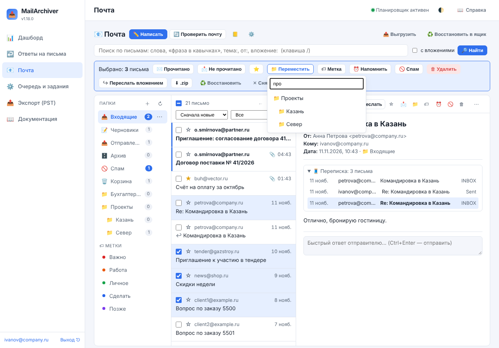

## 22.3. Письмо

Над открытым письмом — «Ответить», «Всем», «Переслать», пометка, «не прочитано», «переместить»,
**«🗄 в архив»** (в папку «Архив» сервера; если её нет — создаётся), **«🏷 метка»**, **«⏰ напомнить
позже»**, «удалить» и **⋯**: скачать `.eml`, заголовки
письма, печать, **переслать как вложение**, **отписаться от рассылки**, **добавить отправителя в
адресную книгу**, **создать правило по этому письму**, **заблокировать отправителя**, «в спам» («не спам» — в
«Спаме»), **сообщить о фишинге**, восстановить в
ящик, удалить с сервера насовсем (без корзины). Ниже шапки — **переписка**: письма той же цепочки из всех папок
ящика (по заголовкам `In-Reply-To` и `References`, из индекса раздела «Ответы на письма»);
щелчок открывает письмо цепочки. Внешние картинки в HTML-письме, как и раньше, загружаются только
по кнопке «Показать картинки» — иначе отправитель узнал бы, что письмо открыли.

**Вложения.** Картинки показаны миниатюрами. Картинку, PDF и текстовый файл можно открыть прямо в
клиенте (щелчок по вложению; ⬇ рядом — скачать), стрелками — листать вложения письма. «⬇ все одним
архивом .zip» — все вложения письма разом.

**Что ещё показывает письмо:**

- **❗ Важное** — отправитель отметил письмо важным (`X-Priority`, `Importance`);
- **«Отправитель просит уведомить его о прочтении»** — «Отправить уведомление» или «Не
  отправлять» (больше не спросит: на письме ставится отметка `$MDNSent`, как в Thunderbird);
- **приглашение на встречу** (`text/calendar`) — карточка: что, когда, где, организатор,
  участники; **«✓ Принять»**, **«? Под вопросом»**, **«✗ Отклонить»** отправляют организатору ответ
  (iTIP REPLY — его понимают Outlook, Exchange, Google Календарь), **«📅 Добавить в календарь
  (.ics)»** — файл события;
- **«Это рассылка. ✋ Отписаться»** — по заголовку `List-Unsubscribe`: открывается страница отписки
  отправителя (в новой вкладке, сервис архива к ней сам не обращается) или готовится письмо отписки.

**Подлинность отправителя.** Рядом с адресом отправителя — отметки:

- **«✔ подтверждён»** / **«⚠ не подтверждён»** — что записал принимающий почтовый сервер в заголовок
  `Authentication-Results` (проверки SPF, DKIM и DMARC). «Подтверждён» значит, что письмо
  действительно пришло с домена отправителя — но не что этому домену можно верить;
- **«внешний»** — адрес не из доменов организации (домены ящиков архива и адресов сотрудников, кроме
  общедоступных вроде gmail.com, и «Ответы на письма → Свои домены»);
- **«впервые пишет»** — раньше писем с этого адреса в ящике не было.

Над письмом появляется **предупреждение**, если: сервер не подтвердил отправителя; в имени отправителя
написан другой адрес («director@company.ru» &lt;evil@mail.ru&gt;); домен похож на свой, но другой
(c0mpany.ru, cornpany.ru, company-ru.com, company.ru.evil.com); имя совпадает с сотрудником, а адрес
внешний; «Ответ на» ведёт в другой домен. Кнопка **«🎣 Сообщить о фишинге»** переносит письмо в «Спам»
и, если задан адрес «Сообщать о фишинге на адрес», пересылает его туда целиком (со всеми
заголовками).

**S/MIME.** У подписанного письма — отметка «🔏 подпись верна» (или «неверна») и строка: кто подписал,
кем выдан сертификат, совпадает ли адрес сертификата с отправителем. Подпись проверяет программа
`openssl` на сервере архива (подпись и цепочка до доверенных центров системы); без неё отметка
«подписано» без проверки. Зашифрованное письмо помечено «🔒 зашифровано»: прочитать его может только
получатель в своей почтовой программе.

**⏰ Напомнить позже** — убрать письмо из «Входящих» до назначенного времени («Сегодня в 18:00»,
«Завтра в 9:00», «В понедельник», своё время). Пока письмо отложено, оно лежит на сервере в папке
**«Отложенные»** (создаётся сама), а в назначенное время возвращается туда, откуда его отложили, —
**непрочитанным**. Возвращает служба, даже если клиент закрыт.

**Быстрый ответ** — поле под письмом: написать пару строк и «📨 Ответить» (`Ctrl+Enter`), не
открывая окно письма; «Открыть в редакторе» — продолжить в обычном окне.

Сотрудник, открывший письмо в своём ящике, отмечает его прочитанным — как в любой почтовой
программе («Отмечать открытое письмо прочитанным»). **Администратор**, открывая письма сотрудника,
его отметок не меняет никогда.

Письмо из папки «Черновики» (например, начатое на телефоне) можно **«✏️ Продолжить»**: оно
откроется в окне письма, а после отправки черновик на сервере удалится.

## 22.4. Новое письмо, ответ, пересылка

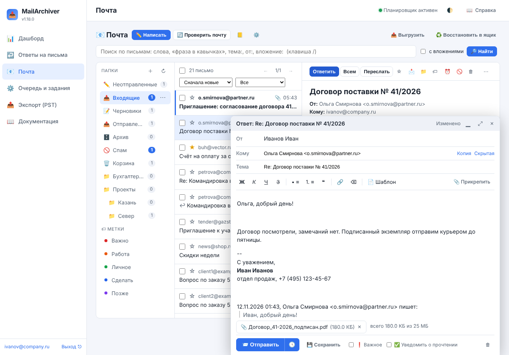

«✏️ Написать» (клавиша `c`) открывает окно письма в правом нижнем углу — его можно свернуть (▁),
развернуть на весь экран (⤢) и закрыть: черновик сохраняется сам каждые несколько секунд и при
закрытии. Окна нескольких писем открываются одновременно.

- **От** — если у ящика есть псевдонимы (22.8), рядом с ящиком выбирается адрес отправителя.
- **Кому, Копия, Скрытая копия** — адреса через запятую. Появляется подсказка: адресная книга ящика и
  её **группы** (имя группы подставляет все её адреса), сотрудники (по ФИО и адресу), те, кто писал в
  ящик, и те, кому из него писали.
- **Текст** — с оформлением: жирный, курсив, подчёркивание, списки, цитата, ссылка. Вставленный из
  другой программы текст очищается от скриптов, стилей и внешних картинок; картинку из буфера
  обмена (снимок экрана) до 3 МБ можно вставить прямо в текст — она уйдёт внутри письма.
- **Вложения** — «📎 Прикрепить» или перетаскивание файлов на окно; вместе — до 25 МБ
  («Вложения письма, МБ»).
- **«📄 Шаблон»** — вставить свой шаблон (тема подставляется, если у письма её нет) или сохранить
  письмо как шаблон.
- **❗ Важное** — письмо придёт с пометкой важности; **✅ Уведомить о прочтении** — попросить
  получателя прислать уведомление (`Disposition-Notification-To`; присылать ли — решает получатель).
- **Проверка орфографии** — браузерная, подчёркивает ошибки в тексте.
- **«Отправить»** (`Ctrl+Enter`). Письмо уходит как HTML с текстовой копией; ответ — с заголовками
  `In-Reply-To` и `References`, чтобы у получателя оно встало в цепочку. Если в тексте сказано о
  вложении («во вложении», «прилагаю»…), а файлов нет, клиент переспросит.
- **«Отменить отправку».** После «Отправить» письмо 5 секунд ждёт («Отменить отправку, секунд»), окно
  прячется, а в углу — кнопка «Отменить»: письмо вернётся в редактор. Если закрыть вкладку в эти
  секунды, письмо не уйдёт и останется в «Неотправленных».
- **🕓 «Отправить позже»** — рядом с «Отправить»: выбрать время, и письмо уйдёт само, даже если
  клиент и браузер закрыты. До отправки оно лежит в «Неотправленных» с отметкой «🕓 Будет
  отправлено …»; «Отменить отправку» или «Изменить» возвращают его в черновики. Если к назначенному
  времени отправка стала недоступна (ящик выключили, администратору запретили писать), письмо
  возвращается в черновики с причиной.

**Ответ** подставляет адрес отправителя (или адрес из «Reply-To»), тему «Re: …» и цитату. **Ответ
всем** добавляет в копию остальных адресатов письма, кроме самого ящика. **Пересылка** — тема
«Fwd: …», шапка исходного письма и все его вложения. **Переслать как вложение** — исходные письма
целиком файлами `.eml` (`message/rfc822`), как их пересылает Outlook: так получатель видит все
заголовки (нужно, например, чтобы переслать фишинговое письмо в службу безопасности).

Черновик, сохранённый кнопкой «💾 Сохранить» или закрытый, кладётся и в папку **«Черновики»** на
сервере (прежняя копия заменяется) — его видно и продолжить можно в почте на телефоне; после
отправки или удаления копия на сервере удаляется («Черновики — и в папку «Черновики» сервера»).

Неотправленные письма (начатые и закрытые) — в папке **«✏️ Неотправленные»** вверху списка папок:
«Продолжить» или «Удалить». Хранятся они в базе архива (вложения — в каталоге данных, при
включённом шифровании копии — зашифрованными), пока их не отправят или не удалят; не тронутые
30 дней («Хранить черновики, дней») удаляются сами. Письмо, которое не удалось отправить, остаётся
в «Неотправленных» с причиной.

После отправки копия кладётся в «Отправленные» на сервере (и сразу в архив), а исходное письмо
получает отметку «Отвечено» («Переслано» — для пересылки). Gmail и Microsoft 365 кладут
отправленное в «Отправленные» сами — им клиент копию не добавляет («Копия в «Отправленные»»: auto).

## 22.5. Правила сортировки и заблокированные отправители

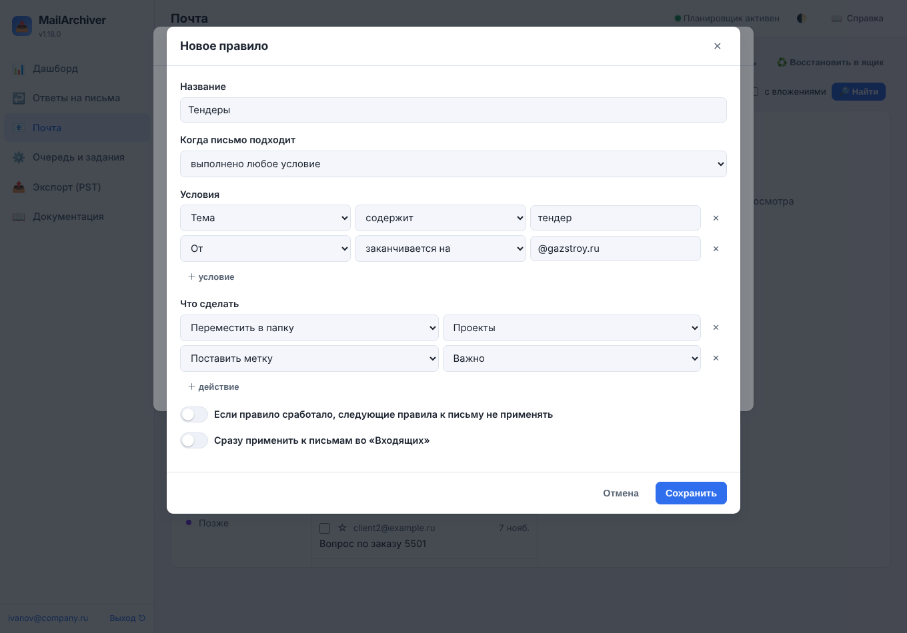

**«⚙️ → ⚙️ Правила»** — правила для новых писем «Входящих». Правило — это **условия** и **действия**:

| Условия | Сравнение |
|---------|-----------|
| От, Кому, Копия, «Кому или копия», Тема, Текст письма | содержит, не содержит, равно, не равно, начинается с, заканчивается на (без учёта регистра; «равно» для адресов — один из адресов поля) |
| Есть вложения, Это рассылка (`List-Id`, `Precedence: bulk`), Отмечено «Важное» | да, нет |
| Размер письма, МБ | больше, меньше |

Срабатывает, когда выполнены **все** условия или **любое** из них. Действия: переместить в папку,
отметить прочитанным, пометить звёздочкой, поставить метку, в спам, удалить (в корзину). Правила
проверяются по порядку (↑ ↓); «дальше не проверять» останавливает проверку письма на этом правиле.
У каждого правила видно, сколько раз оно сработало.

**Работают и без открытого клиента.** Пока клиент открыт, правила срабатывают при каждой проверке
почты. Кроме того, служба сама проверяет «Входящие» ящиков, у которых есть правила (или включён
автоответ), раз в 5 минут («Правила и автоответ без открытого клиента, минут»; 0 — только когда
клиент открыт). Правила касаются только **новых** писем — пришедших после того, как появилось первое
правило, и не старше трёх суток; письмо, которое вручную вернули во «Входящие», они второй раз не
уносят. Применить правила к письмам, которые уже лежат в папке, — «Применить к «Входящим» сейчас»
или «⋯» у папки.

**Заблокировать отправителя** («⋯» у письма): письмо и все следующие письма с этого адреса уходят в
«Спам» (если «Спама» на сервере нет — в корзину). Список заблокированных — внизу вкладки «Правила»,
там же «Разблокировать».

Правила хранятся в базе архива, и выполняет их служба архива. Правила, настроенные на самом
сервере (Sieve, правила Exchange), работают независимо от них.

**Правила на почтовом сервере (Sieve).** Внизу вкладки «Правила» — «Выполнять правила и автоответ на
почтовом сервере»: клиент переводит правила и автоответ в сценарий **Sieve** (RFC 5228) и загружает
его по **ManageSieve** (RFC 5804, обычно порт 4190) — его понимают Dovecot (Pigeonhole), Cyrus,
Stalwart и другие; Exchange, Gmail и Яндекс — нет. Тогда письма раскладываются сразу при получении,
и в почте на телефоне тоже, даже если служба архива остановлена; сама служба эти правила и автоответ
больше не выполняет, а изменённое правило сразу загружает на сервер заново. Сценарий можно
посмотреть там же. Нужен ящик с паролем (вход PLAIN по STARTTLS или SSL). Если на сервере уже
работает другой сценарий (сделанный, например, в Roundcube), клиент спросит, заменить ли его:
активным может быть только один, прежний останется на сервере неактивным. Выключение убирает
сценарий клиента с сервера.

## 22.6. Автоответ

**«⚙️ → 🏖 Автоответ»** — ответ «меня нет на месте» на новые письма: текст, тема (пусто — «Автоответ:
тема письма»), даты «с» и «по» (необязательно) и как часто отвечать одному отправителю (по умолчанию
— раз в 4 дня). Пока автоответ включён, рядом с «Проверить почту» видна кнопка «🏖 Автоответ».

Автоответ уходит, как и правила, при проверке почты и без открытого клиента. Он **не уходит**
(RFC 3834): на свои письма; рассылкам (`List-Id`, `List-Unsubscribe`, `Precedence: bulk`); роботам
(`noreply@`, `mailer-daemon@` и т. п.); на автоматические письма (`Auto-Submitted`) и уведомления
сервера; если ящика нет в «Кому» и «Копии» (письмо пришло через рассылку или скрытой копией); на
письма, которые правила унесли в спам или корзину. Сам автоответ помечен `Auto-Submitted:
auto-replied` — другие автоответчики на него не отвечают, и письма не ходят по кругу. В
«Отправленные» автоответы не кладутся.

Если автоответ уже настроен на самом почтовом сервере (Exchange, Sieve, раздел «Ящики на сервере»),
не включайте второй — отправитель получит два ответа.

## 22.7. Метки, шаблоны, адресная книга

**Метки** («⚙️ → 🏷 Метки», «🏷» у письма и на полосе выбранных): цветные ярлыки на письмах. Метка
хранится на почтовом сервере ключевым словом IMAP, поэтому видна и на другом компьютере; первые пять
(«Важно», «Работа», «Личное», «Сделать», «Позже») — те же, что в Thunderbird. Письма с меткой —
щелчок по метке под папками или отбор «С меткой» над списком. Если сервер не принимает свои
ключевые слова (бывает у старых серверов), метку поставить не получится — клиент скажет об этом.

**Шаблоны** («⚙️ → 📄 Шаблоны», «📄 Шаблон» в окне письма): готовые тексты с темой — ответы на
частые вопросы, счета, приглашения. Шаблоны у каждого пользователя свои: шаблоны сотрудника не
видит администратор, и наоборот.

**Адресная книга** (📒 рядом с ⚙️): контакты ящика — имя, адрес, телефон, организация, группы,
заметка. Контакты подсказываются в «Кому» первыми; **группа** (например, «Поставщики») подставляет
в «Кому» все свои адреса, «✉️ Написать группе» — тоже. **Импорт** — файл vCard (`.vcf`: Outlook,
Google Контакты, Thunderbird, телефон) или CSV (столбцы «Имя», «Email», «Телефон», «Организация»,
«Группы»; кодировка UTF-8 или Windows-1251, разделитель — запятая или точка с запятой); **экспорт** —
vCard или CSV. Добавить отправителя письма — «⋯ → Добавить отправителя в адресную книгу».

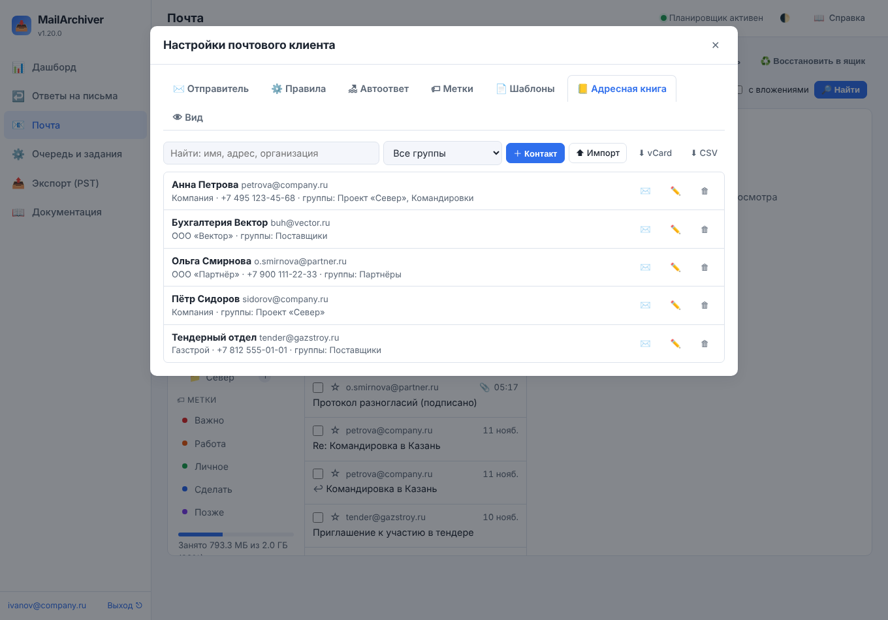

## 22.8. Отправитель, подпись и сервер отправки

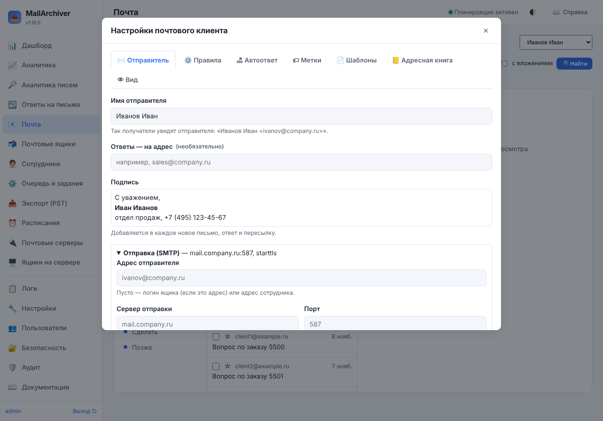

Кнопка **⚙️** рядом с «Проверить почту» открывает **настройки клиента** — вкладки «Отправитель»,
«Правила», «Автоответ», «Метки», «Шаблоны», «Адресная книга», «Вид». Вкладка **«✉️ Отправитель»** —
настройки ящика для отправки:

- **Имя отправителя** — по умолчанию ФИО сотрудника (или название ящика);
- **Ответы — на адрес** — заголовок Reply-To (например, общий адрес отдела);
- **Подпись** — добавляется в каждое новое письмо, ответ и пересылку.

Это меняет и сотрудник в своём ящике. Администратору доступен ещё блок **«Отправка (SMTP)»**:

| Поле | Что значит | По умолчанию |
|------|-----------|--------------|
| Адрес отправителя | адрес в поле «От» | логин ящика, если это адрес, иначе адрес сотрудника |
| Сервер отправки, порт, защита | SMTP-сервер | подбирается по серверу IMAP: Gmail — smtp.gmail.com:465 SSL, Microsoft 365 — smtp.office365.com:587 STARTTLS, Яндекс — smtp.yandex.ru:465, Mail.ru — smtp.mail.ru:465; для imap.домен — smtp.домен:587 STARTTLS; иначе тот же сервер, 587 STARTTLS |
| Вход | как в ящик (пароль или OAuth2 ящика), отдельный логин и пароль (хранится зашифрованным) или без входа — ретранслятор, который принимает письма с адреса архива | как в ящик |
| Копия в «Отправленные» | auto, всегда, никогда | как в настройках |
| Другие адреса отправителя (псевдонимы) | адреса, с которых сотрудник может отправлять (общий адрес отдела, второй домен); в окне письма выбираются в поле «От» | нет |

Как входит клиент на сервер отправки:

- ящик с **паролем** — тем же логином и паролем (AUTH LOGIN/PLAIN);
- ящик с **OAuth2** (Gmail, Microsoft 365) — XOAUTH2 тем же токеном. Gmail пускает с правом
  `https://mail.google.com/`; в Microsoft 365 у приложения должно быть право `SMTP.Send`, а у ящика
  — включён SMTP AUTH (Exchange: «Authenticated SMTP»);
- ящик **через подключение к почтовому серверу** (глава «Почтовые серверы») — токеном приложения
  Microsoft 365 или Google (XOAUTH2); при входе администратора сервера (Dovecot, Zimbra и т. п.)
  пароль администратора на сервер отправки не передаётся — нужен отдельный вход или ретранслятор;
- ящик **через администратора почты** (глава «Вход в ящики через администратора почты») — так же:
  отдельный вход или ретранслятор.

Пароль не отправляется на сервер отправки без шифрования (кроме `localhost`) — выберите SSL или
STARTTLS или ретранслятор без входа.

## 22.9. Кто что может

| Кто | Читать | Проверять почту | Писать и менять ящик |
|-----|--------|-----------------|----------------------|
| Сотрудник (вход паролем своего ящика) | свои ящики | свои ящики | свои ящики, кроме выключенных администратором |
| Сотрудник, которому открыт чужой ящик (22.13) | открытые ему ящики | открытые ему ящики | только с «полным доступом» |
| Администратор | все ящики | все ящики | все ящики, если включено «Администратор может писать и менять ящики» (по умолчанию да) |
| Оператор | — | — | — |

Каждое изменение ящика на сервере записывается в **аудит**: отправка (кто, с какого ящика, тема и
адресаты, без текста), перенос, удаление, спам, очистка корзины, папки, настройки отправки, правила,
автоответ, «напомнить позже», отложенная отправка, уведомления о прочтении и ответы на приглашения
(`webmail_send`, `webmail_move`, `webmail_delete`, `webmail_junk`, `webmail_empty`,
`webmail_folder_create`, `webmail_folder_rename`, `webmail_folder_delete`, `webmail_identity`,
`webmail_rule`, `webmail_autoreply`, `webmail_snooze`, `webmail_schedule`, `webmail_mdn`,
`webmail_invite`, `webmail_archive`, `webmail_phish`, `webmail_sieve`), а выгрузка писем архивом
.zip администратором — `webmail_zip`. Отметки
«прочитано», «помечено» и метки в аудит не пишутся.

Письмо, отправку которого запланировал администратор, уходит, только если в момент отправки
администратору всё ещё разрешено писать из ящиков сотрудников. Правила, автоответ, метки и адресная
книга принадлежат ящику (их видят и сотрудник, и администратор), шаблоны — пользователю.

Если писать письма из архива не нужно вовсе — выключите «Почтовый клиент»: «Почта» снова будет
только показывать архив. Если не должен только администратор — выключите «Администратор может
писать и менять ящики»: он по-прежнему читает и проверяет почту, но ничего не меняет.

Когда менять ящик нельзя (клиент выключен, ящик выключен, у ящика без пароля нет входа по IMAP),
над письмами написано почему, а кнопки действий неактивны.

## 22.10. Горячие клавиши

| Клавиша | Действие |
|---------|----------|
| `j` / `k` | следующее / предыдущее письмо |
| `/` | поиск |
| `c` | новое письмо |
| `r` / `a` / `f` | ответить / ответить всем / переслать |
| `s` | пометить или снять пометку |
| `u` | прочитано / не прочитано |
| `v` | переместить в папку |
| `e` | в архив |
| `l` | метка |
| `b` | напомнить позже |
| `Delete` или `#` | удалить |
| `Ctrl+Enter` (в окне письма) | отправить |
| `Ctrl+S` (в окне письма) | сохранить черновик |
| `?` | справка по клавишам |

Клавиши работают и в русской раскладке.

## 22.11. Подпись и шифрование, проверки перед отправкой, календарь

**S/MIME.** В «⚙️ → 🔏 Подпись и шифрование» загружается сертификат ящика с закрытым ключом —
файл `.p12` или `.pfx` (его выдаёт удостоверяющий центр или служба ИБ) и пароль к нему. Ключ
хранится в базе архива зашифрованным ключом службы (как пароли ящиков); подпись и расшифровка
делаются на сервере архива. В окне письма появляются флажки **«🔏 Подписать»** (получатель увидит,
что письмо от вас и не изменено) и **«🔒 Зашифровать»** — прочитать письмо смогут только получатели
со своим сертификатом. Если сертификата нет хотя бы у одного получателя, клиент назовёт его и письмо
не отправит. Отправленное зашифрованное письмо шифруется и для вас — копия в «Отправленных»
читается. Шифрование — AES-256 (с `cryptography` 45+; с 44 — AES-128, его тоже читают все почтовые
программы).

**Сертификаты получателей** (1.21.0 — строже):

- **из писем** — сертификат запоминается, только если подпись **доверенная** (цепочка до
  удостоверяющего центра — системного или из «Доверенные центры S/MIME», файл PEM вашего УЦ) и
  **адрес отправителя есть в сертификате**; и только для этого адреса. Письмо с самоподписанным
  сертификатом «на чужой адрес» сертификат не подменит; в окне письма такая подпись — «⚠ Адрес
  отправителя не совпадает с сертификатом»;
- **общий справочник** («Сертификаты получателей») пополняет и чистит только администратор; его
  загруженный сертификат письмом с подписью не заменяется, пока действует. Смена сертификата
  адреса — в аудите (`webmail_smime_cert_change`) с обоими отпечатками;
- **сотрудник** загружает сертификаты в **свой список** («Мои сертификаты получателей»): ими
  шифруются только письма из его ящика, общий справочник он не видит;
- в окне письма с «🔒 Зашифровать» видно, **для кого и каким сертификатом** письмо шифруется:
  отпечаток SHA-256 (первые 16 знаков), «⚠ сертификат сменился» (14 дней после смены) и адреса без
  сертификата. Отпечаток сверяйте с получателем по телефону, если письмо важное;
- **скрытые адресаты** получают отдельные копии, зашифрованные только для них: в зашифрованном
  письме видны сертификаты всех, кому оно зашифровано, — общая копия раскрыла бы скрытую копию.

Зашифрованное входящее письмо открывается кнопкой **«🔓 Расшифровать»**: текст и вложения
показываются в окне, на сервере расшифрованное не сохраняется, расшифровка — в аудите
(`webmail_decrypt`). Нужна библиотека `cryptography` 44+ (её ставит `update.sh`).

**Предел отправки.** С одного ящика за час письма могут получить не больше «Предел отправки,
адресатов в час» (по умолчанию 300) адресатов. Превышение — отказ с объяснением, запись в аудите
(`webmail_send_limit`) и уведомление администратору: украденная сессия сотрудника не превратится в
рассылку с его адреса.

**Проверки перед отправкой.** Перед отправкой (и перед «Отправить позже») клиент проверяет письмо
и показывает предупреждения, если:

- письмо уходит **за пределы организации** — адресатам не из доменов ящиков и сотрудников
  («Предупреждать о внешних адресатах»);
- в «Кому» и «Копии» больше адресатов, чем «Предупреждать о большом списке адресатов» (по
  умолчанию 20): каждый увидит адреса остальных — лучше «Скрытая копия»;
- в теме, тексте или **вложениях** (PDF, Word, Excel, текст) похоже на **конфиденциальные данные**:
  номер банковской карты (с проверкой по алгоритму Луна), СНИЛС (с контрольным числом), паспортные
  данные рядом со словом «паспорт», ИНН рядом со словом «ИНН».

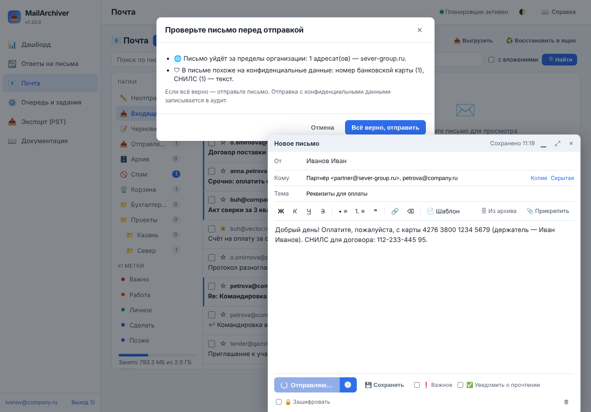

Письмо уходит, если подтвердить «Всё верно, отправить»; отправка с конфиденциальными данными
записывается в аудит (`webmail_dlp_override`). Настройка «Конфиденциальные данные в письме»:
`warn` — предупреждать (по умолчанию), `block_external` — такие письма **за пределы организации не
отправляются** (внутри — предупреждение), `off` — не проверять.

**Письма из архива во вложения.** Кнопка **«🗄 Из архива»** в окне письма ищет по архиву ваших ящиков
(администратор — по всем, поиск — в аудите) и прикладывает выбранные письма файлами `.eml` (до 20).

**Календарь и контакты сервера.** Если почтовый сервер ведёт календари и адресные книги по CalDAV и
CardDAV (Nextcloud, SOGo, Zimbra, Яндекс, Mail.ru, Radicale и другие), администратор указывает адрес
сервера в «⚙️ → 📅 Календарь и контакты» (например `https://mail.company.ru` — адрес календаря
найдётся сам) и выбирает календарь и адресную книгу. Вход — логином и паролем ящика (некоторым
серверам нужен пароль приложения), только по https. Дальше:

- **«⟳ Загрузить контакты»** — контакты сервера попадают в адресную книгу ящика и в подсказку адресов;
  новый контакт адресной книги (1.21.0) записывается и в книгу сервера — появится на телефоне;
- **«📅»** над списком писем — **«Список»** (ближайшие 30 дней) или **«Месяц»** (сетка месяца,
  ‹ › — соседние месяцы), **«＋ Событие»**; событие можно **изменить** (✏️ или щелчок в сетке) и
  **удалить** (🗑). Участники и напоминания события при правке сохраняются; если событие тем временем
  изменили на телефоне, клиент предложит обновить календарь, а не затрёт чужую правку.
  Повторяющиеся события (🔁) меняются в программе календаря;
- **принятое приглашение** («Принять», «Под вопросом») ложится в календарь сервера.

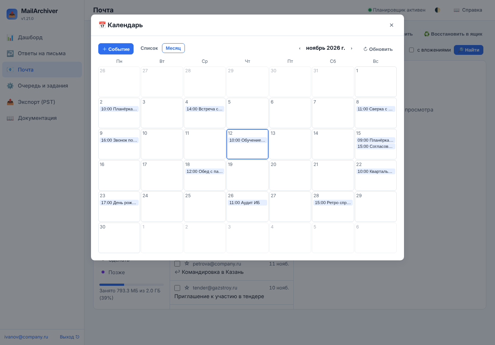

Адрес задаёт только администратор: запросы идут с сервера архива, сотрудник не должен направлять
их в произвольные места сети. Пароль ящика уходит только на этот сервер: если он перенаправляет
на другой адрес (`.well-known` на соседний сервер), клиент покажет новый адрес — укажите его сами.

**Как приложение.** В Chrome, Edge и Яндекс Браузере клиент устанавливается как отдельное
приложение (меню браузера → «Установить приложение»; на телефоне — «Добавить на главный экран»).
Кнопка «Открывать ссылки mailto: здесь» в «⚙️» делает клиент обработчиком ссылок почты: такая ссылка
откроет новое письмо с адресом, темой и текстом. Нужен вход по https (или с той же машины).

## 22.12. Настройки

«Настройки → ✉️ Почтовый клиент» (раздел `webmail` в `config.yaml`): включён ли клиент, может ли
администратор писать и менять ящики, отмечать ли открытое письмо прочитанным, как часто проверять
почту, предел вложений, копия в «Отправленные», сколько хранить черновики, сколько секунд можно
отменить отправку, как часто проверять «Входящие» для правил и автоответа без открытого клиента,
новая почта сразу (IMAP IDLE), черновики в «Черновиках» сервера, адрес для «Сообщить о фишинге»,
проверки перед отправкой (конфиденциальные данные, внешние адресаты, большой список адресатов).
уведомления на компьютер и телефон (Web Push: разрешены ли, отправитель и тема в уведомлении, службы
доставки браузеров). Подробно — в [05-parameters-reference.md](05-parameters-reference.md). Настройки
вида (писем на странице, компактный список) — «⚙️ → 👁 Вид», уведомления — «⚙️ → 🔔 Уведомления»; у
каждого браузера свои.

API — `/api/webmail/…`: `status`, `folders`, `sync`, `messages`, `ids`, `flags`, `move`, `delete`,
`junk`, `tag`, `snooze`, `snoozed`, `unsnooze`, `zip`, `attachments_zip`, `extras`, `receipt`, `unified`,
`invite`, `invite.ics`, `block`, `wait` (ожидание новой почты), `archive`, `phishing`, `searches`,
`sieve`, `quota`, `smime` (`key`, `certs`, `recipients`), `decrypted`, `dav` (`contacts`), `calendar`,
`folders/create`, `folders/rename`, `folders/delete`,
`folders/read_all`, `folders/empty`, `thread`, `headers`, `contacts`, `identity`, `drafts` (создать,
изменить, удалить, вложения, `archived`, `send`, `schedule`, `unschedule`), `tags`, `templates`, `book`
(`import`, `export`, `delete`), `rules` (`order`, `apply`), `autoreply`. Уведомления на устройства —
`/api/push/…`: `state`, `subscribe`, `unsubscribe`, `test`, `devices/{id}`; доступ к ящику —
`/api/accounts/{id}/delegates`.

**Ограничения.** Клиент работает поверх архива: письмо появляется в списке, когда оно скачано в
архив (проверкой почты или копированием), а папки, исключённые из копирования, в списке пусты.
Новая почта приходит сразу только во «Входящие» и только если сервер умеет IMAP IDLE (остальные
папки проверяются раз в «Проверять почту, секунд»); правила и автоответ без открытого клиента — раз в
«Правила и автоответ без открытого клиента, минут» (или сразу — на сервере через Sieve). PGP клиент не
поддерживает — только S/MIME. Поиск
ищет по архиву: недавно скачанные письма находятся, когда их разберёт индекс поиска (раз в 10
минут). Автоматической **пересылки** писем на другие адреса в правилах нет намеренно (так легко
незаметно вывести переписку наружу) — её настраивают на почтовом сервере. Повторяющиеся события
календаря показываются по первому повторению и меняются в программе календаря. Уведомления на
устройство приходят только о «Входящих» и только сотруднику (не администратору); браузеру нужен адрес
https://, а серверу — выход к службам доставки браузеров. Проверки перед отправкой ищут конфиденциальные данные по шаблонам —
они не заменяют DLP-систему почтового шлюза.

## 22.13. Общие ящики и «Все входящие»

Администратор открывает сотруднику **чужой ящик** — в меню ящика «⋯ → 👥 Доступ других сотрудников»
([10-mailboxes.md](10-mailboxes.md)): секретарю — ящик руководителя, отделу — общий ящик `info@`
(у общего ящика может и не быть своего сотрудника). Права:

- **только чтение** — письма, вложения, поиск и архив ящика; писать от его имени, менять ящик на
  сервере, выгружать и запускать копирование нельзя (над письмами — «🔒 открыт вам только для
  чтения»);
- **полный доступ** — как свой ящик: «Почта» целиком, письма от имени ящика, правила, выгрузка,
  восстановление и копирование.

Сотрудник входит паролем **своего** ящика и видит открытые ему ящики в переключателе ящиков —
с пометкой «(только чтение)» или «(открыт вам)». Доступ действует, пока сотрудник числится
работающим и не наступила дата «до» (если задана); снятие доступа и увольнение закрывают его сразу.
Действия делегата пишутся в аудит под его логином; выдача и снятие доступа — `mailbox_delegate`.

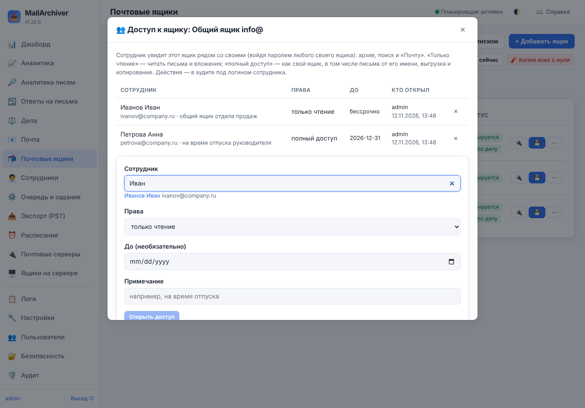

**«📥 Все входящие»** — у сотрудника с несколькими ящиками (своими и открытыми ему) первая строка
списка папок: «Входящие» всех ящиков одним списком, новые сверху, у каждого письма — название ящика.
Щелчок открывает письмо в его ящике. Список строится по архиву: письмо появляется в нём, когда ящик
проверил почту или скопировался.

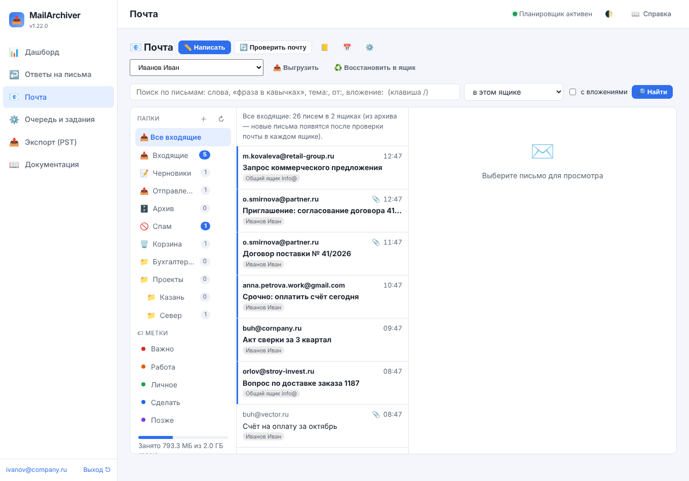

## 22.14. Уведомления на компьютер и телефон

Когда «Почта» открыта во вкладке, о новом письме сообщает сама вкладка («⚙️ → 🔔 Уведомления →
Пока «Почта» открыта»). С 1.22.0 сотрудник может получать уведомления и **когда «Почта» закрыта** —
на компьютере и телефоне, как от обычного почтового приложения (Web Push):

1. Администратор разрешает их: «Настройки → ✉️ Почтовый клиент → Уведомления на компьютер и
   телефон». Интерфейс должен открываться по **https://**, а сервер архива — иметь выход к службам
   доставки браузеров (Google, Mozilla, Apple, Microsoft; список — «Службы уведомлений браузеров»).
2. Сотрудник открывает «⚙️ → 🔔 Уведомления», включает «Уведомлять о новых письмах на этом
   устройстве» и разрешает уведомления в браузере. Если ящиков несколько — отмечает, о каких
   сообщать. «Прислать проверочное» проверяет всю цепочку.
3. На iPhone и iPad (iOS 16.4 и новее) сначала «Поделиться → На экран «Домой»», затем «Почта»
   открывается с экрана «Домой» — только так Safari принимает уведомления сайтов.

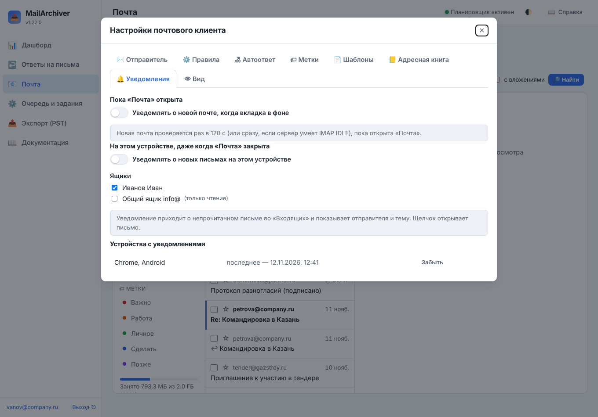

Уведомление приходит о **непрочитанном письме во «Входящих»** и показывает отправителя и тему
(администратор может оставить только «Новое письмо» — «Отправитель и тема в уведомлении»); щелчок
открывает это письмо. Если писем сразу много — три уведомления и одно «Ещё N писем». Правила
сортировки срабатывают раньше: письмо, которое правило убрало из «Входящих», не объявляется.

Как это устроено: браузер подписывается у своей службы доставки и передаёт архиву адрес подписки и
ключи. Пока у ящика есть устройства с уведомлениями, служба архива держит с ним соединение IMAP IDLE
(письмо объявляется за секунды) или, если сервер IDLE не умеет, проверяет «Входящие» раз в «Проверять
«Входящие» для уведомлений, минут». Сообщение шифруется ключом браузера (RFC 8291) и подписывается
ключом сервера (VAPID, RFC 8292) — служба доставки содержимого не видит. Архив отправляет уведомления
только на адреса служб из списка разрешённых.

Внизу окна — **устройства с уведомлениями** (браузер и система, когда приходило последнее, ошибка,
если служба не приняла сообщение); ненужное — «Забыть». Выход из интерфейса («Выйти») выключает
уведомления на этом устройстве. Подписка, которую браузер отменил (служба ответила «нет такой»), и
подписки сотрудника, которому закрыт доступ к ящику, удаляются сами. Включение и выключение — в аудите
(`webpush_subscribe`).

## 22.15. Язык интерфейса

С 1.24.0 вход в систему, оболочка и весь раздел «Почта» — окна, подсказки, вопросы и сообщения
сервера (ошибки отправки, правил, календаря) — есть **на английском**. Переключатель «🌐 Русский ·
English» — на странице входа и внизу боковой панели; выбор запоминается в этом браузере (и на
телефоне выбирается отдельно). Даты и числа показываются по правилам выбранного языка.

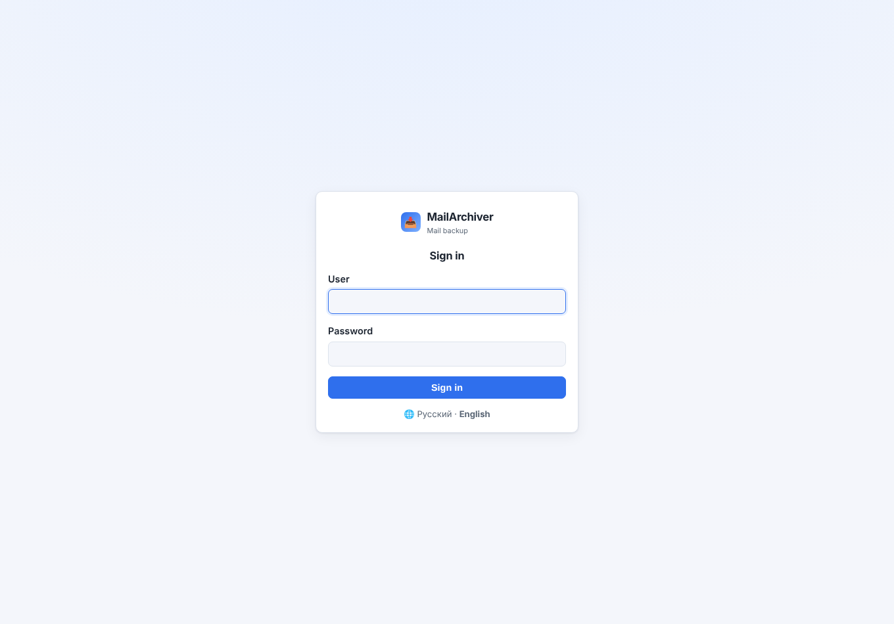

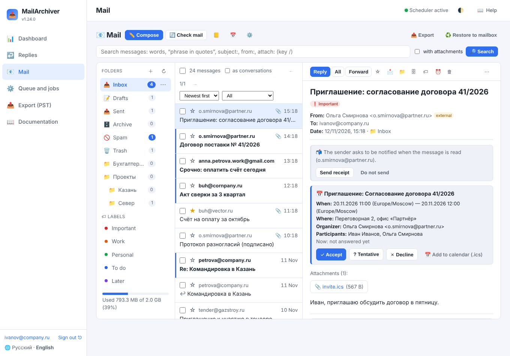

Язык, с которым интерфейс открывается, пока пользователь ничего не выбрал, задаёт администратор:
«Настройки → 🌐 Сервер и сеть → Язык интерфейса по умолчанию» — `ru`, `en` или `auto` (по языку
браузера: русский для русского, украинского, белорусского и казахского, иначе английский).

Разделы администрирования (ящики, задания, настройки, отчёты, документация) пока только на русском:
в английском интерфейсе администратор видит их по-русски. Письма, имена папок, адреса и ваш текст
не переводятся никогда.

Как это устроено (для тех, кто дорабатывает интерфейс): строки разделов написаны по-русски прямо в
разметке, перевод — каталог «русская строка → английская» `mailarchiver/web/static/js/i18n-en.js`
(«{}» — подстановка). Перевод применяется к тому, что появляется на странице. Скрипт
`scripts/i18n_check.py` показывает строки входа и «Почты» без перевода (тест проверяет, что их нет).
