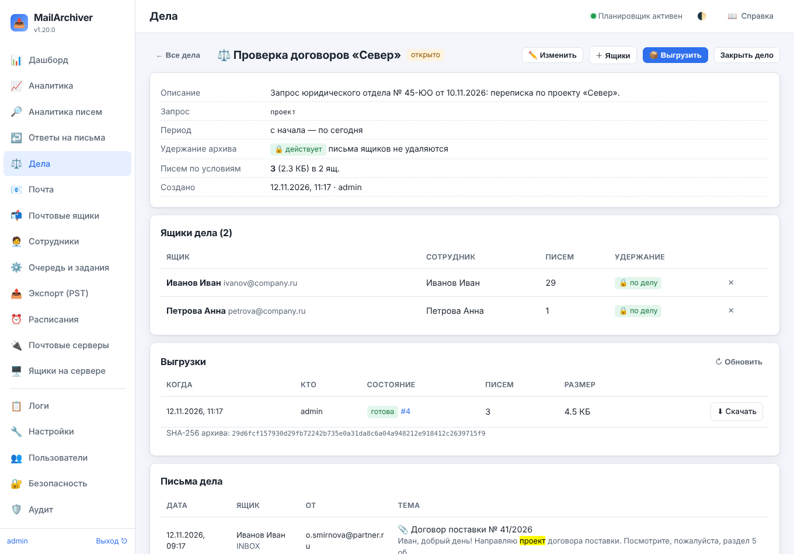
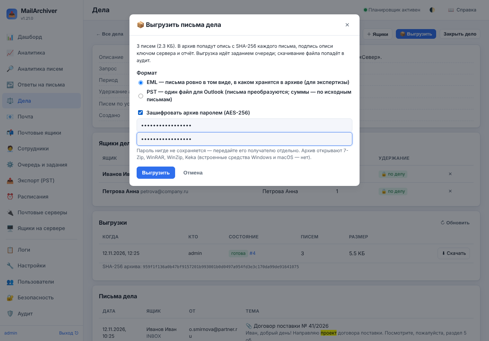

# 23. Дела, журналирование и защищённый аудит

В 1.20.0 архив получил то, что нужно для проверок, споров и запросов регуляторов: **дела** с
юридическим удержанием и выгрузкой писем с описью и контрольными суммами, **приём журналирования**
по SMTP (в архив попадает каждое письмо, даже удалённое до копирования) и **аудит с подписями**,
изменение которого видно.



## 23.1. Дела: удержание и выгрузка писем

Раздел **«⚖️ Дела»** (только администратору) собирает переписку для проверки, спора или запроса.
Дело — это:

- **ящики** — сотрудники, чья переписка нужна (выбираются поиском по названию, логину и имени
  сотрудника);
- **период** — с даты и по дату (по местному времени сервера; пусто — без ограничения);
- **поисковый запрос** — как в поиске писем (`тема:`, `от:`, `кому:`, `вложение:`, «фраза»); пусто —
  все письма ящиков за период;
- **удержание** — пока дело открыто, архив его ящиков удерживается: **весь архив** (по умолчанию)
  или **только письма по условиям дела** (1.21.0).

**Удержание по делу** действует так же, как удержание архива уволенного сотрудника, но строже:
письма не удаляются по сроку хранения, ящик и его архив нельзя удалить, копию «с нуля» не сделать, а
снять удержание вручную (в карточке ящика или групповым действием) **нельзя** — только закрыв дело
или убрав из него ящик. В списке ящиков у такого ящика — «🔒 по делу». Если ящик держат несколько
открытых дел, удержание снимается, когда закрыто последнее. После закрытия ящику возвращается то
удержание, что было до дела, — или то, что поставили за время дела (например, при увольнении). Если
сотрудника за время дела вернули на работу, удержание «уволен» после дела не возвращается.

**«Только письма по условиям дела»** (1.21.0) — для долгих дел по узкому вопросу: ящик по-прежнему
нельзя удалить или пересоздать «с нуля», копирование скачивает все письма, но очистка по сроку
хранения удаляет старые письма, **не** подходящие под запрос и период дела. Письма, до которых
индексация поиска ещё не дошла, тоже не удаляются. Итог очистки показывает, сколько писем оставлено
по условиям дел. Если ящик держит хотя бы одно дело «весь архив», сроки хранения не действуют.

На странице дела видны число и объём писем по условиям, ящики, **письма** (клик открывает письмо в
«Почте»; письма, которых уже нет на почтовом сервере, помечены), **выгрузки** и **история** дела.

**«📦 Выгрузить»** открывает окно выгрузки: **формат** — EML (письма ровно в том виде, в каком
хранятся, — для экспертизы) или PST (один файл для Outlook; письма в нём преобразованы, суммы в описи —
по исходным письмам) — и **пароль архива** по желанию. Выгрузка идёт заданием «Выгрузка дела»;
результат — ZIP-архив в каталоге выгрузок:

| Файл | Что в нём |
|---|---|
| `<ящик>/<папка>/<дата>_<номер>.eml` | письма (формат EML) — ровно в том виде, в каком они хранятся в архиве |
| `mailbox.pst` | письма (формат PST), папки «Ящик/Папка»; большой файл — частями |
| `manifest.csv` | опись: путь, **SHA-256** и размер каждого письма, ящик, папка, дата, отправитель, тема, Message-ID, сумма, записанная архивом при сохранении письма, «нет на сервере», для писем из журналирования — откуда они приняты (`journal_source`) |
| `manifest.sha256` | SHA-256 самой описи (`sha256sum -c manifest.sha256`) |
| `manifest.sig`, `signing_key.pem` | подпись описи ключом сервера (Ed25519) и открытый ключ (1.21.0) |
| `report.txt` | кто и когда сформировал выгрузку, дело, запрос, период, ящики, сколько писем выгружено и что не выгрузилось, отпечаток ключа подписи и как проверить |



**Подпись описи.** SHA-256 доказывает, что опись и письма не меняли после выгрузки; **подпись** —
что опись сформировал ваш архив. Ключ подписи (Ed25519) создаётся при первой выгрузке и хранится в
базе зашифрованным ключом службы. **«Дела → 🔏 Ключ подписи»** показывает отпечаток и открытый ключ:
сообщите отпечаток получателям выгрузок заранее и по другому каналу. Проверка у получателя (OpenSSL 3):

```
openssl pkeyutl -verify -pubin -inkey signing_key.pem -rawin -in manifest.csv -sigfile manifest.sig
```

Совпадение отпечатка в `report.txt` с сообщённым и «Signature Verified Successfully» означают, что
опись подлинная; суммы в ней подтверждают каждое письмо. Подпись отключается настройкой
«Дела → Подписывать опись выгрузки».

**Пароль архива.** С паролем архив шифруется целиком — письма, опись, отчёт (WinZip AES-256). Его
открывают 7-Zip, WinRAR, WinZip, PeaZip, Keka (macOS) и `7z x` в Linux; встроенные средства Windows
и macOS AES-архивы не открывают. Пароль нигде не хранится (в задании — только до его выполнения,
зашифрованным ключом службы) — передайте его получателю отдельно от архива. В списке выгрузок такая
выгрузка помечена «🔐 пароль».

**Срок хранения выгрузок.** «Дела → Хранить выгрузки дел, дней» (по умолчанию 0 — пока не удалено
дело): старые выгрузки удаляются ежечасным обслуживанием, в истории дела и аудите они остаются.

SHA-256 всего архива записывается в базу и показывается рядом с выгрузкой: по нему получатель
проверяет, что файл не меняли после выгрузки. Создание дела, изменения, состав ящиков, просмотр
писем, выгрузка и **каждое скачивание** — в истории дела и в аудите (`case_*`).

Если в деле есть запрос, а индекс поиска ещё не охватывает новейшие письма, дело это покажет и
отметит в `report.txt`. Удалить можно только закрытое дело (вместе с его выгрузками; записи аудита
и письма архива остаются).

## 23.2. Приём журналирования по SMTP

Копирование по IMAP видит только то, что лежит в ящике в момент копии: письмо, пришедшее и
удалённое между двумя копиями, в архив не попадёт. **Журналирование** закрывает этот пробел:
почтовый сервер отправляет копию каждого письма на служебный адрес, а MailArchiver принимает её по
SMTP и кладёт в архив ящиков отправителя и получателей — в папку **«Журнал»**.

Включается в «Настройки → 📨 Приём журналирования (SMTP)»: адрес и порт приёма (по умолчанию
`127.0.0.1:2525`), **кому можно отправлять** (адреса почтовых серверов; с остальных подключение
отклоняется), адрес журнала, папка, сертификат для STARTTLS и «только с шифрованием», предельный
размер письма. Приёмник запускается и останавливается сразу после сохранения настроек; карточка
показывает, принимает ли он письма и сколько принято.

**Microsoft Exchange.** Заведите почтовый контакт, ведущий на `journal@<сервер архива>`, и
коннектор отправки на сервер архива (порт приёма), затем правило журналирования «все сообщения» на
этот контакт. Exchange присылает **журнальный отчёт**: исходное письмо — вложением, все адресаты (в
том числе скрытые) — в тексте отчёта. С «Разворачивать отчёты Exchange» в архив кладётся исходное
письмо, а ящики находятся по адресатам из отчёта.

**Postfix** (и почтовые системы на нём — mailcow, iRedMail, Zimbra):

```
# /etc/postfix/main.cf
always_bcc = journal@archive.local
transport_maps = hash:/etc/postfix/transport
# /etc/postfix/transport
archive.local   smtp:[10.0.0.20]:2525
```

**Кто может отправлять журнал.** Подключения принимаются только с адресов «кому можно
отправлять» (в том числе IPv4-адреса при приёме на `::`). Этого мало, если в той же сети есть другие
узлы: любой из них мог бы подложить письмо. С 1.21.0 почтовый сервер может доказывать, кто он:

- **SMTP AUTH** — «Логин почтового сервера» и «Пароль»: письма принимаются только после STARTTLS и
  входа (PLAIN или LOGIN). Postfix: `smtp_sasl_auth_enable = yes` и `smtp_sasl_password_maps` для
  транспорта журнала; Exchange — учётная запись в коннекторе отправки;
- **сертификат клиента** — «Центр сертификатов почтовых серверов» (PEM): без сертификата этого центра
  соединение рвётся.

У каждого принятого письма сохраняется, **откуда оно пришло**: время, IP, HELO, логин, субъект
сертификата, STARTTLS. Это видно в письме («📨 Из журнала: …», только персоналу) и в описи выгрузки
дела (`journal_source`).

**Docker.** В `docker-compose.yml` откройте порт приёма (строка `2525:2525`, сейчас закомментирована)
и в настройках укажите адрес приёма `0.0.0.0`.

Ящик находится по адресу: логину ящика или адресу сотрудника из справочника (письмо Иванову
попадёт во все его ящики). Письма адресов, для которых ящика нет, не сохраняются (считаются «без
ящика»). Одно и то же письмо (по Message-ID) в ящике не сохраняется дважды. Письма из журнала
ищутся, попадают в дела и выгрузки, подчиняются сроку хранения ящика — как остальные.

## 23.3. Аудит с подписями

Каждая запись аудита (с 1.20.0) **подписана**: HMAC-SHA256 от подписи предыдущей записи и полей
этой записи, ключом из файла секретного ключа (`secret.key`), которого в базе нет. Поэтому запись,
изменённую, удалённую или вставленную задним числом прямо в базе, видно, а пересчитать подписи без
файла ключа нельзя.

- **«🔏 Проверить целостность»** в разделе «Аудит» проверяет всю цепочку и показывает нарушения:
  «запись изменена», «предыдущая запись удалена или изменена», «запись без подписи», «удалены
  записи #…–#…», «удалены последние записи». Записи, удалённые по сроку хранения аудита (по умолчанию год),
  нарушением не считаются. Каждая проверка — тоже в аудите (`audit_verify`).
- Записи, сделанные до 1.20.0, — «без подписи»; подписанные прежним файлом ключа (его заменили) —
  «другим ключом», проверить их нельзя.
- **«⬇ CSV»** выгружает аудит (с текущим отбором) вместе с подписями — для передачи проверяющим.
- Проверка показывает подпись последней записи: сохраните её вне сервера (например, в журнале
  проверок) — тогда будет видно и удаление записей с конца.
- Записи пишут одной цепочкой и несколько процессов (задания в отдельном процессе, CLI): с 1.21.0
  запись идёт под блокировкой базы, цепочка не раздваивается.

### Срок хранения и копия в SIEM (1.21.0)

**«Настройки → 🔏 Аудит»:**

- **«Хранить аудит, дней»** — по умолчанию 365; 0 — хранить всегда. Удалённые по сроку записи
  проверка целостности нарушением не считает.
- **«Сервер журналов (syslog / SIEM)»** — каждая запись аудита (с подписью цепочки) уходит на
  коллектор в формате RFC 5424, facility `authpriv`: UDP, TCP (RFC 6587) или TLS (RFC 5425).
  Структурированные данные `[ma@32473 id=… user=… action=… hash=…]`, текст — «кто: действие детали».
  Недоступный сервер журналов работе не мешает: записи ждут в очереди (до 10 000). Кнопка
  **«Отправить пробную запись»** проверяет сохранённые настройки. Копия аудита вне сервера — лучшая
  защита: удаление записей прямо в базе видно и по разрыву цепочки, и по журналу SIEM.

### Кто читал переписку (1.21.0)

Когда администратор или оператор открывает письмо ящика (просмотр, вложение, исходный файл `.eml`),
в аудит пишется `message_view`: кто, какой ящик, какое письмо, что сделал. Сотрудник в своём ящике
не записывается; одно и то же действие с письмом — не чаще раза в час. Отключается настройкой
«Записывать просмотры писем персоналом». Отбор в «Аудите» по `message_view` отвечает на вопрос «кто
читал переписку сотрудника».

## 23.4. Проверка восстановления (1.21.0)

Раз в месяц (по умолчанию 1-го числа в 05:15, «Настройки → 🧪 Проверка восстановления») задание
**«Проверка восстановления»** читает случайные письма каждого ящика (50 по умолчанию, с расшифровкой),
сверяет их SHA-256 с суммой, записанной при сохранении, разбирает целиком, как при восстановлении, и
проверяет, что снимок базы и копия вне сервера успешны и не старше двух дней. Итог — в аудите
(`restore_drill`), проблемы — в уведомлениях; «Проверить сейчас» — в карточке настроек.
